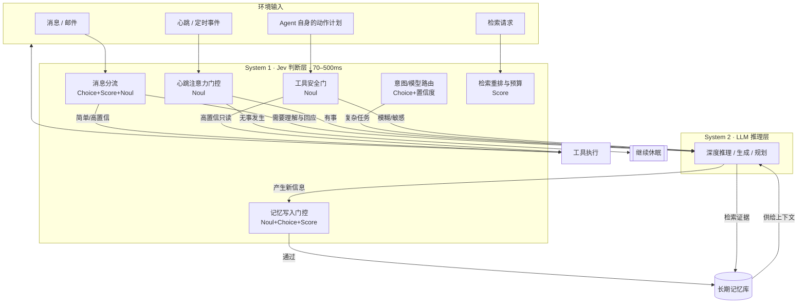

<!-- reviewed & polished -->

# 给 Personal Agent 装上 System 1：Jev 在个人智能体上的应用实践

## 一、Personal Agent 的一天，是被小判断塞满的

先看一个真实的例子。我自己常驻运行着一个个人 Agent（OpenClaw），它每 5 分钟做一次服务健康检查，每天处理几十条来自不同渠道的消息，还有十来个定时任务在后台跑。粗略统计它一天做的事情，深度推理（写文章、分析论文、改代码）大概只占 5%。

剩下 95% 是什么？是判断：

- 心跳轮询到了，这条消息**需不需要我处理**？
- 用户发来一句话，是**现在回**、攒着批量回，还是**根本不用回**？
- 一段对话结束，里面的信息**哪几句值得写进长期记忆**？
- 下一步动作有五个候选工具，**该调哪个**？
- 一个 shell 命令将要执行，**它是只读的吗**？
- 检索回来的 20 条候选记忆，**哪 3 条真正相关**？

这些判断有个共同点：**答案空间很小、判断逻辑一句话能说清、但数量巨大**。而我们现在处理它们的方式，是把整段上下文塞给一个为「生成人类可读文本」设计的大模型，让它输出一段 JSON，再祈祷格式不错、概率不瞎编、账单不爆炸。

这就像让一个教授签字审批每一张快递单。单据本身不需要教授的智力，需要的是**快、稳定、可审计**。

9 月底 TypeSafe AI 发布的 Jev，还有围绕它快速长出来的生态（Jev-Mem 论文、Jev Arena、Datawhale 的 jev-cookbook），把这件事讲清楚了：**判断和生成是两种不同的计算，应该用不同的模型**。Jev 自称第一个 System One 模型——这个命名借用了卡尼曼在《思考，快与慢》里的框架：

- **System 2（慢思考）**：LLM 擅长的事。展开推理、生成文本、处理开放问题。
- **System 1（快直觉）**：Jev 想接管的事。面对一个状态和一组选项，凭"直觉"在几百毫秒内给出带校准概率的类型化判断。

这篇文章聊的不是"Jev 是什么"（社区已经有很好的介绍），而是更具体的问题：**在一个 Personal Agent 里，System 1 到底该装在哪几个位置，怎么装，哪些地方不该装。**

## 二、三十秒理解 Jev 的接口

Jev 的 API 只有一个核心端点：传入一个 **state**（任意文本状态）和一组 **questions**（类型化问题），返回结构化答案。三种问题原语：

| 原语 | 问的事 | 返回 |
| --- | --- | --- |
| **Choice** | 从有限选项里选一个 | `choice` + 全选项概率分布 + `confidence` |
| **Score** | 按评分标准打分 | `score` + 概率分布 + `confidence` |
| **Noul** | 这个命题是否为真 | 0–1 之间的真值概率 |

一次调用可以混着问多个问题，每个问题**并行且相互隔离**地评估同一个 state——官方强调加问题几乎不增加响应时间，也不会产生 context-rot。

```python
from typesafe_sdk import Choice, Noul, Score, TypeSafeClient

client = TypeSafeClient()

resp = client.system_one(
    state="Hi, I've been trying to connect my Stripe account "
          "for 3 days and the integration keeps failing. "
          "I'm losing sales. Please help ASAP.",
    questions={
        "department": Choice(
            instructions="Which team should handle this",
            criteria={
                "billing": "Payment or subscription issues",
                "technical": "Bugs or integration problems",
                "sales": "Pricing or account questions",
            },
        ),
        "frustration": Score(
            instructions="How frustrated the customer appears",
            criteria=[
                "Calm, just stating facts",
                "Frustrated but civil",
                "Very angry, strong language",
            ],
        ),
        "is_urgent": Noul(
            instructions="The message conveys urgency or time-sensitivity",
        ),
    },
)

print(resp.answers["department"].choice)  # "technical"
print(resp.answers["frustration"].score)  # 1.0
print(resp.answers["is_urgent"].noul)     # 1.0
```

没有文本生成，没有解析，返回的就是代码可以直接 `if/else` 的东西。官方宣称单次调用延迟 70–500ms；计费上以输入 token 为主，输出只是一小段结构化载荷。另外注意一个接口细节：**Noul 只返回真值概率，没有 `confidence` 字段**——后面所有用 Noul 做门控的地方，门控值就是它本身。

它到底比 LLM 快多少、省多少、准不准？NanmiCoder 的 [Jev Arena](https://github.com/NanmiCoder/jev-arena) 做过一次 10,000 条评论的实测（Jev 1.13 vs DeepSeek Flash，三个判断维度同题对打）：

| 指标 | Jev 1.13 | DeepSeek Flash |
| --- | ---: | ---: |
| 处理 1 万条耗时 | 203.2 秒 | 823.5 秒 |
| 费用 | $0.84 | $1.50（估算） |
| 相关性准确率 | 94.70% | 96.26% |
| 情感准确率 | 82.91% | 84.54% |
| 意图准确率 | 77.90% | 80.33% |
| 三项同时正确 | 62.69% | 67.26% |

（注意口径：该复核是 AI 参考下的结果，不是人工金标准。）

把这张表读对很重要。第一，**这是批量管道的吞吐数据**（平均每条约 20ms、每秒 49 条、每条 3 个判断），不是单次调用延迟，两者不能混着引用。第二，**Jev 不是全面碾压 LLM，而是用大约 2~5 个点的准确率，换来 4 倍速度和一半成本**。这组数字直接决定了后面的设计原则——**Jev 适合替代的是高频、容错空间可设计、且能被置信度兜底的判断，不适合追求极限准确率的判断**。

## 三、为什么 Personal Agent 是 System 1 的理想宿主

同样是 Agent，为什么我不说客服机器人、不说编码 Agent，偏偏说 Personal Agent？因为它有四个放大 System 1 价值的特征：

**1. 判断密度极高。** Personal Agent 是 7×24 常驻的。心跳、消息事件、定时任务、文件变化，每一轮循环都夹着几个二选一或几分制的小判断。判断频次以「每分钟」计，而不是以「每次会话」计。

**2. 延迟预算以「不打扰」为单位。** 消息分流的判断如果先跑一次 2 秒的 LLM 调用，用户体验已经受损——你希望 Agent 对消息的"感知"是瞬时的。70ms 和 2000ms 的差别，是"有反应"和"卡了一下"的差别。

**3. 成本结构敏感。** Personal Agent 的推理预算通常是个人级的。上面 Arena 数据里 $0.84 vs $1.50 看起来都不贵，但那只是一万条评论的场景。换成常驻 Agent 一年积累的判断量，量级完全不同——更重要的是，把 95% 的琐碎判断从 LLM 挪走之后，**LLM 的 context 和预算才能留给真正需要深度推理的 5%**。

**4. 判断错了有兜底的机会。** 这是认知架构意义上的关键：Personal Agent 有用户在闭环里。一个判断错了的低风险动作（比如漏回一条闲聊）可以被用户纠正，而纠正本身就是反馈。所以我们能设计**置信度门控**——Jev 高置信时直接走，低置信时升级给 LLM 或问用户——用架构换容错。

## 四、七个接入点：System 1 装在哪里

下面是我在个人 Agent 架构里盘出来的七个接入点，按「接入难度 × 收益」排序。每个都对应官方 Patterns 文档或 cookbook 里的模式。

### 4.1 消息分流：所有个人 Agent 的第一道闸

消息进来，第一件事不是理解它，而是**决定要不要理解它**。这是 Jev 最典型的单调用场景——一次请求并行问三个原子问题：

```python
def triage(message: dict, context: str) -> dict:
    state = f"发件人：{message['sender']}\n关系：{message['relation']}\n内容：{message['text']}\n近期上下文：{context}"
    r = client.system_one(
        state=state,
        questions={
            "action": Choice(
                instructions="这条消息应该如何处理",
                criteria={
                    "now": "需要立即回复或处理",
                    "batch": "可以攒到下个汇总批次",
                    "notify": "只需提醒用户，无需 Agent 回应",
                    "ignore": "广告/群发/无信息量，直接忽略",
                },
            ),
            "urgency": Score(
                instructions="时间敏感程度",
                criteria=["可以等几天", "当天处理即可", "一小时内 matters"],
            ),
            "emotional": Score(
                instructions="发件人的情绪强度",
                criteria=["平静", "有情绪但克制", "明显激动或焦虑"],
            ),
        },
    )
    return {
        "action": r.answers["action"].choice,
        "conf": r.answers["action"].confidence,
        "urgency": r.answers["urgency"].score,
    }
```

注意 `emotional` 这个维度：它的值不直接驱动动作，而是作为**上下文注记**传给后续的 System 2——如果用户带着情绪，回复策略就该变。这就是「复合评分」模式（Composite Scoring）的用法：**每个维度单独问，权重组合放在代码里**。想调整优先级策略时，改的是代码里的系数，不是重写 prompt。

### 4.2 置信度门控的模型路由：省钱的正确姿势

个人 Agent 常配多个模型：本地小模型、GLM/Claude 这类主力、偶尔上推理加强档。路由本身就是一个判断——"这个任务需要多聪明的脑子？"——而这恰好是 Jev 的主场。

但这里有个比"选哪个模型"更重要的设计：**置信度是第二个决策轴**。官方叫 Confidence-Gated Routing：

```
Jev 判断：simple (conf 0.93)  → 本地小模型
Jev 判断：complex (conf 0.88) → 主力 LLM
Jev 判断：*，但 conf < 0.70   → 别赌，直接上主力 LLM 复核
```

前两行省钱，第三行保命。**置信度低不是判断失败，而是 System 1 主动承认"这个问题超出直觉范围"**——这正是校准过的模型才有的能力：它的 confidence 数字是可信的，所以你敢拿它做门控阈值。

### 4.3 记忆写入门控：Jev-Mem 已经把路蹚出来了

这是我认为**个人 Agent 价值最高**的接入点，因为它命中了 Agent Memory 最痛的成本结构：记忆系统每写一条、每次检索，都要做一堆小判断（重要吗？什么类型？和哪些旧记忆有因果关系？检索够了没有？），而主流做法全在用 LLM 做这些判断。

9 月 21 日发布的论文 [Jev-Mem](https://arxiv.org/abs/2609.23986)（System-One-Controlled Agentic Memory）验证了架构级的答案：把记忆管理的频繁判断交给 System One 控制器（Noul 做二元命题、Choice 做分类决策，代码负责校验和执行约束），System Two LLM 只负责最终的证据合成。在 LoCoMo 基准上（GPT-4o-mini 做回答模型）：

| 方法 | 综合得分 | 记忆构建耗时 | 检索延迟 |
| --- | ---: | ---: | ---: |
| MAGMA（此前最强） | 0.700 | 1,404 s | 1.47 s |
| Nemori（此前最快构建） | 0.590 | 1,044 s | 2.59 s |
| **Jev-Mem** | **0.777** | **158 s** | **0.93 s** |

回答质量相对提升 11%，构建快 6.6 倍，查询延迟降 36.7%。尤其要看 Adversarial 类目：Jev-Mem 拿到 0.962（对比 Full Context 的 0.205）——**检索控制器判断得又快又准，Agent 反而更不容易被干扰项带偏**。

落到自己的 Agent 上，哪怕不搬整套 Jev-Mem，写入门控这一刀就值得切：

```python
memory_gate = {
    "worth_saving": Noul(instructions="这条信息值得进入长期记忆吗"),
    "kind": Choice(
        instructions="这条信息属于哪类记忆",
        criteria={
            "episodic": "发生了什么事",
            "semantic": "事实/知识/概念",
            "procedural": "用户偏好怎么做某事",
            "preference": "用户的喜好或厌恶",
        },
    ),
    "importance": Score(
        instructions="如果丢失这条信息，未来对话受损程度",
        criteria=["毫无影响", "略有影响", "明显受损", "严重受损"],
    ),
}

r = client.system_one(state=observation, questions=memory_gate)
```

一个务实的策略：**Noul 阈值以上的才走 LLM 做记忆摘要与去重，以下的直接丢弃**。我自己的 Agent 记忆管道里，大部分对话其实产生不了值得存的判断——让 Jev 在门口把这部分噪声拦下来，存储、embedding、去重的 LLM 调用一起省掉。

### 4.4 心跳与主动触发的注意力门控

Personal Agent 最容易被忽视的成本黑洞是心跳。我的 Agent 每 5 分钟醒来一次，大多数时候无事可做。现在的实现是每次心跳都让 LLM 读一遍上下文再输出 HEARTBEAT_OK——一个月就是八千多次"睁眼看看"。

这本质是一个 Noul 问题："当前状态需要主动处理吗？"低置信或为真才升级给 LLM 细看。同样的门控适用于所有**主动式通知**：要不要打扰用户？用 Score 问一句"打扰的紧急程度"，配上静音时段规则，比在 prompt 里写"请谨慎决定是否打扰"可靠得多——前者是带概率的判断，后者是祈祷。

### 4.5 工具调用前的安全门

cookbook 第九章给了两个真实 Agent 框架的集成实验，其中 Pi 框架的模式值得抄：**在工具执行前加一道语义判断门，但权限和动作控制保留在代码里**。

```python
def tool_gate(call) -> str:
    state = f"工具：{call.tool}\n参数：{call.args}\n触发上下文：{call.reason}"
    r = client.system_one(state=state, questions={
        "readonly": Noul(instructions="这次调用是否只读、无副作用、低风险"),
    })
    p = r.answers["readonly"].noul
    if p > 0.95:
        return "proceed"          # 高置信只读 → 直接放行
    if p > 0.70:
        return "confirm"          # 模糊 → 请示用户
    return "elevate"              # 低置信或明确有副作用 → System 2 审查 + 权限系统
```

这道门的正确性不依赖 Jev 永远正确，而依赖**阈值设计**：宁可将中间地带全部导向人工确认。对于个人 Agent 这种有删除文件、发消息、花钱能力的执行体，一道 100ms 的门比一段 2000ms 的"安全自我反思 prompt"更符合纵深防御。

### 4.6 检索链路的重排序与预算分配

RAG 侧的两个点：候选重排序（Score 打分取 top-k，替代动辄几百 ms 的交叉编码器或 LLM rerank）和**检索预算分配**——Jev-Mem 里的控制器会判断"该沿哪张关系图查、这轮搜索值不值得继续"，个人 Agent 的多源检索（本地笔记 / 网页 / 历史）同样可以用 Choice 做"先查哪个源、查多深"的路由，省下大量空转调用。

### 4.7 投机判断（Speculative Fan-Out）

官方 Patterns 里最"激进"的一个：既然加问题几乎不增加耗时和成本，那就**把所有可能用得上的判断一次性全问了**，代码只取当下需要的。例如消息分流那次调用里，可以顺手把"是否包含日程邀请""是否涉及付款""是否需要联网搜索"全问了——反正并行评估、几乎免费。当下用不上的答案丢弃，需要时已经有了。这个模式把 Agent 从"串行感知-思考-行动"变成"一次感知，多路待命"。

## 五、合起来：双层认知架构

把上面七个点收拢，Personal Agent 的认知层会自然分成两层：



设计要领就一句话：**System 1 负责"要不要、是哪个、几分"，System 2 负责"为什么、怎么做"；中间用置信度阈值连接，而不是用 prompt 连接。**

## 六、诚实的边界：Jev 不该装在哪

写到这里都是安利，该泼冷水了。这几条来自 Arena 数据、cookbook 的评测纪律和官方文档自己的表态：

**1. 它不做生成，也别逼它。** Jev 没有自回归循环，答案空间必须有限。任何"帮我写""帮我分析"类需求都是 System 2 的领地。混用的边界要画清楚：判断进 Jev，内容进 LLM。

**2. 准确率确实低一点。** Arena 的三项全对率是 62.69% vs 67.26%。在评论分析这种容错高的场景无伤大雅；但如果是医疗、法律这类高风险判断的**最终裁决**，System 1 只适合做前置分流，不能做结论。

**3. 原子问题纪律比 prompt 技巧重要。** "评估这段代码好不好"这种复合问题会让判断质量劣化。正确姿势是拆成"可读性""性能风险""安全问题"分开问，代码里加权。**这一步拆解质量决定了整个系统的上限。**

**4. 概率 ≠ 正确率，校准要自己验。** Jev 的卖点是校准概率，但"校准"是针对训练分布说的。落到你的私人数据上，先跑一遍 Brier 分数和 ECE（cookbook 第六章有现成的四维评测方法：准确率/底线/Brier/ECE），再定阈值。**阈值是算出来的，不是拍出来的。**

**5. 隐私账要算。** Personal Agent 的 state 里全是你的私人对话。把每条消息都发给云端判断 API，隐私面比"偶尔调用 LLM"大得多。三个缓解：state 做脱敏投影（只放判断需要的字段）；敏感域走本地部署——开源同类模型 [Laya](https://huggingface.co/convaiinnovations/laya) 已经可以用 RLCD 方法在本地微调部署，Jev-Mem 也原生支持 Laya 做本地 System One；或者干脆只在低敏判断域用 Jev。

**6. 措辞敏感，需要版本化。** 判断问题的 instructions 就是你系统的"校准文件"。改一个词可能改变概率分布——把问题定义当代码管理（版本化 + 评测回归），而不是当 prompt 随手改。

## 七、落地路线：从心跳开始，一周够用

如果只挑一件事先做，我建议是**心跳门控**，理由很功利：

1. 它是纯 Noul 二元判断，原语最简单；
2. 现有实现全是冗余 LLM 调用，省得最理直气壮；
3. 判断错了代价最低（最多晚一步发现告警），最适合用来验证置信度阈值怎么定；
4. 有天然的真值回流——心跳后你实际做的事就是标注。

跑顺了之后，第二周上消息分流（4.1）+ 模型路由（4.2），第三周动记忆门控（4.3）。每接入一个点，先攒 200 条左右自己的标注数据测校准，再上生产阈值。

判断密集型系统有个和传统 LLM 应用完全不同的迭代手感：**你调的不是 prompt，是问题定义、阈值和组合逻辑——全是代码，全可回归测试。** 这大概才是 TypeSafe 把产品叫 "TypeSafe" 的真正意思：让 AI 判断获得类型系统级别的可靠性和可组合性。

System 2 让 Agent 变聪明，System 1 让 Agent 变得**可以常驻**。个人智能体缺的从来不是那 5% 的灵光一现，而是撑起另外 95% 时间的、又快又稳的直觉。

## 参考资料

- [TypeSafe AI 官方文档](https://docs.typesafe.ai) — System One 概念、三原语、四种架构模式（Speculative Fan-Out / Confidence-Gated Routing / Composite Scoring / Intent Routing）
- [Jev-Mem: System-One-Controlled Agentic Memory for Efficient AI Agents](https://arxiv.org/abs/2609.23986) — Dongming Jiang, Yi Li, Bingzhe Li, 2026-09；LoCoMo 基准数据
- [Jev Arena（NanmiCoder）](https://github.com/NanmiCoder/jev-arena) — Jev 1.13 vs DeepSeek Flash 万条评论实测，含准确率审计与逐条核查数据
- [Jev Cookbook（Datawhale）](https://github.com/datawhalechina/jev-cookbook) — 十一章中文教程；第九章 Pi/DSH Agent 集成实验、第六章四维评测纪律、第十章 Laya 本地化
- [Laya（开源 System One 同类模型）](https://huggingface.co/convaiinnovations/laya) — 支持本地部署与 RLCD 微调
