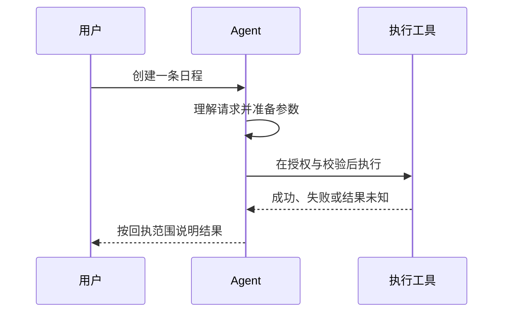

# 决策与生成：从输出合同理解 Agent 设计范式

一个 Agent 收到“帮我找附近适合聊天的咖啡馆”，至少要完成三种不同的工作：判断是否需要地图工具，组织搜索参数，根据搜索结果写出回答。它们都需要理解语言，却不要求交付同一种产物。第一种交付一个选择，第二种交付开放的文本或结构，第三种交付用户可读的表达。若还要收藏地点，则多出一项必须由系统确认的真实操作。

许多 Agent 把这些工作塞进一次大模型调用，另一些系统把它们拆成多个判断节点。两种做法都可能有效，也都可能失效。问题不在“用了几次 LLM”，而在每个环节到底承诺交付什么，以及下游凭什么相信它。

本文的观点是：**先区分封闭决策、开放生成与确定性执行，再选择模型和编排方式。** 决策模型可以改善某些封闭任务；LLM 也可以做决策；确定性代码则承担明确规则和真实状态的约束。它们是可组合的能力，不是高低等级，也不是三个必须建设的新架构层。

## 一、从输出合同出发，而不是从模型名字出发

封闭决策的候选集合可以在当前任务中预先确定。例如工具路由可以选择“不调用工具、联网搜索、地图搜索”；在已有三条日程中选出用户指代的对象，也是封闭选择。关键是候选集合完整、语义互斥程度足够，并且允许表达无法判断。

开放生成的答案无法在事先列完。例如把“刚才那家，有没有安静一点的”改写为完整查询，生成一份多步计划，或者向用户解释地图结果，都需要产生新的语言内容。结构化输出并不改变这一点：JSON 中的 `query` 是字符串，`steps` 是可变列表，它们依然可能承载开放生成任务。

确定性执行依据明确合同处理状态。例如校验权限，按上海时区归一时间，检测幂等键，执行写库，读取工具回执。代码可以检查日期是否合法，却不能因为日期格式合法就证明“用户说的下周一”被正确理解；可以检查工具名在白名单，却不能因此证明调用该工具符合用户意图。

| 工作 | 交付物 | 主要验证问题 |
|---|---|---|
| 封闭决策 | 标签、候选选择或分数 | 选对了吗？何时应拒判？ |
| 开放生成 | 参数、计划、摘要、正文 | 内容完整且有依据吗？ |
| 确定性执行 | 状态变化与可核验回执 | 授权、对象、幂等与结果是否成立？ |

同一个节点可能同时包含三类责任。小懂的 `ChatRouteResult` 不仅有 `chat_type`、`tool_hint` 等分类，还包含 `map_keyword`、`ref_location` 和 `rewritten_query`。因此，“替换路由分类模型”并不等于“可以删除整个路由调用”。若新的模型只能选枚举，搜索关键词和指代改写仍需有明确的交付者。

这里的工程启发很直接：替换之前应画出完整输出合同，而不是只看节点名称。名称叫 classifier 的节点可能正在生成参数；名称叫 planner 的节点也可能只是在做分类。架构图上的方框不能代替真实字段和调用关系。

## 二、判别与生成的理论差别，能解释什么

从统计学习的视角看，分类关心给定状态 `x` 后，候选标签 `y` 的条件分布 `P(y|x)`；自回归文本生成则把一个输出序列的概率分解为逐 token 的条件概率乘积。前者面对有限候选，后者不断构造后续内容。两者的训练目标、接口和计算路径可以不同，但这个区分不是模型能力的绝对边界。

LLM 可以通过标签生成、受约束解码或候选评分完成分类。决策模型也需要理解复杂语言，不能把它想成一张不思考的查表。更不能仅凭产品提供 Choice 或 Score 接口，就断言其内部一定使用某一种判别架构。**接口的封闭性是可观察合同，内部计算机制需要公开技术证据。**

专门的决策接口有一个潜在优势：系统不必为一个简单选择等待长段文本，也不必从解释中解析最终结论。如果接口返回合法候选，它还能减少格式处理成本。但“总能返回合法候选”与“总能选对候选”完全不同。类型安全消除的是一类接口错误，不是语义错误、上下文缺失或分布变化。

TypeSafe 对 Jev 的官方介绍展示了封闭决策接口的产品方向。这里应把它视为待验证的实现选项：接口适配程度、本地质量和部署链路性能需要分别测量，供应商展示无法替代业务验收。[TypeSafe 官方介绍](https://typesafe.ai/blog/introducing-system-one-models-and-jev)

生成模型的解释也有类似边界。它可以帮助人理解一种可能的判断路径，但解释流畅不构成正确性证明。调试时更可靠的问题是：它拿到了哪些历史、候选和回执？在只改变一个变量的对照样本中，结论是否随之正确变化？

## 三、决策应优化损失，而不只是分类准确率

假设系统要判断是否发送一条消息，模型认为用户确实授权发送的概率为 `p`。为了说明方法，暂设正确执行的损失为 0，误发送的损失为 100，澄清一次的损失为 2；这些都是教学假设，不是小懂配置。

这里先作一个理想拒判假设：澄清能完全消除授权歧义，后续正确执行不增加损失，且用户不会放弃。在这一简化模型中，直接发送的预期损失为 `100 × (1-p)`，澄清的总损失为 2。当 `p=0.95` 时，发送的预期损失是 5，澄清更划算；当 `p=0.99` 时，发送的预期损失是 1，低于澄清。因此，仅在这些假设下，`p>0.98` 才使发送损失更低，等于 0.98 时两者无差异。实际澄清可能失败或被放弃，系统还必须验证权限、对象和用户授权，概率比较不能替代这些条件。

这体现了贝叶斯决策的基本思想：在可能的真实状态上计算各行动的预期损失，选择代价更小的行动。若再加入“暂不执行”，还要计入漏执行成本；若加入升级到更强模型，就要计入调用成本、额外延迟以及升级后仍可能出错的损失。只比较 `confidence > 某个数字`，其实是在隐藏这些取舍。

同样的概率，在不同动作上应有不同含义。把一段闲聊从“简短解释”分到“详细解释”，错误通常可恢复；把删除指令指向错误日程，损失更大。因此，不能把一个统一的“高置信阈值”铺到所有业务，更不能把高置信自动解释为写操作放行。

概率本身也需要验证。模型输出 0.9，并不天然意味着这类样本约有 90% 正确。校准研究提醒我们，预测分数与实际正确率可能有明显偏差；具体校准方法的效果仍依赖数据与模型条件。[Guo 等：On Calibration of Modern Neural Networks](https://arxiv.org/abs/1706.04599)

对 Agent 来说，更实用的是观察风险与覆盖率。覆盖率表示有多少请求被直接接受，接受分支风险表示这些请求中有多少决策错误。拒判越多，可能越安全，也可能让用户不断等待和澄清。选择性分类研究讨论了这种取舍，但研究中的保证不能直接外推到不断变化的在线对话分布。[Geifman 与 El-Yaniv：Selective Classification for Deep Neural Networks](https://arxiv.org/abs/1705.08500)

本地评测应把中文多轮续问、复合操作、工具失败、否定表达等样本分开观察。调阈值的数据与最终验收数据要分离；与现有 LLM 的一致率只能衡量模仿程度，不能充当独立正确率。如果两个模型同时误解了“别发”，一致率反而会掩盖问题。

## 四、一个地图请求：决定“走哪条路”不等于准备好“怎么走”

看一个教学场景：上一轮用户问“静安寺附近有什么适合看书的地方”，这一轮说“找家能聊聊天的咖啡馆，别太吵”。系统需要理解地点继承、活动变化和噪声偏好。

封闭部分可以判断使用地图工具。开放部分则要组织关键词、参考地点及筛选说明。若只返回 `tool_route=map`，工具依然没有可用参数；若参数生成把“附近”错误落在用户实时位置，分类虽正确，用户结果仍然失败。


这张图是教学责任划分，不是小懂新增架构。实际实现也可以把 B 与 D 放在同一次 LLM 调用中。拆开有利于独立评测和选型，却可能增加一次串行等待，丢失共享推理信息。是否拆分，应由最终参数正确率、用户结果和关键路径成本决定。

一个示意输出可以是：

```text
decision: tool_route = map
generated_arguments:
  map_keyword = 咖啡馆
  ref_location = 静安寺
  preferences = 适合交谈，环境较安静
```

它不是 SDK 定义，尤其不能假设现有地图接口支持 `preferences` 字段。示例只是说明：路线标签、开放参数和结果解释有不同验证方式。系统需要检查地点是否有上下文依据，而不能只对工具枚举计准确率。

小懂 Planner 也有类似情况。`IntentResult` 包含主体、动作、核心对象、续答和 `has_sub_tasks` 等字段。“查一下明天的会议，把最早的一场改到下午”即使归为日程能力，也还需要查询、定位对象和修改计划。能力选择是入口判断，不等于规划完成。

## 五、多个判断放进一次请求，仍需处理冲突

一次请求同时判断工具、话题和深度，可以降低重复传输和调用开销，但不保证结论逻辑一致。模型完全可能返回 `need_tool=false` 与 `tool_route=map`；两个字段各自合法，组合却不可执行。

最先该做的通常不是再加一个裁判模型，而是减少重复判决。如果 `need_tool` 的定义就是“路由不是 none”，应由路由派生这个布尔值。每多问一个本可计算的字段，都会扩大不一致空间。确实独立的判断可以保留，但需要明确哪些字段控制执行，哪些只是建议，以及发生冲突时是否整包拒绝。

话题继承体现了另一种冲突：用户说“继续刚才的话题，但简单说”。`topic_relation=continue` 与“调整深度”并不矛盾。若把继续话题解释为所有状态冻结，高置信决策反而会阻止用户的明确要求。

合理的解释是：话题继承作默认，显式局部指令覆盖默认。延续什么、修改什么应分别判断。小懂的对话框架专题提出“继承优先、局部调整”，其中“详细解释”只改变深度，不应连带重置话题和框架；这是一份设计约束，不应读成所有路径已经完全实现。

异常也不宜压成同一个默认值。低置信表示拿到了判断但证据不足；超时表示未按时拿到答案；部分结果表示合同不完整；供应商不可用表示决策服务失败。把四者都转换成“不需要工具”，会把系统故障伪装成业务结论。

处理原则应沿着任务后果展开：阅读型请求可升级或澄清；关键路由字段缺失时不能拿其他高置信字段拼出一个假完整包；已经发起的外部副作用若结果未知，应先核验，不能通过重新生成计划来重复执行。局部降级是否成立，取决于剩余信息能否满足原合同。

## 六、控制流可以参考模型，事实必须参考执行结果

把路由、继承和升级理解为控制流，把参数、材料和正文理解为内容数据，是一个有用的理论类比。它帮助我们辨认责任，却不意味着必须增加两个平台层或一套新协议。

控制流决定系统接下来做什么，生成过程把信息组织成可读产物，而执行结果决定哪些事实可以被声明。用户要求创建日程，是意图证据；模型生成了创建计划，是计划证据；只有工具确认创建，才是成功证据。



教学场景中，工具超时后，生成模型不能因为“创建”是最可能的语言续写，就说“已为你安排好了”。反过来，也不能把查询成功当成创建成功。理想合同应让成功声明绑定对应动作、对象和已核验结果，复合任务尤其需要逐项说明。

小懂已有写声明回执门闸，代码检查当前 run 是否至少有一条 `verified_applied` 写回执。这提供了重要边界，但还不能据此宣称每句声明都已与对应业务对象细粒度绑定；现有文字声明检测的语义漏检、误检也仍需独立评测。

后置审计同样有边界。如果正文已经流给用户，再判断它是否谎称成功，只能发现问题，不能撤回已经发生的体验。质量观测与输出阻断是不同合同，文章、架构图和验收指标都应清楚区分。

## 七、性能收益应在完整关键路径上计算

“把三次分类换成一次决策”听起来省了三段等待，但这只在原先串行时成立。小懂闲聊图在启用相关模式时，会并行展开 retrieve、chat_route、goal_classify 和 domain_classify，然后汇合。分支耗时对汇合等待的贡献接近最大值，加上调度等开销，不能直接求和。

假设检索耗时 700ms，三个分类分别耗时 350ms、400ms、450ms，原并行阶段约由 700ms 的检索主导。把分类换成 120ms 决策，并不会自动节省 1080ms。若还要串行进行 250ms 的参数生成，且这一步位于决策分支内部，仍可能被检索遮蔽；若参数必须等汇合后的材料，则可能反而拉长后续路径。这里的数字只是教学例子。

低置信升级也必须算进去。决策先等待，再调用旧 LLM，会让这部分请求承受两段延迟。平均成本下降与长尾变差可以同时发生。应按接受分支、升级分支和故障分支观察首字延迟、完整响应时间和任务成功率，并把参数生成、检索、网络和工具调用纳入测量。

因此，节点快只是局部性质。端到端有效，还要求它没有挤掉必要参数、制造更多澄清或放大重试。部署区域、网络路径和业务样本都会影响结果，公开延迟不能直接充当本地 SLO。

## 八、把评测设计成可证伪的实验

最有价值的对照不是“新旧模型是否同意”，而是“新系统是否在相同合同下交付更好的用户结果”。对地图场景，标签正确但地点错误应计为失败；对话题场景，延续正确但无视“简单说”也应计为失败；复合日程只完成查询却声称全部完成，更不能算成功。

可从成对样本开始：保持历史与候选相同，只把“发给他”改为“别发给他”；保持话题相同，只加入“简单说”；保持查询对象相同，只改变工具回执为成功、失败或未知。这些变量隔离样本能暴露模型究竟依赖什么，也便于区别输入合同问题与模型能力问题。

实验还应记录拒判后的实际结果。升级到更强模型并不天然等于解决；澄清也有用户放弃成本。应比较错误减少、覆盖率损失、额外等待和最终完成率，而非只报告直接接受样本的漂亮准确率。

若用 shadow 收集数据，观察路径必须与生产字段、外呼副作用和等待路径隔离。否则新模型虽未“接管”，也已经影响用户。项目对 shadow 的效果指标、下线条件和生命周期有明确要求；遵循这些约束，是为了让实验能被停止和解释，而不是让实验永久存在。

## 九、实践选择：何时决策、何时生成、何时合并

Anthropic 的工程经验区分预定义工作流与模型动态决定路径的 Agent，并强调从简单、可组合的模式出发。对本文而言，其启发是避免为了体现“智能”而增加节点：只有新增分工购买了可测价值，才值得承担它的成本。[Building effective agents](https://www.anthropic.com/engineering/building-effective-agents)

| 任务条件 | 优先考虑 | 需要保留的边界 |
|---|---|---|
| 候选稳定、错误代价可度量 | 分类器、决策模型或受约束 LLM | 本地校准、拒判和候选完整性 |
| 需要改写、开放参数或多步计划 | 生成模型 | 参数依据、计划依赖和完整输出合同 |
| 分类与参数高度耦合，拆分增加等待 | 保留一次联合生成并分别评测字段 | 结构合法与语义正确分别验收 |
| 规则明确且可机械验证 | 确定性代码 | 不扩大为机械语言理解替代品 |
| 写库、发送或付费等操作 | 语义理解加执行门闸与回执 | 模型分数不等于授权或成功 |
| 任务模糊、上下文缺失 | 澄清或升级 | 不把不确定与系统故障混为业务否定 |

决策与生成的分工，最终应该让系统更容易回答四个问题：为什么选择这条路径，参数从哪里来，行动是否真实完成，用户收到的表达是否忠于结果。Jev、LLM 或规则都只是实现选项。清晰合同、可恢复的不确定性和真实回执，才是把语言能力变成可靠 Agent 行为的基础。


