# 合规决策模型训练的方法论和经验复盘

### 合规模型微调背景和设计目标

目前toC的个各类agent为了更好的服务用户，积极满足相关的合规要求。虽然在内容生成更加合规，但是带来了的副作业也比较明显，一是增加了性能负担，二是增加了系统的复杂性。

设计初期相关的合规检查以旁路fail-close的大模型检查为主，为了提高处理性能，结合Jev类模型的兴起成熟，我们决定以 qwen3.5-2b 为基座，训练专门用于合规分类的微调模型（工程上落地为 Unsloth Decision FT / typed-decisions，三问决策头 `action` / `major` / `intent`）。

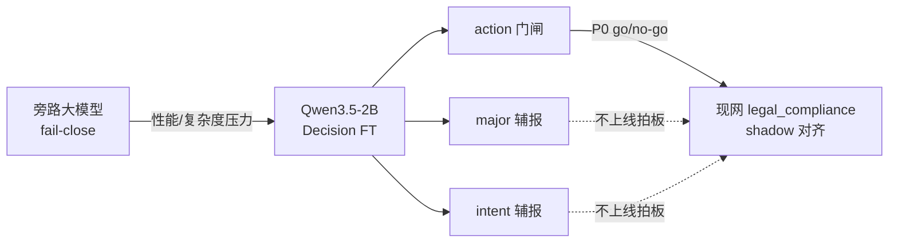

合规处理的特点包括以下几点：
1. 不同类型的内容有不同的合规性要求和门禁控制
2. 对语义理解的要求比较高，很多合规性问题是在复杂逻辑，歧义逻辑下要求模型做一些不合规的输出

基于这两个特点，我们设计模型的业务目标为：
- 宁可误伤，不要能漏拦；因为漏拦代价远高于拒答；（工程指标对应 `gate.false_allow_rate` / `gate.refuse_recall`，上线 go/no-go 只看门闸，不看 major）
- 不关注非合规分类。不过多解释非合规的分类（`aux.major` / `aux.intent` 是辅报；v2 major 从约 0.52→0.71，但漏拦从约 0.11→0.16，说明细类涨了也不能当交付依据）
- 训练loss低不代表泛化好，这个是从实际业务出发的，很多非合规的query逻辑和语义丰富，我们希望有更好的泛化。（v2 续训日志里 loss 很快贴零、`eval_loss=0`，但 holdout 门闸反而退步）
- 提升性能（2B + 4bit LoRA，训练峰值显存大约 4.3–4.4GB 量级，替代旁路大模型检查的一部分负载）

总体而言，微调的原则是在可接受的错误代价下，让微调模型在目标分布上稳定表现。

指标优先级（方法论上要先画清楚，再开训）：

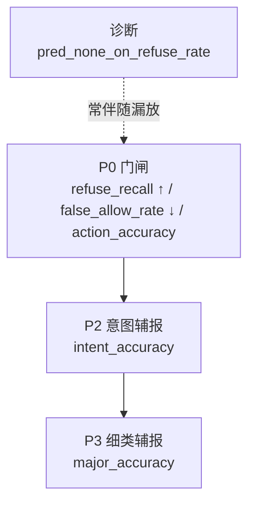

这个项目设计上分为4个阶段：

1 问题定义
这个阶段是重中之中。除了要关注业务现实和业务诉求，还需要看几个问题
- 现在的业务数据有哪些，输入输出的契约是什么，现有数据能不能投影到这个结构上  
  （本项目：`state`≤12k 字 + 固定 `questions_template.json` → 闭集三问；投影规则写死 `allow→major=none`、`refuse→intent=produce_harm`，由 `build_decision_ft_dataset.py` 落盘）
- 业务目标指标化，这里面要分解大的业务目标为量化指标，要设计指标算法和业务意义  
  （P0：`refuse_recall` / `false_allow_rate` / `action_accuracy`；P2 intent；P3 major；诊断项 `pred_none_on_refuse_rate` 常伴随漏放）
- 确定业务指标的优先级，主要权衡不同的不同指标组合的取舍  
  （证据：v1 holdout≈0.89 recall / 0.11 漏拦，交付；v2 开 `--balance-major` 后 major 更好但门闸更差——优先级冲突被实验直接打出来了）
- 业务规则嵌入，这个也是比较关键的一点，哪些业务规则是既定，可以体现在训练数据中，或者隐含在训练数据中，但是要通过评估数据给予验证  
  （questions 文案与现网 `LegalClassifyResult.intent` 对齐；推理必须与训练模板字面一致，`--sync-questions` 防漂移）

2 数据准备
这个可以说是模型训练的燃料，没有数据，模型训练就动不起来，专业的工具和ai可以实现数据的处理，但是还是要建立数据视图框架，这个框架用来透视以下方面：
- 数据分布，不同类型的数据的数量级如何，不同类型的数据分布如何，是否符合业务上侧重点  
  （`manifest.json`：train 22000，refuse 10013 / allow 11987；major 里 none≈55%，A5 仅 646 最稀；intent 上 seek_remedy 96、self_use 79）

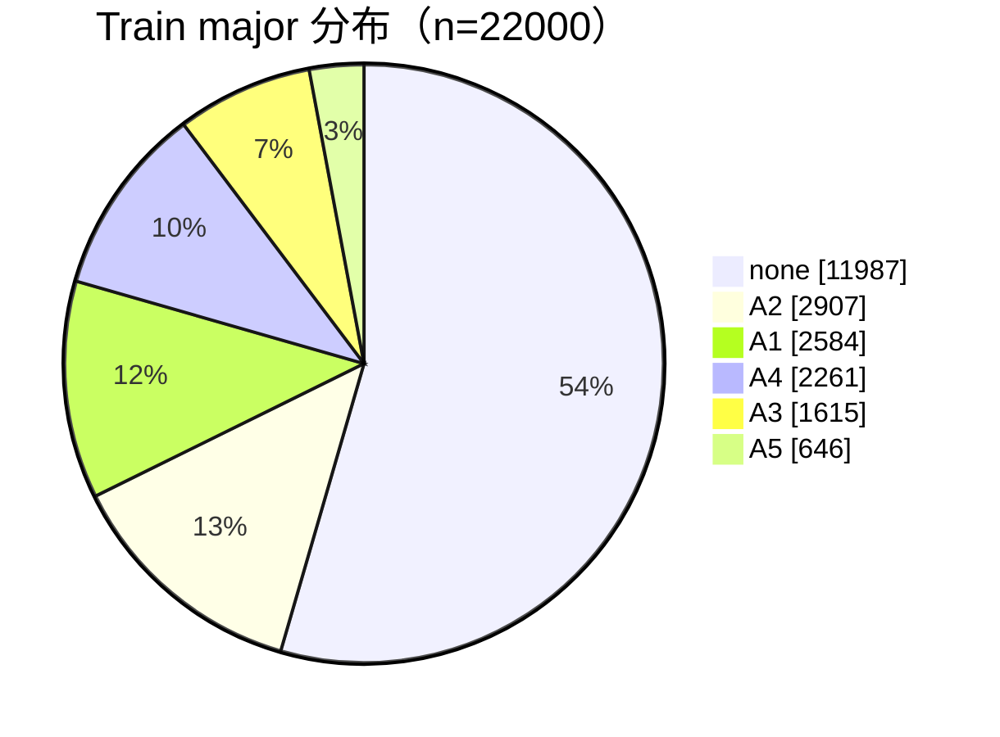

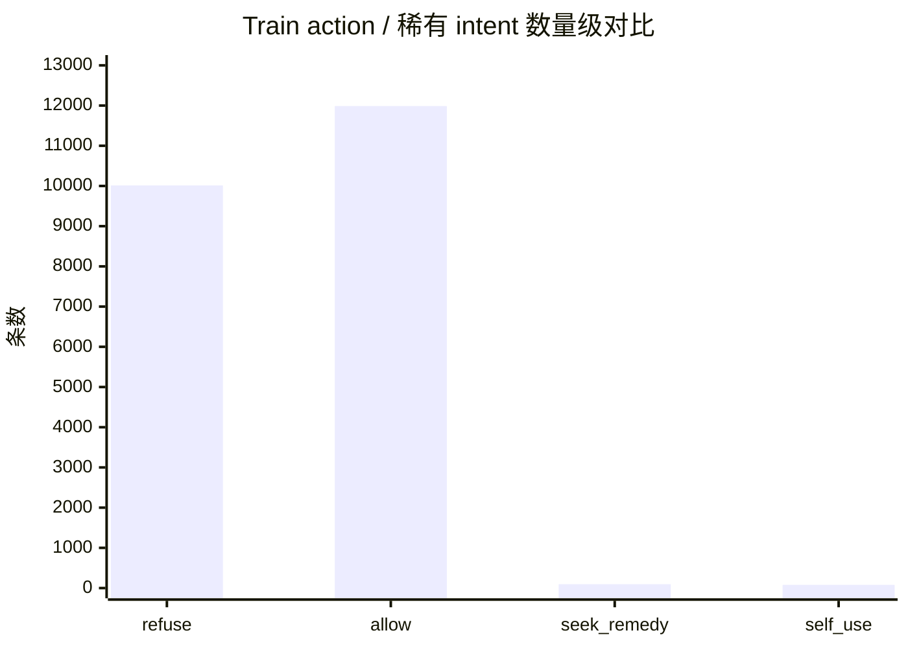

- 泄露数据，数据分类是否合理，是否符合业务规范和分类原则  
  （holdout 来自 `t2t_v3_refuse`，与 train 文本零重叠；契约单测 `test_decision_ft_dataset.py` / `evaluate --self-check`）
- 盲点数据，检查是否有盲点数据，这类数据没有覆盖业务指标，比如没有拒答数据，没有通过数据等  
  （外部 holdout 3000 **全是 refuse**，能测漏拦，测不了 false_refuse / allow_recall——allow 质量仍是盲区）

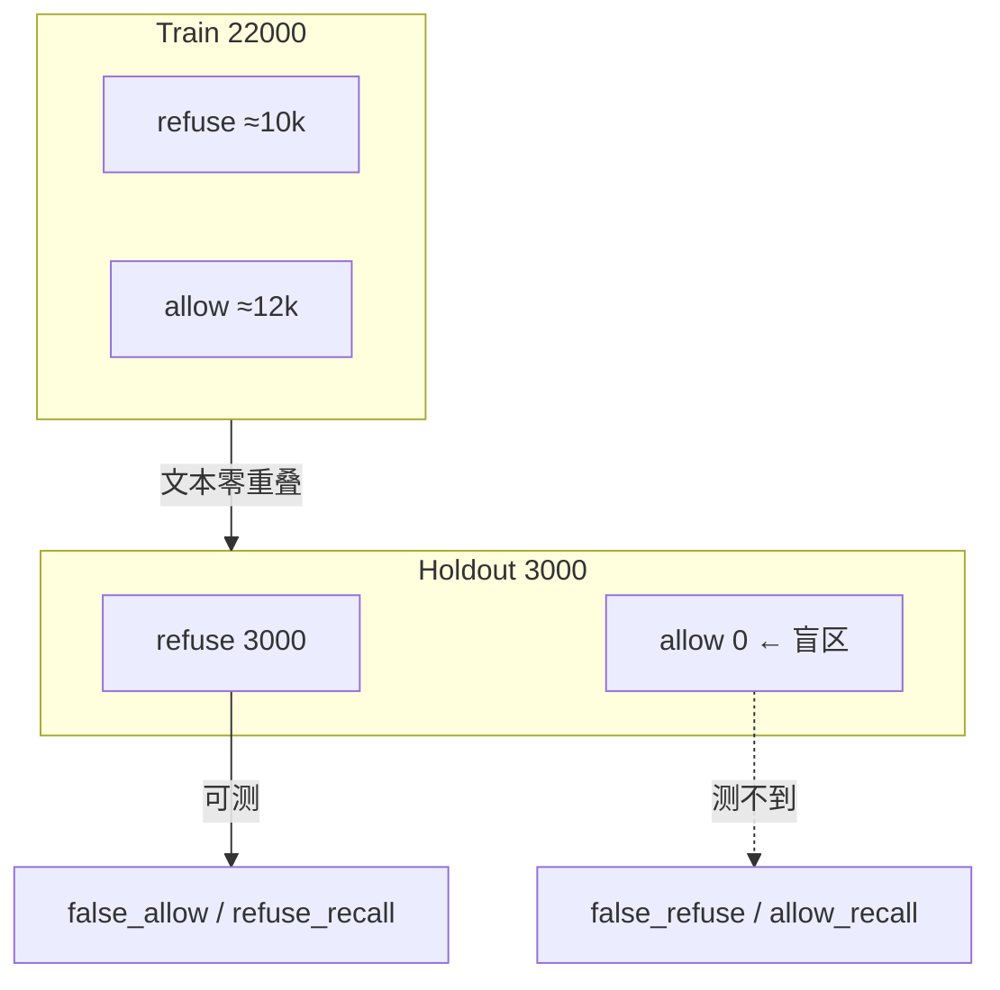

3 微调方法选择
- 做好不同微调方法的评估和选型，要理解不同微调模型需要的数据，耗时，效果，解决的问题，对算力的大概要求，算法本身的问题和优势  
  （选型 typed Decision FT / `layout=clef`，而不是开放式生成 SFT；加载必须 `FastDecisionModel` + `joint_head`，普通 PEFT 不够）
- 需要注意超参的设置
    - 数据质量与标签一致性
    - 类别均衡 / 采样策略（`--balance-major` / `--none-ratio`，默认压 none 到约 0.35；抬 A1–A5）
    - 学习率与 epoch（续训要更小 lr、更短 epoch；压漏拦示例：`--epochs 1 --lr 5e-5 --none-ratio 0.2`）
    - LoRA r/alpha（通常不如数据和采样敏感；交付 v1 为 r=16/alpha=16，脚本默认也可到 32）

超参敏感度（经验排序，不是绝对公式）：

4 训练 & 评估
- Holdout 指标 ≠ 现网分布
- Shadow 对齐才是生产信任的来源（对接现网 `legal_compliance` classifier）
- 交付物要可复现：权重 + 模板 + 加载方式  
  （`lora/` 里 `adapter_model` + **`joint_head`** 缺一不可；同包 `questions_template.json`；评测可直接用 LoRA，merge 可选）

信任链：

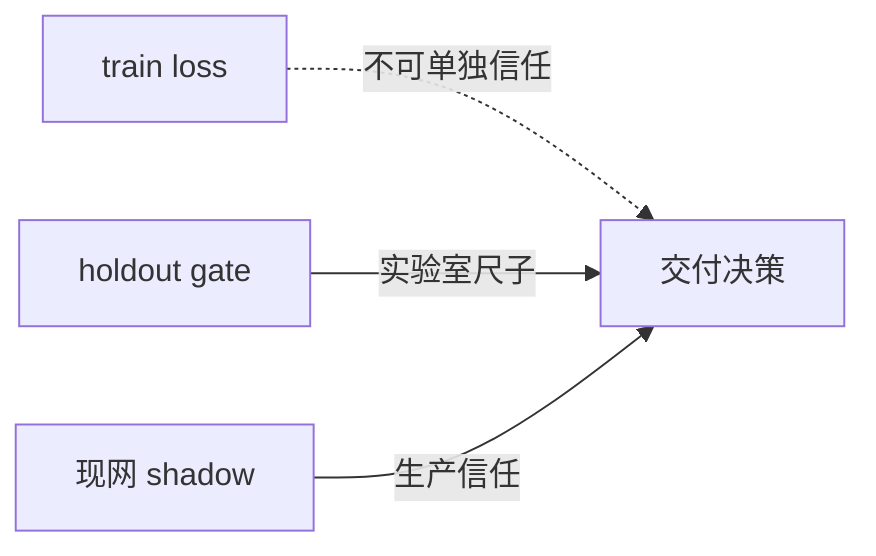

### 经验
- 多目标冲突时要确定目标优先级，哪些需要增，哪些可以牺牲，然后确定如何调整，如何改采样和损失权重  
  （本项目结论：门闸优先；major 可牺牲。v2 证明「均衡抬细类」和「压漏拦」不能同时当第一目标）

```mermaid
xychart-beta
  title "v1 vs v2 holdout（约值，n=3000 全 refuse）"
  x-axis ["refuse_recall", "false_allow", "major_acc"]
  y-axis "比例" 0 --> 1
  bar [0.89, 0.11, 0.52]
  bar [0.84, 0.16, 0.71]
```

> 读图：第一组柱为 v1（交付），第二组为 v2（开 `--balance-major`）。门闸两项 v1 更好；major 是 v2 更好——这就是「辅指标欺骗」。

- Loss 坍缩是危险信号  
  （v2 续训曲线大量步 loss≈0 / 1e-9，epoch≈1 时 `eval_loss=0`，holdout 却更差——loss 不能当泛化成功信号）

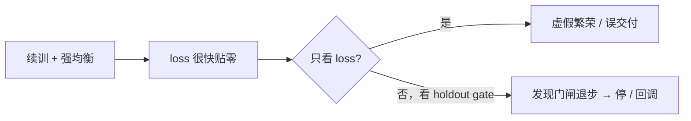

- 均衡是双刃剑  
  （`--balance-major` 把 major≈0.52→0.71，同时 false_allow≈0.11→0.16；旋钮有效，但会推决策边界）
- 工程闭环比单次评估好坏更重要
    - build - test - sync - train - evaluate - package，保证整个工程闭环完整  
      （对应：`build_decision_ft_dataset.py` → pytest/`--self-check` → `sync.sh` → `train_decision_ft_unsloth.py` → `evaluate_decision_ft.py` → `deliver/*-lora.tgz`；训练中可用 `serve_training_dashboard.py` 盯 `metrics.jsonl`）
    - 整个项目 能复现，能对比，能回滚  
      （远端固定 `~/autodl-tmp/compliance_decision_ft`，别跑到旧副本；每次写出 `holdout_metrics.json`）

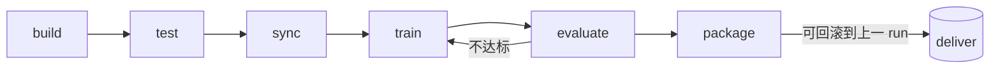

- 善用图表观察趋势  
  Loss 折线图，lr 折线图，grad norm 折线图及组合（本项目：`metrics.jsonl` + `serve_training_dashboard.py`，浏览器看实时曲线；历史也可用 tee 日志导出静态 HTML）

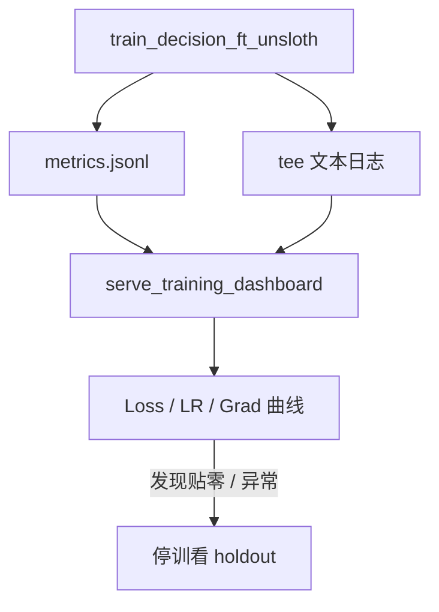

- 一旋钮一实验；失败就停，别用「再训久一点」赌运气
- 每次必写 holdout_metrics.json，和 run 目录绑在一起
- 先错误分析，再改数据/采样；最后才动架构/更大基座
- 上线前：shadow 先对现网 classifier，holdout 只是实验室尺子  

### 后面要注意的坑
- 评测盲区：尽快补「refuse/allow 混合 holdout」或 shadow 抽样，否则 allow 质量是黑盒。（当前 holdout 全 refuse 已证实只能验收漏拦侧）
- 稀有类：A5、seek_remedy/self_use 极少——辅报别当真，要么补数据要么降权。（train：A5=646，seek_remedy=96，self_use=79）
- 续训过拟合：已有 LoRA 上再训，优先短 epoch + 更小 lr；看到 loss 贴零就该停下来看 holdout。（v2 已踩过）
- 契约漂移：改 questions 文案 = 新数据版本，必须重投影重训。（改 major 文案后须重建 `train/holdout.jsonl`）
- 指标落盘：每次跑完写出 holdout_metrics.json + 版本对照表，别靠记忆。（v1/v2 精确 JSON 若未落盘，验收应以重跑 evaluate 为准）
- 上线边界：模型只给门闸信号，不直接放行副作用——保持这个产品纪律。
- 工程坑（顺带记一笔）：跑错目录会缺 `holdout.jsonl` / 不认 `--resume-lora`；merge 卡 HF 超时用 `merge_decision_ft.py --base $本地snapshot`，或跳过 merge 直接评 LoRA。

### 后续提升点
#### 短期继续把这套项目炼透
- 跑完 v3：以 false_allow_rate↓ 为成功标准（建议自 v1 LoRA：`--balance-major --none-ratio 0.2 --epochs 1 --lr 5e-5`，对照 holdout 三数）

- 做一张「实验卡」：改了什么 → 期望 → holdout 三数 → 结论（交付/废弃）

- 错误分析：抽 50–100 条 false_allow，看是边界模糊、标签噪声，还是 major=none 伴随漏放（可看 `pred_none_on_refuse_rate`）

#### 中期从「会跑脚本」到「会设计实验」
- 学会读混淆矩阵，而不只看 accuracy（`evaluate_decision_ft.py` 已打 major 混淆矩阵）

- 理解采样/损失权重如何改变决策边界（先拧 `none_ratio`，再动 lr/epoch）

- 建立校准集：训练内 split + 外部 holdout + 现网 shadow 三层

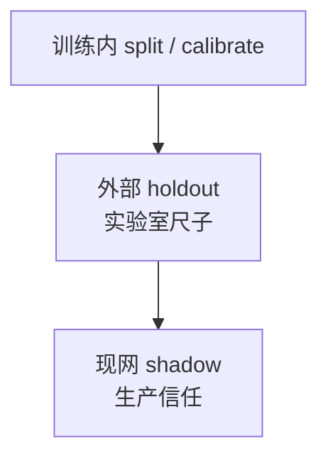

#### 长期要提升的能力和素质
- 数据飞轮：线上误拦/漏拦回流 → 再标注 → 再训
- 任务是否该用生成式 SFT：你现在是 typed decision，比开放式生成更可控；别为了「更炫」换范式
- 成本意识：2B + LoRA 对门闸任务往往够用；先榨干数据和指标，再考虑更大基座

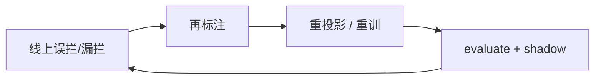

### 总结

先定义代价，再定义指标；先信评测分布，再信 loss；先保门闸，再优化解释项。

你第一次微调已经踩到了最关键的坑（辅指标欺骗、loss 虚假繁荣、目标冲突），这比「一次就刷到完美分数」更有价值。证据就在桌上：v1 门闸更好所以交付；v2 major 更好但不能上线。

### 参考
[d3](https://huggingface.co/vllm-sr/d3)