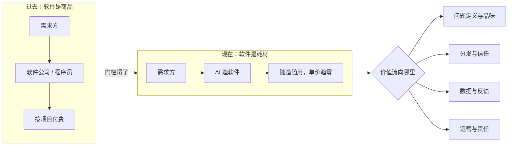

# 软件不值钱了，然后呢

先从一个越来越常见的场景说起。

一家电商公司，运营团队想要个对账小工具。搁两年前，这需求报给 IT 部门，排期三个月起；或者花十几万买套 SaaS，一半功能用不上。现在，运营的人用 Cursor 这类工具，两天上线。能用，不好看，但够用。

写这个东西的人不是程序员。这种事正在很多公司里每周发生。

它背后是个大问题：当软件可以随造随用——程序员给自己造，业务部门给自己造，企业不再排队等 IT、不再为长尾需求付 SaaS 的钱——软件这门生意还剩什么？写代码的人，还剩什么？

这篇文章想把这件事说透。

## 一、"自给自足"到底改变了什么

先定义清楚。软件自给自足，说的是一个组织或个人，需要的软件自己就能造出来，不再依赖外部供给。它分三层发生。

**个人层。** 你想要个记账工具、爬虫脚本、家庭相册服务，以前要么忍着，要么花几个月自学。现在跟 AI 说几句话，就有个能跑的东西。"个人软件"这个概念被喊了二十多年，到今天才真的成立。

**企业层。** 企业内部软件有个特点：需求又长尾又碎片，变化还快。正式的 IT 团队只覆盖头部需求，剩下的要么买 SaaS（常常买不到合适的），要么靠 Excel 硬扛。AI 编程把这些长尾需求全释放了——运营、财务、HR 自己就把工具造了。这块市场以前叫"企业长尾软件"，现在叫"自己写"。

**行业层。** 软件从商品变成耗材。这是全文最重的一个判断，展开说说。

过去代码是资产：一个系统写出来，要维护、要迭代、要传承，公司估值里有一块叫"软件资产"。当造软件的成本趋近于零，代码的地位就变了——它更像装修时的脚手架，用完可以拆，坏了可以随时重造。重要的不再是"拥有这套代码"，而是"这套代码解决的问题还在不在"。

经济学里有个老现象，十九世纪英国经济学家杰文斯观察到的：当某种资源的使用效率提升、成本下降，它的总消耗量不降反升。煤价跌了，煤烧得更多。软件正在重演：单价在坍缩，总需求在爆炸。软件没有死，是被用爆了。

麻烦在于——**总价值在上升，单位价值在下降，而且价值换了地方住。**

## 二、价值没有消失，只是搬家

成本曲线塌了，价值不会蒸发，只会迁移。这事历史上发生过。

第一次是"会做网站"。1998 年，会写 HTML 能按小时收费，建站公司给企业做个官网收几万块。后来 WordPress、模板、建站平台把门槛踩平，"做网站"从一门职业变成一项基本技能。网站消失了吗？没有，多了几百倍。钱去了哪？SEO、内容、流量、电商运营——网站变成了渠道，价值跑到渠道的上下游去了。

软件正在重演这一幕，只是规模大得多。

价值从"造软件"里外溢出来，主要流向四个地方。

**1. 问题定义端。** 当"怎么做"不再稀缺，"做什么"就成了最稀缺的东西。该解决哪个问题、不该碰哪个问题、什么才算"解决"了——这个判断 AI 给不了。AI 能把一个明确的需求实现得很好，但需求从哪来、为什么值得做，还是人的领地。

**2. 分发与信任端。** 产品生产成本趋近零之后，瓶颈从生产侧挪到了注意力侧。东西都能造，用户凭什么用你的？渠道、品牌、口碑，这些东西造不出来，只能攒。

**3. 数据与反馈端。** 用得越多、数据越多、产品越好的那个飞轮，比代码本身难复制得多。

**4. 运营与责任端。** 交付只是生意的开始。谁来运营？出了事故谁负责？半夜三点谁爬起来修？责任没法外包给 AI。能签字、能兜底的人，价值在涨。

看清楚这个格局就明白：软件本身坍缩成了"载体"，定价权整体上移。**卖软件的生意越来越难，卖结果、卖信任、卖解决方案的生意还在涨。**

## 三、程序员被重新定价

回到程序员自己。哪些能力在贬值，其实很清楚：

- 把明确需求翻译成代码的能力。这是过去二十年程序员的立身之本，现在 AI 干这个又快又便宜。
- 模板化的实现活。CRUD、表单、后台、报表，这条供给曲线被 AI 一夜拉平。
- 把"精通某语言某框架"当核心卖点。语言和框架是 AI 最擅长的部分——这就像打字员时代过去之后，简历上还写着"每分钟 80 字"。

哪些能力在升值：

**判断力和品味。** AI 一次给你五个实现，选哪个、为什么、差在哪，这需要品味。过去稀缺的是"写出来"的能力，现在稀缺的是"判断好坏"的能力。验收 AI 的产出，比写出第一版更难，也更重要。

**系统设计。** AI 能写函数，但一个系统的边界怎么划、失败怎么兜底、半年后怎么演进，这些决定得有人对后果负责。架构的本质从来不是画图，是做取舍、担后果。

**责任承担。** 这条最朴素，也最硬：系统挂了，谁负责？AI 不会为此赔钱，也不会被开除。只要社会还要求"有人为结果负责"，能签字的人就有不可替代的价值。程序员的核心身份，正在从"写代码的人"变成"对系统负责的人"。

**领域 × 技术。** 单纯懂技术在贬值，但懂医疗、懂供应链、懂清算规则的人同时懂技术，价值在暴涨。这种复合能力来自真实场景里泡了很多年的经验，恰恰是 AI 最难替代的部分。

一句话：**程序员不会消失，但这个职业正在被重新定价——从卖工时的生产资料，变成持有杠杆的人。** 一个会用 agent 的工程师，产出顶过去一个小组。组织买的不再是你的时间，是你把算力对准真问题的能力。

## 四、择业：去离问题近的地方

落到具体选择上，判断标准一句话就够：

**你的工作是在放大 AI 的产出，还是在和 AI 拼实现速度？** 前者是加杠杆，后者是内卷。

按这个标准过一遍现在的岗位。

值得去的方向：

**垂直行业的内部工程师。** 金融、医疗、制造、物流，这些行业里既懂业务又能自己造软件的岗位，价值正在重估。以前这种人是被埋没的"信息孤岛"，现在成了全公司杠杆最高的人——业务部门的每个长尾需求，你都能直接变成工具。

**AI 基础设施与工程效能。** Agent 平台、评估（Evals）、安全、推理优化，这是卖铲子的生意，窗口期红利真实存在。但要清醒：巨头会进场，铲子生意也有保质期。

**超小团队与独立开发。** 个人杠杆被放大到历史最高点，一个人加一组 agent，能做出三年前一个团队的产出。但必须认清一件事：做出来不等于卖得掉。分发能力比开发能力稀缺一百倍，只会造不会卖的话，先补课再上桌。

慎选的方向：

- 大型外包和人力外派。这类模式卖的就是工时，而工时正是被 AI 塌缩的东西，整个模式都在贬值通道里。
- 纯实现型初级岗位。"需求给清楚，你照着写"的岗位，是 AI 最先吃掉的一层。
- 任何需要和 AI 拼速度的岗位。

市场信号已经出来了：JD 里"能驾驭 agent 工作流""会评估 AI 产出""对结果负责"出现得越来越多。简历上"精通 XX 语言"在贬值，"我用 AI 把 XX 事做成了"在升值。

## 五、创业：门槛塌了，护城河上移

对想创业的人，这是 1995 年以来成本最低的时刻：MVP 的成本趋近于零，一人公司真的成立。

听起来全是好消息？另一面是——所有人都是。你三天做出来的产品，别人三天也能做出来。"我能把它做出来"这句话，从今天起不再构成创业理由。投资人为"做出来之后凭什么赢"付钱。

护城河整体上移，搬到软件之外去了：

**数据飞轮。** 前面说过它比代码难复制，这里补一句：飞轮起步慢，但一旦转起来，就是时间垒出来的壁垒。

**渠道与信任。** 受众、品牌、分发网络，没有捷径，攒一年是一年。

**行业 know-how。** 深水区的脏活、合规、流程细节——AI 不懂，外行进不来。这是眼下最结实的护城河。

**服务的最后一公里。** 纯软件卖不上价了，"软件加服务"、为结果负责的混合形态在涨价。

定价逻辑也在变。按席位收费的 SaaS 时代在收尾，按结果收费在起来：不卖工具，卖"问题被解决了"。软件公司的形态，正在从产品公司变成结果公司。

具体的机会，几个方向值得认真看：垂直行业的 agent，懂行的人做深水区；旧流程的 AI 重构——注意，不是给老流程加个聊天框，是把流程推倒按 AI 原生重来；以及反着走——别人在把服务软件化，你可以把软件服务化，AI 让"服务规模化"第一次变得可行。

## 最后

回到"自给自足"这个词。

农业时代的自给自足，是分工的倒退，小农经济，低效的代名词。软件的自给自足恰恰相反——它让分工在更高的层面上重组：造软件的人不再困在"造"里，挪到了问题、信任和责任的位置上。

程序员从来不是靠打字创造价值的。写代码只是过去二十年恰好最稀缺的一种表达方式。

现在，稀缺的东西换了位置。该挪窝了。
