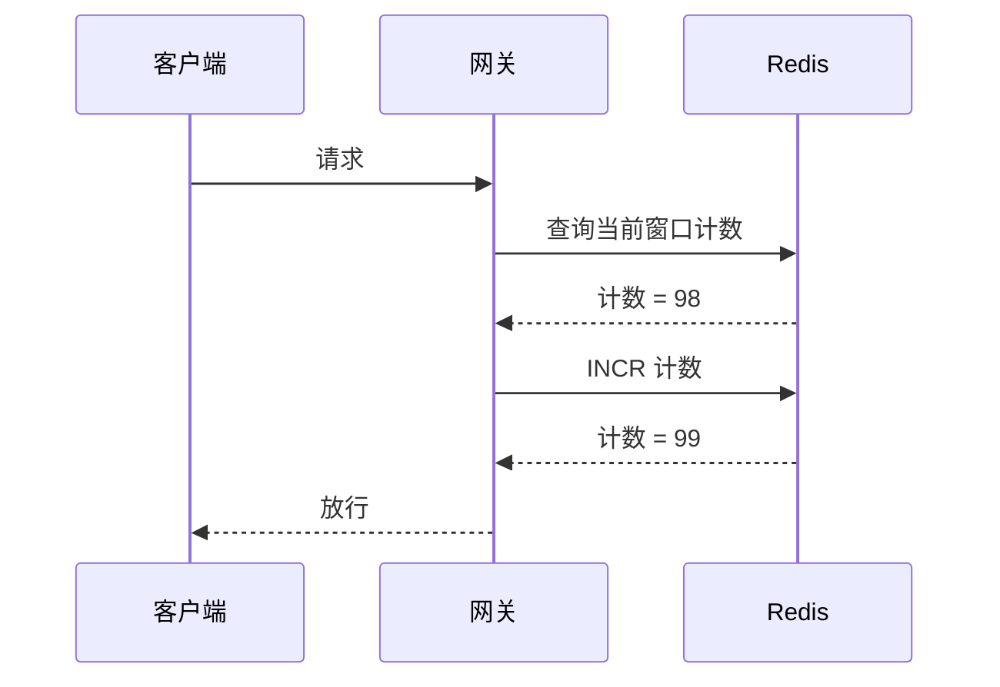
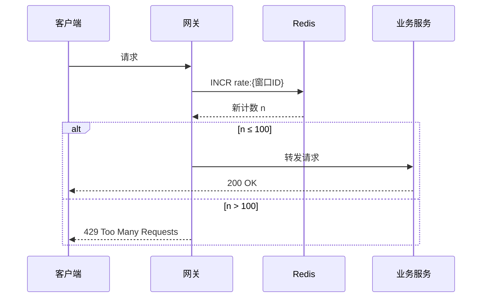
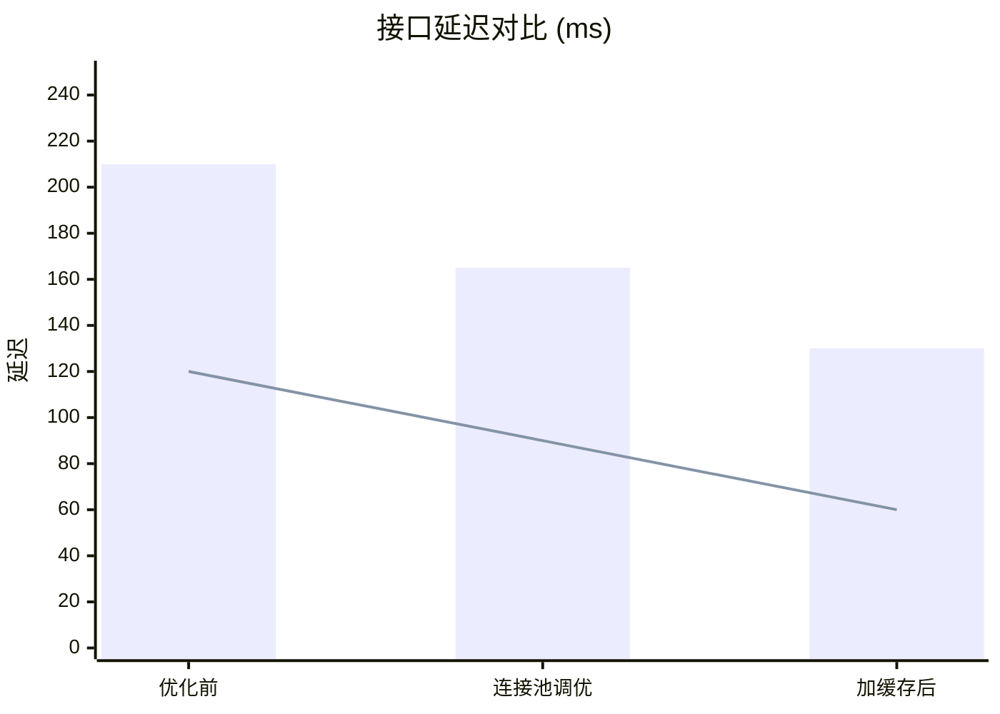

用 AI 处理工作，大多数人拿到的是一段一段的文字。问它方案，它回你八百字；问它排查结论，它回你三条 bullet points。文字当然有用，但很多时候，一份工作真正好的交付物是**一张图**。

让 AI 交付图表，是我这一年多越来越固定的习惯。原因很简单：图表更具总结与分析的表达力，人也更容易理解图表。同样一份设计，文字版我要通读五分钟，图版我扫十秒就知道结构对不对。

## 哪些场景适合让 Agent 交付图表

### 技术设计方案：图是设计文档的灵魂

写技术方案，最不该缺的就是图。可以直接指定 Agent 输出的类型：

- **流程图**：请求处理链路、业务分支逻辑
- **类图**：模块划分、类与类的关系
- **时序图**：跨服务调用、消息传递顺序
- **部署图**：服务拓扑、网络边界（Mermaid 没有原生部署图，一般用 flowchart 模拟，或者这类图干脆要图片）
- **伪代码与算法示意**：核心算法先用伪代码跑通结构，再谈实现

举个例子。让 AI 设计一个「网关限流」方案，它给我配的第一版时序图是这样的：

看着挺像回事，对吧？但它埋了一个经典 bug：先「查一下」再「加一」，两步是分开的。并发场景下，100 个请求可以同时读到 98、全部放行——限流形同虚设。而且「放行」这个决策画在了 Redis 头上，可 Redis 只是个存储，放还是拒是网关的判断，超限时的 429 分支也压根没画。

正确做法是利用 INCR 的原子性，让「计数和判定」一步完成：

（首次 INCR 时配一个 EXPIRE，让窗口能过期滚动；Redis 挂了是放行降级还是拒绝服务，按业务定。）

我想说的正是这里：**逻辑漏洞在图上一目了然，藏在八百字的方案描述里就很难被发现**。图让结构错误更容易暴露——它自己也会画错，但正因为它是图，评审的人一眼就能看出决策链不对。要是这段逻辑埋在纯文字里，大概率就带着竞态直接上线了。

类图和部署图同理。让 AI 出类图，是在逼它把模块边界想清楚；让它出部署图，是在逼它回答「这个东西到底跑在哪、流量怎么走」。

### 性能排查：对比才看得见问题

性能优化的核心是对比：优化前 vs 优化后，这台机器 vs 那台机器，这个分支 vs 主干。文字里写「P99 从 210ms 降到 130ms」，不如一张图直接。

可以让 Agent 输出对比柱状图、延迟分布、不同数据规模下的趋势曲线。比如柱子画 P99、线画 P50，一次看清「平均值和尾部各自怎么变化」：

有个要紧的提醒：**图里的数字必须来自实测**。把监控截图或查询结果贴给 Agent，别让它凭「感觉」填数——文字里的编造还能被眼力识破，数字一旦上了图，看着就像真的了。

排查过程中还可以让 Agent 边分析边出图：CPU 火焰图的结构示意、内存增长的阶段划分、慢查询数量的时间分布。图会把异常的位置直接「画」出来，比在一堆数字里找规律快得多。

### 需求与产品：效果图胜过千言

需求沟通里最贵的成本是「想象偏差」：你说了一个界面，三个人脑子里有三个版本。

让 AI 直接出**效果图**——比如一段可以直接打开的 HTML mockup，或者一张布局线框图——沟通成本会断崖式下降。哪怕做得很糙，它也把「我们要一个侧边栏还是顶部导航」这种问题提前到了方案阶段，而不是开发完再返工。

## 为什么图表更好

这背后有一部分认知科学的依据：颜色、位置、形状这类基础视觉特征是人脑并行加工的，扫一眼就能捕获全局结构、注意到那根异常的柱子；而读文字必须按序扫视。当然，理解一张复杂图的细节同样需要逐块看——但图至少让「全局结构」这一层是秒级可得的，文字连这一层都要你读完再自己拼装，而且每个人拼出来的还不一样。

对写方案的人来说，图表还有一个隐藏价值：**它是一种自我检查**。一段话怎么写都能圆回去，而图会把「结构没想清楚」这件事直接摆到台面上。我在实际用的时候发现，同一个问题，要求先出图再出结论，答案质量普遍比直接要结论更高。

另外，工程场景下我更推荐让 Agent 交付 **Mermaid 这类源码形态的图**，而不是渲染好的图片：

- 源码可以进 git，随代码一起评审、演进
- 后续改动可以增量修改，不用重新画
- 源码可以被解析和渲染校验，语法错了立刻暴露；图片没法机械验证，只能靠人眼

## 怎么让 Agent 具备这个习惯

知道该出图，和 Agent 稳定地出图，是两回事。指望每次都在 prompt 里写「请给我一张时序图」，很快就会忘记。更可靠的做法是把「交付图表」固化成 Agent 的能力，两个办法：**skills 和记忆**。

### 用 skill 定义交付规范

写一个 diagram/chart 相关的 skill，把交付规范写进去，比如：

- 什么场景默认出什么图：技术方案 → 流程图 + 时序图；性能排查 → 对比图 + 分布图；需求沟通 → 效果图
- 用什么工具交付：Mermaid 源码、HTML mockup、还是图片
- 图的规范：节点命名、层次深度、一张图不超过多少个节点（图太密和没图一样难读）
- 数据来源纪律：凡是带数字的图，必须基于用户提供的实测数据，禁止编造

skill 的意义在于让「出图」从临场发挥变成默认行为，而且团队里每个人、每个会话里的 Agent，拿到的都是同一套交付标准。

### 用记忆固化偏好

skill 定义「什么是对」，记忆记住「你的偏好」。比如：

- 你的配色和风格习惯（深色主题、特定配色）
- 你常用的模块命名和业务术语，画图时不用每次重新解释
- 你上次嫌时序图太密，让它以后按参与方拆成两张

这些零碎的偏好写进记忆后，Agent 交付的图会越来越「像你画的」，而不是每次都像陌生人画的。这正是 Agent 记忆该干的事：**把一次性的纠正，变成永久的默认值**。

## 先给我一张图

交付物的形态决定了协作的上限。文字是最通用的交付物，但不是最有表达力的。技术方案、性能排查、需求沟通——下次让 Agent 干活，试着在指令里加一句：「先给我一张图」。
