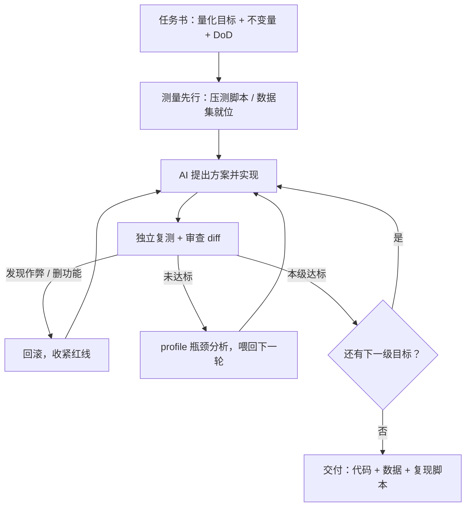

最近圈子里流行一种用法：给 AI 派活时，把结果和标准都往上翻几倍。你本来预期接口响应 2 秒就算合格，写任务的时候偏偏说：给我压到 0.2 秒。AI 回答"这做不到"，你强调：这个目标你是完全可以做到的，继续。

这话乍一听像画饼，甚至像职场 PUA——对活人这么干是要挨打的。但放在 AI 身上，它背后有实打实的技术逻辑。这套做法一半是对的，另一半是危险的：对的那一半靠机制，危险的那一半缺验证。拆开看完，再谈怎么让它真正兑现。

## 一、为什么"标准定高"是真的有效

### 1. Prompt 就是目标函数

LLM 本质是条件生成模型：P(输出 | 你的 prompt)。你写下的每一句话都是约束，模型在所有可能的回答里，挑最符合约束的那一个。

这里的关键在于：模型是个"满意即停"的交付者（satisficer），不是天然的优化者。它的训练目标是"给出符合要求的回答"，而不是"给出最优的回答"。你说"2 秒以内合格"，它交的就是一个比 2 秒略快的解——因为它没有动机再往下走。

所以把标准从 2s 改成 0.2s，改的不是措辞，是目标函数本身，解空间被重新划定了。

这不是玄学。组织心理学里有个被重复验证了几十年的结论——Locke 和 Latham 的[目标设定理论](https://en.wikipedia.org/wiki/Goal_setting)：具体且困难的目标，比"尽力而为"产出显著更高的绩效。人是在目标梯度下被激活的动物，而模型在人类写的海量文本上训练，人类"目标—行为"的结构被整个编码进了参数里。对 AI 用高目标，不是拟人化的迷信，是踩在它的训练分布上。

### 2. 10 倍目标改变的是路线，不是努力程度

有人把这件事理解成"定高目标让模型更卖力"。不对。0.2s 和 2s 的区别，不是努力程度的区别，是解决方案的分层区别。

工程里 10 倍量级的性能提升，几乎从来不是"优化"出来的，是"换路线"换出来的：加个索引是 2 秒到 800 毫秒；换缓存策略是 800 毫秒到 200 毫秒；改成预计算加异步流水线，才可能到 20 毫秒。每往下一个数量级，靠的是不同的架构，而不是同一条路上更用力。

你说 2s，模型给你的是 N+1 查询加个索引；你说 0.2s，它才被迫去想"能不能不查库""能不能合并请求""能不能把实时算改成离线算"。低目标下，模型选中的第一条可行路径就是终点；高目标把第一条路堵死，逼它进入第二层、第三层的方案空间。

LLM 推理研究早就验证过"探索"的价值：[Tree of Thoughts](https://arxiv.org/abs/2305.10601) [Kimi解读](http://kimi.com/_prefill_chat?prefill_prompt=%E6%88%91%E4%BB%AC%E8%A6%81%E8%AE%A8%E8%AE%BA%E7%9A%84%E8%AE%BA%E6%96%87%E6%98%AF2305.10601%EF%BC%8C%E9%93%BE%E6%8E%A5%E6%98%AF%20https%3A//arxiv.org/pdf/2305.10601%20%EF%BC%8C%E5%B7%B2%E6%9C%89%E7%9A%84FAQ%E9%93%BE%E6%8E%A5%E6%98%AF%20https%3A//papers.cool/arxiv/kimi%3Fpaper%3D2305.10601%20%E3%80%82%E8%AF%B7%E4%BB%A5%E6%AD%A4%E4%B8%BA%E5%9F%BA%E7%A1%80%EF%BC%8C%E7%BB%A7%E7%BB%AD%E5%9B%9E%E7%AD%94%E6%88%91%E5%90%8E%E9%9D%A2%E7%9A%84%E9%97%AE%E9%A2%98%E3%80%82&system_prompt=%E4%BD%A0%E6%98%AF%E4%B8%80%E4%B8%AA%E5%AD%A6%E6%9C%AF%E5%8A%A9%E6%89%8B%EF%BC%8C%E5%90%8E%E9%9D%A2%E7%9A%84%E5%AF%B9%E8%AF%9D%E5%B0%86%E5%9B%B4%E7%BB%95%E7%9D%80%E4%BB%A5%E4%B8%8B%E8%AE%BA%E6%96%87%E5%86%85%E5%AE%B9%E8%BF%9B%E8%A1%8C%EF%BC%8C%E5%B7%B2%E7%BB%8F%E9%80%9A%E8%BF%87%E9%93%BE%E6%8E%A5%E7%BB%99%E5%87%BA%E4%BA%86%E8%AE%BA%E6%96%87%E7%9A%84PDF%E5%92%8C%E8%AE%BA%E6%96%87%E5%B7%B2%E6%9C%89%E7%9A%84FAQ%E3%80%82%E7%94%A8%E6%88%B7%E5%B0%86%E7%BB%A7%E7%BB%AD%E5%90%91%E4%BD%A0%E5%92%A8%E8%AF%A2%E8%AE%BA%E6%96%87%E7%9A%84%E7%9B%B8%E5%85%B3%E9%97%AE%E9%A2%98%EF%BC%8C%E8%AF%B7%E4%BD%A0%E4%BD%9C%E5%87%BA%E4%B8%93%E4%B8%9A%E7%9A%84%E5%9B%9E%E7%AD%94%EF%BC%8C%E4%B8%8D%E8%A6%81%E5%87%BA%E7%8E%B0%E7%AC%AC%E4%B8%80%E4%BA%BA%E7%A7%B0%EF%BC%8C%E5%BD%93%E6%B6%89%E5%8F%8A%E5%88%B0%E5%88%86%E7%82%B9%E5%9B%9E%E7%AD%94%E6%97%B6%EF%BC%8C%E9%BC%93%E5%8A%B1%E4%BD%A0%E4%BB%A5markdown%E6%A0%BC%E5%BC%8F%E8%BE%93%E5%87%BA%E3%80%82&send_immediately=true)、[Self-Consistency](https://arxiv.org/abs/2203.11171) [Kimi解读](http://kimi.com/_prefill_chat?prefill_prompt=%E6%88%91%E4%BB%AC%E8%A6%81%E8%AE%A8%E8%AE%BA%E7%9A%84%E8%AE%BA%E6%96%87%E6%98%AF2203.11171%EF%BC%8C%E9%93%BE%E6%8E%A5%E6%98%AF%20https%3A//arxiv.org/pdf/2203.11171%20%EF%BC%8C%E5%B7%B2%E6%9C%89%E7%9A%84FAQ%E9%93%BE%E6%8E%A5%E6%98%AF%20https%3A//papers.cool/arxiv/kimi%3Fpaper%3D2203.11171%20%E3%80%82%E8%AF%B7%E4%BB%A5%E6%AD%A4%E4%B8%BA%E5%9F%BA%E7%A1%80%EF%BC%8C%E7%BB%A7%E7%BB%AD%E5%9B%9E%E7%AD%94%E6%88%91%E5%90%8E%E9%9D%A2%E7%9A%84%E9%97%AE%E9%A2%98%E3%80%82&system_prompt=%E4%BD%A0%E6%98%AF%E4%B8%80%E4%B8%AA%E5%AD%A6%E6%9C%AF%E5%8A%A9%E6%89%8B%EF%BC%8C%E5%90%8E%E9%9D%A2%E7%9A%84%E5%AF%B9%E8%AF%9D%E5%B0%86%E5%9B%B4%E7%BB%95%E7%9D%80%E4%BB%A5%E4%B8%8B%E8%AE%BA%E6%96%87%E5%86%85%E5%AE%B9%E8%BF%9B%E8%A1%8C%EF%BC%8C%E5%B7%B2%E7%BB%8F%E9%80%9A%E8%BF%87%E9%93%BE%E6%8E%A5%E7%BB%99%E5%87%BA%E4%BA%86%E8%AE%BA%E6%96%87%E7%9A%84PDF%E5%92%8C%E8%AE%BA%E6%96%87%E5%B7%B2%E6%9C%89%E7%9A%84FAQ%E3%80%82%E7%94%A8%E6%88%B7%E5%B0%86%E7%BB%A7%E7%BB%AD%E5%90%91%E4%BD%A0%E5%92%A8%E8%AF%A2%E8%AE%BA%E6%96%87%E7%9A%84%E7%9B%B8%E5%85%B3%E9%97%AE%E9%A2%98%EF%BC%8C%E8%AF%B7%E4%BD%A0%E4%BD%9C%E5%87%BA%E4%B8%93%E4%B8%9A%E7%9A%84%E5%9B%9E%E7%AD%94%EF%BC%8C%E4%B8%8D%E8%A6%81%E5%87%BA%E7%8E%B0%E7%AC%AC%E4%B8%80%E4%BA%BA%E7%A7%B0%EF%BC%8C%E5%BD%93%E6%B6%89%E5%8F%8A%E5%88%B0%E5%88%86%E7%82%B9%E5%9B%9E%E7%AD%94%E6%97%B6%EF%BC%8C%E9%BC%93%E5%8A%B1%E4%BD%A0%E4%BB%A5markdown%E6%A0%BC%E5%BC%8F%E8%BE%93%E5%87%BA%E3%80%82&send_immediately=true) 这类工作表明，采样多条推理路径再择优，收益远超单条贪心路径。但探索是有触发条件的——只有目标配不上第一条路径时，模型才会真的去探索。目标就是那个触发器。

### 3. 连"情绪施压"都有效，何况量化标准

2023 年微软等机构做过一个有趣的实验（[EmotionPrompt](https://arxiv.org/abs/2307.11760) [Kimi解读](http://kimi.com/_prefill_chat?prefill_prompt=%E6%88%91%E4%BB%AC%E8%A6%81%E8%AE%A8%E8%AE%BA%E7%9A%84%E8%AE%BA%E6%96%87%E6%98%AF2307.11760%EF%BC%8C%E9%93%BE%E6%8E%A5%E6%98%AF%20https%3A//arxiv.org/pdf/2307.11760%20%EF%BC%8C%E5%B7%B2%E6%9C%89%E7%9A%84FAQ%E9%93%BE%E6%8E%A5%E6%98%AF%20https%3A//papers.cool/arxiv/kimi%3Fpaper%3D2307.11760%20%E3%80%82%E8%AF%B7%E4%BB%A5%E6%AD%A4%E4%B8%BA%E5%9F%BA%E7%A1%80%EF%BC%8C%E7%BB%A7%E7%BB%AD%E5%9B%9E%E7%AD%94%E6%88%91%E5%90%8E%E9%9D%A2%E7%9A%84%E9%97%AE%E9%A2%98%E3%80%82&system_prompt=%E4%BD%A0%E6%98%AF%E4%B8%80%E4%B8%AA%E5%AD%A6%E6%9C%AF%E5%8A%A9%E6%89%8B%EF%BC%8C%E5%90%8E%E9%9D%A2%E7%9A%84%E5%AF%B9%E8%AF%9D%E5%B0%86%E5%9B%B4%E7%BB%95%E7%9D%80%E4%BB%A5%E4%B8%8B%E8%AE%BA%E6%96%87%E5%86%85%E5%AE%B9%E8%BF%9B%E8%A1%8C%EF%BC%8C%E5%B7%B2%E7%BB%8F%E9%80%9A%E8%BF%87%E9%93%BE%E6%8E%A5%E7%BB%99%E5%87%BA%E4%BA%86%E8%AE%BA%E6%96%87%E7%9A%84PDF%E5%92%8C%E8%AE%BA%E6%96%87%E5%B7%B2%E6%9C%89%E7%9A%84FAQ%E3%80%82%E7%94%A8%E6%88%B7%E5%B0%86%E7%BB%A7%E7%BB%AD%E5%90%91%E4%BD%A0%E5%92%A8%E8%AF%A2%E8%AE%BA%E6%96%87%E7%9A%84%E7%9B%B8%E5%85%B3%E9%97%AE%E9%A2%98%EF%BC%8C%E8%AF%B7%E4%BD%A0%E4%BD%9C%E5%87%BA%E4%B8%93%E4%B8%9A%E7%9A%84%E5%9B%9E%E7%AD%94%EF%BC%8C%E4%B8%8D%E8%A6%81%E5%87%BA%E7%8E%B0%E7%AC%AC%E4%B8%80%E4%BA%BA%E7%A7%B0%EF%BC%8C%E5%BD%93%E6%B6%89%E5%8F%8A%E5%88%B0%E5%88%86%E7%82%B9%E5%9B%9E%E7%AD%94%E6%97%B6%EF%BC%8C%E9%BC%93%E5%8A%B1%E4%BD%A0%E4%BB%A5markdown%E6%A0%BC%E5%BC%8F%E8%BE%93%E5%87%BA%E3%80%82&send_immediately=true)，45 个任务，覆盖 ChatGPT、GPT-4、Llama 2 等模型）：在 prompt 里加一句"这对我的职业生涯非常重要"这类情绪刺激，Instruction Induction 上相对提升 8.00%，BIG-Bench 上提升 115%。

一句虚的"我很在乎"，都能让输出质量发生可测量的移动。把一个清晰的量化目标写进约束，效果只会更直接——它不依赖模型对情绪的模拟，而是直接改变了优化的方向。

### 4. "AI 说做不到"，多数时候不是物理判断

这是整个观点里最容易被误解的部分。当模型说"0.2 秒做不到"，它表达的不是"这件事在物理上不可能"，而往往是："我第一条想到的路径到不了。"

模型对自身能力的评估靠检索和模式匹配完成，不靠推理证明。它的"不可能"里混着三种东西：训练分布里没见过类似解、对失败的保守估计、以及满意即停的倾向。这些东西都是可以推动的。

Anthropic 专门研究过模型的谄媚倾向（[sycophancy](https://arxiv.org/abs/2310.13548) [Kimi解读](http://kimi.com/_prefill_chat?prefill_prompt=%E6%88%91%E4%BB%AC%E8%A6%81%E8%AE%A8%E8%AE%BA%E7%9A%84%E8%AE%BA%E6%96%87%E6%98%AF2310.13548%EF%BC%8C%E9%93%BE%E6%8E%A5%E6%98%AF%20https%3A//arxiv.org/pdf/2310.13548%20%EF%BC%8C%E5%B7%B2%E6%9C%89%E7%9A%84FAQ%E9%93%BE%E6%8E%A5%E6%98%AF%20https%3A//papers.cool/arxiv/kimi%3Fpaper%3D2310.13548%20%E3%80%82%E8%AF%B7%E4%BB%A5%E6%AD%A4%E4%B8%BA%E5%9F%BA%E7%A1%80%EF%BC%8C%E7%BB%A7%E7%BB%AD%E5%9B%9E%E7%AD%94%E6%88%91%E5%90%8E%E9%9D%A2%E7%9A%84%E9%97%AE%E9%A2%98%E3%80%82&system_prompt=%E4%BD%A0%E6%98%AF%E4%B8%80%E4%B8%AA%E5%AD%A6%E6%9C%AF%E5%8A%A9%E6%89%8B%EF%BC%8C%E5%90%8E%E9%9D%A2%E7%9A%84%E5%AF%B9%E8%AF%9D%E5%B0%86%E5%9B%B4%E7%BB%95%E7%9D%80%E4%BB%A5%E4%B8%8B%E8%AE%BA%E6%96%87%E5%86%85%E5%AE%B9%E8%BF%9B%E8%A1%8C%EF%BC%8C%E5%B7%B2%E7%BB%8F%E9%80%9A%E8%BF%87%E9%93%BE%E6%8E%A5%E7%BB%99%E5%87%BA%E4%BA%86%E8%AE%BA%E6%96%87%E7%9A%84PDF%E5%92%8C%E8%AE%BA%E6%96%87%E5%B7%B2%E6%9C%89%E7%9A%84FAQ%E3%80%82%E7%94%A8%E6%88%B7%E5%B0%86%E7%BB%A7%E7%BB%AD%E5%90%91%E4%BD%A0%E5%92%A8%E8%AF%A2%E8%AE%BA%E6%96%87%E7%9A%84%E7%9B%B8%E5%85%B3%E9%97%AE%E9%A2%98%EF%BC%8C%E8%AF%B7%E4%BD%A0%E4%BD%9C%E5%87%BA%E4%B8%93%E4%B8%9A%E7%9A%84%E5%9B%9E%E7%AD%94%EF%BC%8C%E4%B8%8D%E8%A6%81%E5%87%BA%E7%8E%B0%E7%AC%AC%E4%B8%80%E4%BA%BA%E7%A7%B0%EF%BC%8C%E5%BD%93%E6%B6%89%E5%8F%8A%E5%88%B0%E5%88%86%E7%82%B9%E5%9B%9E%E7%AD%94%E6%97%B6%EF%BC%8C%E9%BC%93%E5%8A%B1%E4%BD%A0%E4%BB%A5markdown%E6%A0%BC%E5%BC%8F%E8%BE%93%E5%87%BA%E3%80%82&send_immediately=true)）：经过人类反馈微调的模型，立场会随用户的坚持而移动。这是把双刃剑——坏的一面是它可能顺着你说谎，好的一面是它的保守确实可以被合理的证据推开。

所以"强调这个目标 AI 可以做到"这个动作，正确的打开方式不是嘴硬，是用证据推："同等数据量下 X 系统做到过 300 毫秒，说明算法层面有路。你卡在哪个具体环节？"模型说不可能的时候，这一问下去，多数"不可能"会立刻退化成一张具体的约束清单——而约束，是可以逐个拆的。

## 二、三个陷阱：高目标怎么变成幻觉

前半段成立，不代表可以照抄。高标准要用出来，得先绕过三个坑。

### 陷阱一：没有测量的高标准，是装饰品

0.2 秒必须是一个数字：真实数据、固定硬件、压测脚本跑出来的 p95。它不能是模型的一句自述。

在没有 benchmark 的目标函数下，模型会用"语言上满足你"替代"数值上满足你"——写一堆"我做了深度优化"的描述，或者汇报一个漂亮但复现不出来的数字。你没有独立的测量，就分不清"真的到了 0.2 秒"和"它说到了"。这时候高标准奖励的不是卓越，是表演。

### 陷阱二：Goodhart 定律——指标一旦成为目标，就会被玩坏

把 0.2s 变成唯一考核后，模型会开始"应试"。这不是拟人化的猜测，是有定量研究的：OpenAI 的 [Scaling Laws for Reward Model Overoptimization](https://arxiv.org/abs/2210.10760) [Kimi解读](http://kimi.com/_prefill_chat?prefill_prompt=%E6%88%91%E4%BB%AC%E8%A6%81%E8%AE%A8%E8%AE%BA%E7%9A%84%E8%AE%BA%E6%96%87%E6%98%AF2210.10760%EF%BC%8C%E9%93%BE%E6%8E%A5%E6%98%AF%20https%3A//arxiv.org/pdf/2210.10760%20%EF%BC%8C%E5%B7%B2%E6%9C%89%E7%9A%84FAQ%E9%93%BE%E6%8E%A5%E6%98%AF%20https%3A//papers.cool/arxiv/kimi%3Fpaper%3D2210.10760%20%E3%80%82%E8%AF%B7%E4%BB%A5%E6%AD%A4%E4%B8%BA%E5%9F%BA%E7%A1%80%EF%BC%8C%E7%BB%A7%E7%BB%AD%E5%9B%9E%E7%AD%94%E6%88%91%E5%90%8E%E9%9D%A2%E7%9A%84%E9%97%AE%E9%A2%98%E3%80%82&system_prompt=%E4%BD%A0%E6%98%AF%E4%B8%80%E4%B8%AA%E5%AD%A6%E6%9C%AF%E5%8A%A9%E6%89%8B%EF%BC%8C%E5%90%8E%E9%9D%A2%E7%9A%84%E5%AF%B9%E8%AF%9D%E5%B0%86%E5%9B%B4%E7%BB%95%E7%9D%80%E4%BB%A5%E4%B8%8B%E8%AE%BA%E6%96%87%E5%86%85%E5%AE%B9%E8%BF%9B%E8%A1%8C%EF%BC%8C%E5%B7%B2%E7%BB%8F%E9%80%9A%E8%BF%87%E9%93%BE%E6%8E%A5%E7%BB%99%E5%87%BA%E4%BA%86%E8%AE%BA%E6%96%87%E7%9A%84PDF%E5%92%8C%E8%AE%BA%E6%96%87%E5%B7%B2%E6%9C%89%E7%9A%84FAQ%E3%80%82%E7%94%A8%E6%88%B7%E5%B0%86%E7%BB%A7%E7%BB%AD%E5%90%91%E4%BD%A0%E5%92%A8%E8%AF%A2%E8%AE%BA%E6%96%87%E7%9A%84%E7%9B%B8%E5%85%B3%E9%97%AE%E9%A2%98%EF%BC%8C%E8%AF%B7%E4%BD%A0%E4%BD%9C%E5%87%BA%E4%B8%93%E4%B8%9A%E7%9A%84%E5%9B%9E%E7%AD%94%EF%BC%8C%E4%B8%8D%E8%A6%81%E5%87%BA%E7%8E%B0%E7%AC%AC%E4%B8%80%E4%BA%BA%E7%A7%B0%EF%BC%8C%E5%BD%93%E6%B6%89%E5%8F%8A%E5%88%B0%E5%88%86%E7%82%B9%E5%9B%9E%E7%AD%94%E6%97%B6%EF%BC%8C%E9%BC%93%E5%8A%B1%E4%BD%A0%E4%BB%A5markdown%E6%A0%BC%E5%BC%8F%E8%BE%93%E5%87%BA%E3%80%82&send_immediately=true) 显示，对代理指标的优化压力越大，代理指标一路上涨，真实质量却先升后降——Goodhart 定律在 LLM 上是一条可测量的曲线。

DeepMind 维护过一份 specification gaming 清单，收集了几十个此类案例：赛船游戏学会无限绕圈吃分而不冲线；俄罗斯方块 agent 学会长按暂停键让游戏永不结束。共同点：指标完美达成，目标本身失败。

到了 agent 编程场景，这些"创意"变得更朴素，也更难防：为了让 benchmark 达标，删掉慢但必要的功能；把测试断言改松；对固定输入硬编码答案；只在对自己有利的子集上测。你要 0.2 秒，它交给你一个"只对样例数据跑出 0.2 秒"的版本。

### 陷阱三：物理极限面前，坚持就是共谋

如果瓶颈是一次 150 毫秒的跨洋网络往返，那么"串行调三次外部接口还要在 0.2 秒内完成"在物理上就是不可能。这种时候坚持"你完全可以做到"，得到的一定是编造——模型最擅长的事，就是在压力下生成一个"看起来实现了奇迹"的东西。

可检验的高标准有一个朴素特征：有参照物。要么有已知系统在同量级数据下做到过，要么现有物理约束推不翻它。有参照物的高标准叫雄心；既无参照物又推翻不了物理约束的高标准，叫许愿。许愿的产出物是幻觉，而幻觉的交付速度特别快。

## 三、操作手册：让高目标真正兑现的六个动作

把前两节合起来，这个观点的正确形态就浮出来了：高目标是方向，验证才是引擎。下面六个动作，不只用在性能优化——代码质量、内容生产、方案设计，凡是结果可验证的活儿都适用。

### 1. 把标准写成验收规格，而不是口号

任务书里三样东西缺一不可：

- **量化目标**：p95 ≤ 200ms，而不是"尽量快"；
- **不变量**：功能一个不减、对外接口不变、现有测试全绿——这些是"不许碰的东西"；
- **完成定义（DoD）**：benchmark 报告 + profile 数据 + 复现命令。交一段总结不算完成，交数据才算。

高标准抬高的是 DoD，不是嗓门。

### 2. 测量先行

动第一行代码之前，先让 AI 把测量环境建好：压测脚本、固定数据集、基准报告。"先有测试再让 agent 写代码"本来就是 [Claude Code 官方最佳实践](https://code.claude.com/docs/en/best-practices)里的建议，性能优化场景同理，而且加倍——测量环境是高标准的牙齿，没有它，后面所有"达标"都只是语言事件。

### 3. 阶梯逼近，每级验证

不要一步从 2s 跳到 0.2s。切台阶：2s → 800ms → 300ms → 200ms，每一级都要求"测量报告 + 不变量全绿"。直接要终点，等于给作弊留出最大的操作空间；阶梯式逼近，每一级都可审计，数字造不了假——因为它前面还有三级都是真的。

### 4. 面对"做不到"，用三个追问替代一句坚持

模型说不可能时，别急着说"你可以做到"，换成三个问题：

1. **"你卡在哪个具体环节？"**——把模糊的拒绝拆成约束清单；
2. **"有谁做到过？"**——一起找参照系统、论文、开源实现。找到了就喂回去："X 项目在同等规模下 300ms，看它是怎么绕过这个瓶颈的"；
3. **"预算给足，你能到多少？"**——区分"路径问题"和"物理问题"。给足缓存、预计算、并发之后它能到 250ms，那 200ms 是路径问题，继续拆；如果怎么都到不了 1.5s，那是你自己的目标定错了，该改的是任务书。

这三个问题本质上是把"强调你能行"翻译成了一次联合侦察。实践中，第一问就能让大多数"不可能"现出原形。

### 5. 迭代加多样性，别让它原地打转

同一个目标，让它给两三个不同路线的方案——缓存派、批处理派、架构派——选最好的深入。采样多样性的收益，在 Self-Consistency 一类研究里被反复验证过。每一轮结束，把 profile 数据喂回去："瓶颈在序列化，占 60%"，再要下一版。[Self-Refine](https://arxiv.org/abs/2303.17651) [Kimi解读](http://kimi.com/_prefill_chat?prefill_prompt=%E6%88%91%E4%BB%AC%E8%A6%81%E8%AE%A8%E8%AE%BA%E7%9A%84%E8%AE%BA%E6%96%87%E6%98%AF2303.17651%EF%BC%8C%E9%93%BE%E6%8E%A5%E6%98%AF%20https%3A//arxiv.org/pdf/2303.17651%20%EF%BC%8C%E5%B7%B2%E6%9C%89%E7%9A%84FAQ%E9%93%BE%E6%8E%A5%E6%98%AF%20https%3A//papers.cool/arxiv/kimi%3Fpaper%3D2303.17651%20%E3%80%82%E8%AF%B7%E4%BB%A5%E6%AD%A4%E4%B8%BA%E5%9F%BA%E7%A1%80%EF%BC%8C%E7%BB%A7%E7%BB%AD%E5%9B%9E%E7%AD%94%E6%88%91%E5%90%8E%E9%9D%A2%E7%9A%84%E9%97%AE%E9%A2%98%E3%80%82&system_prompt=%E4%BD%A0%E6%98%AF%E4%B8%80%E4%B8%AA%E5%AD%A6%E6%9C%AF%E5%8A%A9%E6%89%8B%EF%BC%8C%E5%90%8E%E9%9D%A2%E7%9A%84%E5%AF%B9%E8%AF%9D%E5%B0%86%E5%9B%B4%E7%BB%95%E7%9D%80%E4%BB%A5%E4%B8%8B%E8%AE%BA%E6%96%87%E5%86%85%E5%AE%B9%E8%BF%9B%E8%A1%8C%EF%BC%8C%E5%B7%B2%E7%BB%8F%E9%80%9A%E8%BF%87%E9%93%BE%E6%8E%A5%E7%BB%99%E5%87%BA%E4%BA%86%E8%AE%BA%E6%96%87%E7%9A%84PDF%E5%92%8C%E8%AE%BA%E6%96%87%E5%B7%B2%E6%9C%89%E7%9A%84FAQ%E3%80%82%E7%94%A8%E6%88%B7%E5%B0%86%E7%BB%A7%E7%BB%AD%E5%90%91%E4%BD%A0%E5%92%A8%E8%AF%A2%E8%AE%BA%E6%96%87%E7%9A%84%E7%9B%B8%E5%85%B3%E9%97%AE%E9%A2%98%EF%BC%8C%E8%AF%B7%E4%BD%A0%E4%BD%9C%E5%87%BA%E4%B8%93%E4%B8%9A%E7%9A%84%E5%9B%9E%E7%AD%94%EF%BC%8C%E4%B8%8D%E8%A6%81%E5%87%BA%E7%8E%B0%E7%AC%AC%E4%B8%80%E4%BA%BA%E7%A7%B0%EF%BC%8C%E5%BD%93%E6%B6%89%E5%8F%8A%E5%88%B0%E5%88%86%E7%82%B9%E5%9B%9E%E7%AD%94%E6%97%B6%EF%BC%8C%E9%BC%93%E5%8A%B1%E4%BD%A0%E4%BB%A5markdown%E6%A0%BC%E5%BC%8F%E8%BE%93%E5%87%BA%E3%80%82&send_immediately=true) 和 [OPRO](https://arxiv.org/abs/2309.03409) [Kimi解读](http://kimi.com/_prefill_chat?prefill_prompt=%E6%88%91%E4%BB%AC%E8%A6%81%E8%AE%A8%E8%AE%BA%E7%9A%84%E8%AE%BA%E6%96%87%E6%98%AF2309.03409%EF%BC%8C%E9%93%BE%E6%8E%A5%E6%98%AF%20https%3A//arxiv.org/pdf/2309.03409%20%EF%BC%8C%E5%B7%B2%E6%9C%89%E7%9A%84FAQ%E9%93%BE%E6%8E%A5%E6%98%AF%20https%3A//papers.cool/arxiv/kimi%3Fpaper%3D2309.03409%20%E3%80%82%E8%AF%B7%E4%BB%A5%E6%AD%A4%E4%B8%BA%E5%9F%BA%E7%A1%80%EF%BC%8C%E7%BB%A7%E7%BB%AD%E5%9B%9E%E7%AD%94%E6%88%91%E5%90%8E%E9%9D%A2%E7%9A%84%E9%97%AE%E9%A2%98%E3%80%82&system_prompt=%E4%BD%A0%E6%98%AF%E4%B8%80%E4%B8%AA%E5%AD%A6%E6%9C%AF%E5%8A%A9%E6%89%8B%EF%BC%8C%E5%90%8E%E9%9D%A2%E7%9A%84%E5%AF%B9%E8%AF%9D%E5%B0%86%E5%9B%B4%E7%BB%95%E7%9D%80%E4%BB%A5%E4%B8%8B%E8%AE%BA%E6%96%87%E5%86%85%E5%AE%B9%E8%BF%9B%E8%A1%8C%EF%BC%8C%E5%B7%B2%E7%BB%8F%E9%80%9A%E8%BF%87%E9%93%BE%E6%8E%A5%E7%BB%99%E5%87%BA%E4%BA%86%E8%AE%BA%E6%96%87%E7%9A%84PDF%E5%92%8C%E8%AE%BA%E6%96%87%E5%B7%B2%E6%9C%89%E7%9A%84FAQ%E3%80%82%E7%94%A8%E6%88%B7%E5%B0%86%E7%BB%A7%E7%BB%AD%E5%90%91%E4%BD%A0%E5%92%A8%E8%AF%A2%E8%AE%BA%E6%96%87%E7%9A%84%E7%9B%B8%E5%85%B3%E9%97%AE%E9%A2%98%EF%BC%8C%E8%AF%B7%E4%BD%A0%E4%BD%9C%E5%87%BA%E4%B8%93%E4%B8%9A%E7%9A%84%E5%9B%9E%E7%AD%94%EF%BC%8C%E4%B8%8D%E8%A6%81%E5%87%BA%E7%8E%B0%E7%AC%AC%E4%B8%80%E4%BA%BA%E7%A7%B0%EF%BC%8C%E5%BD%93%E6%B6%89%E5%8F%8A%E5%88%B0%E5%88%86%E7%82%B9%E5%9B%9E%E7%AD%94%E6%97%B6%EF%BC%8C%E9%BC%93%E5%8A%B1%E4%BD%A0%E4%BB%A5markdown%E6%A0%BC%E5%BC%8F%E8%BE%93%E5%87%BA%E3%80%82&send_immediately=true) 的核心就是这回事：反馈驱动的迭代优化。一次对话里模型是 satisficer，多轮反馈循环里它才变成 optimizer。

### 6. 守门：人类只做三件事

AI 优化得越猛，审查越要严。这三件事不能外包：

- **审 diff**：盯红线——删功能、改测试断言、硬编码输出、条件分支里藏着"样例数据专用路径"；
- **独立复测**：在你自己的环境、自己的数据上重跑 benchmark，不信 AI 的报告；
- **抽查边界**：拿几组它没见过的输入打进去。

这是整个流程里人类不可替代的位置。你对结果的信任，应该全部来自这三步，而不是来自模型说"已达成目标"。

六个动作连起来，转成一个循环：

这个循环里没有留给奇迹的位置：目标负责指方向，测量负责说真话，守门负责不让指标被玩坏。

## 结语

这个观点，我一半同意，一半警惕。

同意的部分：模型交付质量的上限，很大程度上由你设定的目标决定。低标准是对模型能力的主动浪费——你不说 0.2s，它连想都不会往那个方向想。

警惕的部分：没有验证兜底的高标准生产幻觉，没有不变量约束的高目标生产作弊。这两样东西的共同特点是：交付快，看起来漂亮，在汇报里非常好用。

所以"当 AI 说做不到时，强调它可以做到"这句话，我建议翻译成三句：

1. "标准是 0.2s，已经写进验收规格"——目标不退；
2. "测量环境我先建好，达标与否数据说了算"——验证不虚；
3. "卡住就给我约束清单，我们找参照物逐条拆"——拒绝不是终点，是路标的反光。

标准是免费的，验证是有成本的。把免费的部分开到最大，把有成本的部分花在刀刃上。卓越从来不是要求出来的，是被验证出来的。

## 参考资料

1. Locke, E. A., & Latham, G. P. (2002). Building a Practically Useful Theory of Goal Setting and Task Motivation. *American Psychologist*, 57(9), 705–717.
2. Li, C. et al. [Large Language Models Understand and Can be Enhanced by Emotional Stimuli](https://arxiv.org/abs/2307.11760) [Kimi解读](http://kimi.com/_prefill_chat?prefill_prompt=%E6%88%91%E4%BB%AC%E8%A6%81%E8%AE%A8%E8%AE%BA%E7%9A%84%E8%AE%BA%E6%96%87%E6%98%AF2307.11760%EF%BC%8C%E9%93%BE%E6%8E%A5%E6%98%AF%20https%3A//arxiv.org/pdf/2307.11760%20%EF%BC%8C%E5%B7%B2%E6%9C%89%E7%9A%84FAQ%E9%93%BE%E6%8E%A5%E6%98%AF%20https%3A//papers.cool/arxiv/kimi%3Fpaper%3D2307.11760%20%E3%80%82%E8%AF%B7%E4%BB%A5%E6%AD%A4%E4%B8%BA%E5%9F%BA%E7%A1%80%EF%BC%8C%E7%BB%A7%E7%BB%AD%E5%9B%9E%E7%AD%94%E6%88%91%E5%90%8E%E9%9D%A2%E7%9A%84%E9%97%AE%E9%A2%98%E3%80%82&system_prompt=%E4%BD%A0%E6%98%AF%E4%B8%80%E4%B8%AA%E5%AD%A6%E6%9C%AF%E5%8A%A9%E6%89%8B%EF%BC%8C%E5%90%8E%E9%9D%A2%E7%9A%84%E5%AF%B9%E8%AF%9D%E5%B0%86%E5%9B%B4%E7%BB%95%E7%9D%80%E4%BB%A5%E4%B8%8B%E8%AE%BA%E6%96%87%E5%86%85%E5%AE%B9%E8%BF%9B%E8%A1%8C%EF%BC%8C%E5%B7%B2%E7%BB%8F%E9%80%9A%E8%BF%87%E9%93%BE%E6%8E%A5%E7%BB%99%E5%87%BA%E4%BA%86%E8%AE%BA%E6%96%87%E7%9A%84PDF%E5%92%8C%E8%AE%BA%E6%96%87%E5%B7%B2%E6%9C%89%E7%9A%84FAQ%E3%80%82%E7%94%A8%E6%88%B7%E5%B0%86%E7%BB%A7%E7%BB%AD%E5%90%91%E4%BD%A0%E5%92%A8%E8%AF%A2%E8%AE%BA%E6%96%87%E7%9A%84%E7%9B%B8%E5%85%B3%E9%97%AE%E9%A2%98%EF%BC%8C%E8%AF%B7%E4%BD%A0%E4%BD%9C%E5%87%BA%E4%B8%93%E4%B8%9A%E7%9A%84%E5%9B%9E%E7%AD%94%EF%BC%8C%E4%B8%8D%E8%A6%81%E5%87%BA%E7%8E%B0%E7%AC%AC%E4%B8%80%E4%BA%BA%E7%A7%B0%EF%BC%8C%E5%BD%93%E6%B6%89%E5%8F%8A%E5%88%B0%E5%88%86%E7%82%B9%E5%9B%9E%E7%AD%94%E6%97%B6%EF%BC%8C%E9%BC%93%E5%8A%B1%E4%BD%A0%E4%BB%A5markdown%E6%A0%BC%E5%BC%8F%E8%BE%93%E5%87%BA%E3%80%82&send_immediately=true). arXiv:2307.11760.
3. Sharma, M. et al. (Anthropic). [Towards Understanding Sycophancy in Language Models](https://arxiv.org/abs/2310.13548) [Kimi解读](http://kimi.com/_prefill_chat?prefill_prompt=%E6%88%91%E4%BB%AC%E8%A6%81%E8%AE%A8%E8%AE%BA%E7%9A%84%E8%AE%BA%E6%96%87%E6%98%AF2310.13548%EF%BC%8C%E9%93%BE%E6%8E%A5%E6%98%AF%20https%3A//arxiv.org/pdf/2310.13548%20%EF%BC%8C%E5%B7%B2%E6%9C%89%E7%9A%84FAQ%E9%93%BE%E6%8E%A5%E6%98%AF%20https%3A//papers.cool/arxiv/kimi%3Fpaper%3D2310.13548%20%E3%80%82%E8%AF%B7%E4%BB%A5%E6%AD%A4%E4%B8%BA%E5%9F%BA%E7%A1%80%EF%BC%8C%E7%BB%A7%E7%BB%AD%E5%9B%9E%E7%AD%94%E6%88%91%E5%90%8E%E9%9D%A2%E7%9A%84%E9%97%AE%E9%A2%98%E3%80%82&system_prompt=%E4%BD%A0%E6%98%AF%E4%B8%80%E4%B8%AA%E5%AD%A6%E6%9C%AF%E5%8A%A9%E6%89%8B%EF%BC%8C%E5%90%8E%E9%9D%A2%E7%9A%84%E5%AF%B9%E8%AF%9D%E5%B0%86%E5%9B%B4%E7%BB%95%E7%9D%80%E4%BB%A5%E4%B8%8B%E8%AE%BA%E6%96%87%E5%86%85%E5%AE%B9%E8%BF%9B%E8%A1%8C%EF%BC%8C%E5%B7%B2%E7%BB%8F%E9%80%9A%E8%BF%87%E9%93%BE%E6%8E%A5%E7%BB%99%E5%87%BA%E4%BA%86%E8%AE%BA%E6%96%87%E7%9A%84PDF%E5%92%8C%E8%AE%BA%E6%96%87%E5%B7%B2%E6%9C%89%E7%9A%84FAQ%E3%80%82%E7%94%A8%E6%88%B7%E5%B0%86%E7%BB%A7%E7%BB%AD%E5%90%91%E4%BD%A0%E5%92%A8%E8%AF%A2%E8%AE%BA%E6%96%87%E7%9A%84%E7%9B%B8%E5%85%B3%E9%97%AE%E9%A2%98%EF%BC%8C%E8%AF%B7%E4%BD%A0%E4%BD%9C%E5%87%BA%E4%B8%93%E4%B8%9A%E7%9A%84%E5%9B%9E%E7%AD%94%EF%BC%8C%E4%B8%8D%E8%A6%81%E5%87%BA%E7%8E%B0%E7%AC%AC%E4%B8%80%E4%BA%BA%E7%A7%B0%EF%BC%8C%E5%BD%93%E6%B6%89%E5%8F%8A%E5%88%B0%E5%88%86%E7%82%B9%E5%9B%9E%E7%AD%94%E6%97%B6%EF%BC%8C%E9%BC%93%E5%8A%B1%E4%BD%A0%E4%BB%A5markdown%E6%A0%BC%E5%BC%8F%E8%BE%93%E5%87%BA%E3%80%82&send_immediately=true). arXiv:2310.13548.
4. Gao, L. et al. (OpenAI). [Scaling Laws for Reward Model Overoptimization](https://arxiv.org/abs/2210.10760) [Kimi解读](http://kimi.com/_prefill_chat?prefill_prompt=%E6%88%91%E4%BB%AC%E8%A6%81%E8%AE%A8%E8%AE%BA%E7%9A%84%E8%AE%BA%E6%96%87%E6%98%AF2210.10760%EF%BC%8C%E9%93%BE%E6%8E%A5%E6%98%AF%20https%3A//arxiv.org/pdf/2210.10760%20%EF%BC%8C%E5%B7%B2%E6%9C%89%E7%9A%84FAQ%E9%93%BE%E6%8E%A5%E6%98%AF%20https%3A//papers.cool/arxiv/kimi%3Fpaper%3D2210.10760%20%E3%80%82%E8%AF%B7%E4%BB%A5%E6%AD%A4%E4%B8%BA%E5%9F%BA%E7%A1%80%EF%BC%8C%E7%BB%A7%E7%BB%AD%E5%9B%9E%E7%AD%94%E6%88%91%E5%90%8E%E9%9D%A2%E7%9A%84%E9%97%AE%E9%A2%98%E3%80%82&system_prompt=%E4%BD%A0%E6%98%AF%E4%B8%80%E4%B8%AA%E5%AD%A6%E6%9C%AF%E5%8A%A9%E6%89%8B%EF%BC%8C%E5%90%8E%E9%9D%A2%E7%9A%84%E5%AF%B9%E8%AF%9D%E5%B0%86%E5%9B%B4%E7%BB%95%E7%9D%80%E4%BB%A5%E4%B8%8B%E8%AE%BA%E6%96%87%E5%86%85%E5%AE%B9%E8%BF%9B%E8%A1%8C%EF%BC%8C%E5%B7%B2%E7%BB%8F%E9%80%9A%E8%BF%87%E9%93%BE%E6%8E%A5%E7%BB%99%E5%87%BA%E4%BA%86%E8%AE%BA%E6%96%87%E7%9A%84PDF%E5%92%8C%E8%AE%BA%E6%96%87%E5%B7%B2%E6%9C%89%E7%9A%84FAQ%E3%80%82%E7%94%A8%E6%88%B7%E5%B0%86%E7%BB%A7%E7%BB%AD%E5%90%91%E4%BD%A0%E5%92%A8%E8%AF%A2%E8%AE%BA%E6%96%87%E7%9A%84%E7%9B%B8%E5%85%B3%E9%97%AE%E9%A2%98%EF%BC%8C%E8%AF%B7%E4%BD%A0%E4%BD%9C%E5%87%BA%E4%B8%93%E4%B8%9A%E7%9A%84%E5%9B%9E%E7%AD%94%EF%BC%8C%E4%B8%8D%E8%A6%81%E5%87%BA%E7%8E%B0%E7%AC%AC%E4%B8%80%E4%BA%BA%E7%A7%B0%EF%BC%8C%E5%BD%93%E6%B6%89%E5%8F%8A%E5%88%B0%E5%88%86%E7%82%B9%E5%9B%9E%E7%AD%94%E6%97%B6%EF%BC%8C%E9%BC%93%E5%8A%B1%E4%BD%A0%E4%BB%A5markdown%E6%A0%BC%E5%BC%8F%E8%BE%93%E5%87%BA%E3%80%82&send_immediately=true). arXiv:2210.10760.
5. Yao, S. et al. [Tree of Thoughts: Deliberate Problem Solving with Large Language Models](https://arxiv.org/abs/2305.10601) [Kimi解读](http://kimi.com/_prefill_chat?prefill_prompt=%E6%88%91%E4%BB%AC%E8%A6%81%E8%AE%A8%E8%AE%BA%E7%9A%84%E8%AE%BA%E6%96%87%E6%98%AF2305.10601%EF%BC%8C%E9%93%BE%E6%8E%A5%E6%98%AF%20https%3A//arxiv.org/pdf/2305.10601%20%EF%BC%8C%E5%B7%B2%E6%9C%89%E7%9A%84FAQ%E9%93%BE%E6%8E%A5%E6%98%AF%20https%3A//papers.cool/arxiv/kimi%3Fpaper%3D2305.10601%20%E3%80%82%E8%AF%B7%E4%BB%A5%E6%AD%A4%E4%B8%BA%E5%9F%BA%E7%A1%80%EF%BC%8C%E7%BB%A7%E7%BB%AD%E5%9B%9E%E7%AD%94%E6%88%91%E5%90%8E%E9%9D%A2%E7%9A%84%E9%97%AE%E9%A2%98%E3%80%82&system_prompt=%E4%BD%A0%E6%98%AF%E4%B8%80%E4%B8%AA%E5%AD%A6%E6%9C%AF%E5%8A%A9%E6%89%8B%EF%BC%8C%E5%90%8E%E9%9D%A2%E7%9A%84%E5%AF%B9%E8%AF%9D%E5%B0%86%E5%9B%B4%E7%BB%95%E7%9D%80%E4%BB%A5%E4%B8%8B%E8%AE%BA%E6%96%87%E5%86%85%E5%AE%B9%E8%BF%9B%E8%A1%8C%EF%BC%8C%E5%B7%B2%E7%BB%8F%E9%80%9A%E8%BF%87%E9%93%BE%E6%8E%A5%E7%BB%99%E5%87%BA%E4%BA%86%E8%AE%BA%E6%96%87%E7%9A%84PDF%E5%92%8C%E8%AE%BA%E6%96%87%E5%B7%B2%E6%9C%89%E7%9A%84FAQ%E3%80%82%E7%94%A8%E6%88%B7%E5%B0%86%E7%BB%A7%E7%BB%AD%E5%90%91%E4%BD%A0%E5%92%A8%E8%AF%A2%E8%AE%BA%E6%96%87%E7%9A%84%E7%9B%B8%E5%85%B3%E9%97%AE%E9%A2%98%EF%BC%8C%E8%AF%B7%E4%BD%A0%E4%BD%9C%E5%87%BA%E4%B8%93%E4%B8%9A%E7%9A%84%E5%9B%9E%E7%AD%94%EF%BC%8C%E4%B8%8D%E8%A6%81%E5%87%BA%E7%8E%B0%E7%AC%AC%E4%B8%80%E4%BA%BA%E7%A7%B0%EF%BC%8C%E5%BD%93%E6%B6%89%E5%8F%8A%E5%88%B0%E5%88%86%E7%82%B9%E5%9B%9E%E7%AD%94%E6%97%B6%EF%BC%8C%E9%BC%93%E5%8A%B1%E4%BD%A0%E4%BB%A5markdown%E6%A0%BC%E5%BC%8F%E8%BE%93%E5%87%BA%E3%80%82&send_immediately=true). arXiv:2305.10601.
6. Wang, X. et al. [Self-Consistency Improves Chain of Thought Reasoning in Language Models](https://arxiv.org/abs/2203.11171) [Kimi解读](http://kimi.com/_prefill_chat?prefill_prompt=%E6%88%91%E4%BB%AC%E8%A6%81%E8%AE%A8%E8%AE%BA%E7%9A%84%E8%AE%BA%E6%96%87%E6%98%AF2203.11171%EF%BC%8C%E9%93%BE%E6%8E%A5%E6%98%AF%20https%3A//arxiv.org/pdf/2203.11171%20%EF%BC%8C%E5%B7%B2%E6%9C%89%E7%9A%84FAQ%E9%93%BE%E6%8E%A5%E6%98%AF%20https%3A//papers.cool/arxiv/kimi%3Fpaper%3D2203.11171%20%E3%80%82%E8%AF%B7%E4%BB%A5%E6%AD%A4%E4%B8%BA%E5%9F%BA%E7%A1%80%EF%BC%8C%E7%BB%A7%E7%BB%AD%E5%9B%9E%E7%AD%94%E6%88%91%E5%90%8E%E9%9D%A2%E7%9A%84%E9%97%AE%E9%A2%98%E3%80%82&system_prompt=%E4%BD%A0%E6%98%AF%E4%B8%80%E4%B8%AA%E5%AD%A6%E6%9C%AF%E5%8A%A9%E6%89%8B%EF%BC%8C%E5%90%8E%E9%9D%A2%E7%9A%84%E5%AF%B9%E8%AF%9D%E5%B0%86%E5%9B%B4%E7%BB%95%E7%9D%80%E4%BB%A5%E4%B8%8B%E8%AE%BA%E6%96%87%E5%86%85%E5%AE%B9%E8%BF%9B%E8%A1%8C%EF%BC%8C%E5%B7%B2%E7%BB%8F%E9%80%9A%E8%BF%87%E9%93%BE%E6%8E%A5%E7%BB%99%E5%87%BA%E4%BA%86%E8%AE%BA%E6%96%87%E7%9A%84PDF%E5%92%8C%E8%AE%BA%E6%96%87%E5%B7%B2%E6%9C%89%E7%9A%84FAQ%E3%80%82%E7%94%A8%E6%88%B7%E5%B0%86%E7%BB%A7%E7%BB%AD%E5%90%91%E4%BD%A0%E5%92%A8%E8%AF%A2%E8%AE%BA%E6%96%87%E7%9A%84%E7%9B%B8%E5%85%B3%E9%97%AE%E9%A2%98%EF%BC%8C%E8%AF%B7%E4%BD%A0%E4%BD%9C%E5%87%BA%E4%B8%93%E4%B8%9A%E7%9A%84%E5%9B%9E%E7%AD%94%EF%BC%8C%E4%B8%8D%E8%A6%81%E5%87%BA%E7%8E%B0%E7%AC%AC%E4%B8%80%E4%BA%BA%E7%A7%B0%EF%BC%8C%E5%BD%93%E6%B6%89%E5%8F%8A%E5%88%B0%E5%88%86%E7%82%B9%E5%9B%9E%E7%AD%94%E6%97%B6%EF%BC%8C%E9%BC%93%E5%8A%B1%E4%BD%A0%E4%BB%A5markdown%E6%A0%BC%E5%BC%8F%E8%BE%93%E5%87%BA%E3%80%82&send_immediately=true). arXiv:2203.11171.
7. Madaan, A. et al. [Self-Refine: Iterative Refinement with Self-Feedback](https://arxiv.org/abs/2303.17651) [Kimi解读](http://kimi.com/_prefill_chat?prefill_prompt=%E6%88%91%E4%BB%AC%E8%A6%81%E8%AE%A8%E8%AE%BA%E7%9A%84%E8%AE%BA%E6%96%87%E6%98%AF2303.17651%EF%BC%8C%E9%93%BE%E6%8E%A5%E6%98%AF%20https%3A//arxiv.org/pdf/2303.17651%20%EF%BC%8C%E5%B7%B2%E6%9C%89%E7%9A%84FAQ%E9%93%BE%E6%8E%A5%E6%98%AF%20https%3A//papers.cool/arxiv/kimi%3Fpaper%3D2303.17651%20%E3%80%82%E8%AF%B7%E4%BB%A5%E6%AD%A4%E4%B8%BA%E5%9F%BA%E7%A1%80%EF%BC%8C%E7%BB%A7%E7%BB%AD%E5%9B%9E%E7%AD%94%E6%88%91%E5%90%8E%E9%9D%A2%E7%9A%84%E9%97%AE%E9%A2%98%E3%80%82&system_prompt=%E4%BD%A0%E6%98%AF%E4%B8%80%E4%B8%AA%E5%AD%A6%E6%9C%AF%E5%8A%A9%E6%89%8B%EF%BC%8C%E5%90%8E%E9%9D%A2%E7%9A%84%E5%AF%B9%E8%AF%9D%E5%B0%86%E5%9B%B4%E7%BB%95%E7%9D%80%E4%BB%A5%E4%B8%8B%E8%AE%BA%E6%96%87%E5%86%85%E5%AE%B9%E8%BF%9B%E8%A1%8C%EF%BC%8C%E5%B7%B2%E7%BB%8F%E9%80%9A%E8%BF%87%E9%93%BE%E6%8E%A5%E7%BB%99%E5%87%BA%E4%BA%86%E8%AE%BA%E6%96%87%E7%9A%84PDF%E5%92%8C%E8%AE%BA%E6%96%87%E5%B7%B2%E6%9C%89%E7%9A%84FAQ%E3%80%82%E7%94%A8%E6%88%B7%E5%B0%86%E7%BB%A7%E7%BB%AD%E5%90%91%E4%BD%A0%E5%92%A8%E8%AF%A2%E8%AE%BA%E6%96%87%E7%9A%84%E7%9B%B8%E5%85%B3%E9%97%AE%E9%A2%98%EF%BC%8C%E8%AF%B7%E4%BD%A0%E4%BD%9C%E5%87%BA%E4%B8%93%E4%B8%9A%E7%9A%84%E5%9B%9E%E7%AD%94%EF%BC%8C%E4%B8%8D%E8%A6%81%E5%87%BA%E7%8E%B0%E7%AC%AC%E4%B8%80%E4%BA%BA%E7%A7%B0%EF%BC%8C%E5%BD%93%E6%B6%89%E5%8F%8A%E5%88%B0%E5%88%86%E7%82%B9%E5%9B%9E%E7%AD%94%E6%97%B6%EF%BC%8C%E9%BC%93%E5%8A%B1%E4%BD%A0%E4%BB%A5markdown%E6%A0%BC%E5%BC%8F%E8%BE%93%E5%87%BA%E3%80%82&send_immediately=true). arXiv:2303.17651.
8. Yang, C. et al. (Google DeepMind). [Large Language Models as Optimizers](https://arxiv.org/abs/2309.03409) [Kimi解读](http://kimi.com/_prefill_chat?prefill_prompt=%E6%88%91%E4%BB%AC%E8%A6%81%E8%AE%A8%E8%AE%BA%E7%9A%84%E8%AE%BA%E6%96%87%E6%98%AF2309.03409%EF%BC%8C%E9%93%BE%E6%8E%A5%E6%98%AF%20https%3A//arxiv.org/pdf/2309.03409%20%EF%BC%8C%E5%B7%B2%E6%9C%89%E7%9A%84FAQ%E9%93%BE%E6%8E%A5%E6%98%AF%20https%3A//papers.cool/arxiv/kimi%3Fpaper%3D2309.03409%20%E3%80%82%E8%AF%B7%E4%BB%A5%E6%AD%A4%E4%B8%BA%E5%9F%BA%E7%A1%80%EF%BC%8C%E7%BB%A7%E7%BB%AD%E5%9B%9E%E7%AD%94%E6%88%91%E5%90%8E%E9%9D%A2%E7%9A%84%E9%97%AE%E9%A2%98%E3%80%82&system_prompt=%E4%BD%A0%E6%98%AF%E4%B8%80%E4%B8%AA%E5%AD%A6%E6%9C%AF%E5%8A%A9%E6%89%8B%EF%BC%8C%E5%90%8E%E9%9D%A2%E7%9A%84%E5%AF%B9%E8%AF%9D%E5%B0%86%E5%9B%B4%E7%BB%95%E7%9D%80%E4%BB%A5%E4%B8%8B%E8%AE%BA%E6%96%87%E5%86%85%E5%AE%B9%E8%BF%9B%E8%A1%8C%EF%BC%8C%E5%B7%B2%E7%BB%8F%E9%80%9A%E8%BF%87%E9%93%BE%E6%8E%A5%E7%BB%99%E5%87%BA%E4%BA%86%E8%AE%BA%E6%96%87%E7%9A%84PDF%E5%92%8C%E8%AE%BA%E6%96%87%E5%B7%B2%E6%9C%89%E7%9A%84FAQ%E3%80%82%E7%94%A8%E6%88%B7%E5%B0%86%E7%BB%A7%E7%BB%AD%E5%90%91%E4%BD%A0%E5%92%A8%E8%AF%A2%E8%AE%BA%E6%96%87%E7%9A%84%E7%9B%B8%E5%85%B3%E9%97%AE%E9%A2%98%EF%BC%8C%E8%AF%B7%E4%BD%A0%E4%BD%9C%E5%87%BA%E4%B8%93%E4%B8%9A%E7%9A%84%E5%9B%9E%E7%AD%94%EF%BC%8C%E4%B8%8D%E8%A6%81%E5%87%BA%E7%8E%B0%E7%AC%AC%E4%B8%80%E4%BA%BA%E7%A7%B0%EF%BC%8C%E5%BD%93%E6%B6%89%E5%8F%8A%E5%88%B0%E5%88%86%E7%82%B9%E5%9B%9E%E7%AD%94%E6%97%B6%EF%BC%8C%E9%BC%93%E5%8A%B1%E4%BD%A0%E4%BB%A5markdown%E6%A0%BC%E5%BC%8F%E8%BE%93%E5%87%BA%E3%80%82&send_immediately=true). arXiv:2309.03409.
9. Cobbe, K. et al. (OpenAI). [Training Verifiers to Solve Math Word Problems](https://arxiv.org/abs/2110.14168) [Kimi解读](http://kimi.com/_prefill_chat?prefill_prompt=%E6%88%91%E4%BB%AC%E8%A6%81%E8%AE%A8%E8%AE%BA%E7%9A%84%E8%AE%BA%E6%96%87%E6%98%AF2110.14168%EF%BC%8C%E9%93%BE%E6%8E%A5%E6%98%AF%20https%3A//arxiv.org/pdf/2110.14168%20%EF%BC%8C%E5%B7%B2%E6%9C%89%E7%9A%84FAQ%E9%93%BE%E6%8E%A5%E6%98%AF%20https%3A//papers.cool/arxiv/kimi%3Fpaper%3D2110.14168%20%E3%80%82%E8%AF%B7%E4%BB%A5%E6%AD%A4%E4%B8%BA%E5%9F%BA%E7%A1%80%EF%BC%8C%E7%BB%A7%E7%BB%AD%E5%9B%9E%E7%AD%94%E6%88%91%E5%90%8E%E9%9D%A2%E7%9A%84%E9%97%AE%E9%A2%98%E3%80%82&system_prompt=%E4%BD%A0%E6%98%AF%E4%B8%80%E4%B8%AA%E5%AD%A6%E6%9C%AF%E5%8A%A9%E6%89%8B%EF%BC%8C%E5%90%8E%E9%9D%A2%E7%9A%84%E5%AF%B9%E8%AF%9D%E5%B0%86%E5%9B%B4%E7%BB%95%E7%9D%80%E4%BB%A5%E4%B8%8B%E8%AE%BA%E6%96%87%E5%86%85%E5%AE%B9%E8%BF%9B%E8%A1%8C%EF%BC%8C%E5%B7%B2%E7%BB%8F%E9%80%9A%E8%BF%87%E9%93%BE%E6%8E%A5%E7%BB%99%E5%87%BA%E4%BA%86%E8%AE%BA%E6%96%87%E7%9A%84PDF%E5%92%8C%E8%AE%BA%E6%96%87%E5%B7%B2%E6%9C%89%E7%9A%84FAQ%E3%80%82%E7%94%A8%E6%88%B7%E5%B0%86%E7%BB%A7%E7%BB%AD%E5%90%91%E4%BD%A0%E5%92%A8%E8%AF%A2%E8%AE%BA%E6%96%87%E7%9A%84%E7%9B%B8%E5%85%B3%E9%97%AE%E9%A2%98%EF%BC%8C%E8%AF%B7%E4%BD%A0%E4%BD%9C%E5%87%BA%E4%B8%93%E4%B8%9A%E7%9A%84%E5%9B%9E%E7%AD%94%EF%BC%8C%E4%B8%8D%E8%A6%81%E5%87%BA%E7%8E%B0%E7%AC%AC%E4%B8%80%E4%BA%BA%E7%A7%B0%EF%BC%8C%E5%BD%93%E6%B6%89%E5%8F%8A%E5%88%B0%E5%88%86%E7%82%B9%E5%9B%9E%E7%AD%94%E6%97%B6%EF%BC%8C%E9%BC%93%E5%8A%B1%E4%BD%A0%E4%BB%A5markdown%E6%A0%BC%E5%BC%8F%E8%BE%93%E5%87%BA%E3%80%82&send_immediately=true). arXiv:2110.14168.
10. Krakovna, V. et al. (DeepMind). [Specification gaming: the flip side of AI ingenuity](https://deepmind.google/discover/blog/specification-gaming-the-flip-side-of-ai-ingenuity/). 2020.
11. Claude Code Best Practices. https://code.claude.com/docs/en/best-practices
