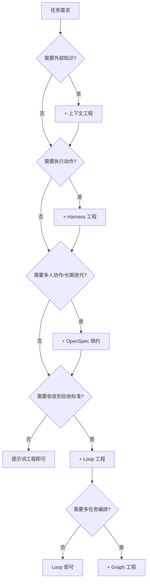

## 引子：被问题逼出来的范式

2017 年 Transformer 论文发表，2020 年 GPT-3 把"用大模型"简化成往 API 丢一句话。六年过去，一个生产级 Agent 系统背后可能叠了十几层工程：检索、记忆、工具、权限、评估、编排。每加一层都不是因为工程师喜欢复杂，而是上一层解决不了的问题逼出来的。

这种"被问题逼出来的可复用解法"，软件工程里有个现成名字——设计模式。1994 年 GoF 那本书把模式定义为一组"力"（forces）的平衡方案：每个模式解决一类问题，带来收益的同时制造新的张力，张力积累到临界点，下一个模式就被催生出来。

AI 应用工程的演进也是这个路子。本文把过去六年的工程范式迭代拆成六层：

每个范式用"模式卡片"呈现，包含意图、动机、方案结构、实践案例、瓶颈与升级信号。六层之间不是替代关系，是叠加关系——后面会展开。先后是大致顺序，彼此有重叠交叉。年份特意没标。Harness 这层最典型：实践雏形 2023 年就有了（AutoGPT、OpenAI function calling 那一波），但"agent harness"作为通用叫法，是 2024-2025 年才流行开的——同一个范式，两个年份都能自圆其说，标哪个都失真。上下文工程同理：RAG 论文 2020 年就发了，"context engineering"这个词却 2024 年底才开始叫开。所以图里只保留顺序。

---

## 范式一：提示词工程

> **模式卡片**
> - **意图**：用自然语言精确对齐模型输出与任务目标，在单次调用内最大化成功率。
> - **别名**：Prompt Engineering、指令工程
> - **经典对照**：Strategy 模式——封装可替换的"策略"（prompt），同一接口下产出不同行为。

### 动机

GPT-3 在 2020 年证明了一件事：同一个模型，换一种问法，输出质量天差地别。"Few-Shot Learning"（Brown et al., 2020, [arXiv:2005.14165](https://arxiv.org/abs/2005.14165) [Kimi解读](http://kimi.com/_prefill_chat?prefill_prompt=%E6%88%91%E4%BB%AC%E8%A6%81%E8%AE%A8%E8%AE%BA%E7%9A%84%E8%AE%BA%E6%96%87%E6%98%AF2005.14165%EF%BC%8C%E9%93%BE%E6%8E%A5%E6%98%AF%20https%3A//arxiv.org/pdf/2005.14165%20%EF%BC%8C%E5%B7%B2%E6%9C%89%E7%9A%84FAQ%E9%93%BE%E6%8E%A5%E6%98%AF%20https%3A//papers.cool/arxiv/kimi%3Fpaper%3D2005.14165%20%E3%80%82%E8%AF%B7%E4%BB%A5%E6%AD%A4%E4%B8%BA%E5%9F%BA%E7%A1%80%EF%BC%8C%E7%BB%A7%E7%BB%AD%E5%9B%9E%E7%AD%94%E6%88%91%E5%90%8E%E9%9D%A2%E7%9A%84%E9%97%AE%E9%A2%98%E3%80%82&system_prompt=%E4%BD%A0%E6%98%AF%E4%B8%80%E4%B8%AA%E5%AD%A6%E6%9C%AF%E5%8A%A9%E6%89%8B%EF%BC%8C%E5%90%8E%E9%9D%A2%E7%9A%84%E5%AF%B9%E8%AF%9D%E5%B0%86%E5%9B%B4%E7%BB%95%E7%9D%80%E4%BB%A5%E4%B8%8B%E8%AE%BA%E6%96%87%E5%86%85%E5%AE%B9%E8%BF%9B%E8%A1%8C%EF%BC%8C%E5%B7%B2%E7%BB%8F%E9%80%9A%E8%BF%87%E9%93%BE%E6%8E%A5%E7%BB%99%E5%87%BA%E4%BA%86%E8%AE%BA%E6%96%87%E7%9A%84PDF%E5%92%8C%E8%AE%BA%E6%96%87%E5%B7%B2%E6%9C%89%E7%9A%84FAQ%E3%80%82%E7%94%A8%E6%88%B7%E5%B0%86%E7%BB%A7%E7%BB%AD%E5%90%91%E4%BD%A0%E5%92%A8%E8%AF%A2%E8%AE%BA%E6%96%87%E7%9A%84%E7%9B%B8%E5%85%B3%E9%97%AE%E9%A2%98%EF%BC%8C%E8%AF%B7%E4%BD%A0%E4%BD%9C%E5%87%BA%E4%B8%93%E4%B8%9A%E7%9A%84%E5%9B%9E%E7%AD%94%EF%BC%8C%E4%B8%8D%E8%A6%81%E5%87%BA%E7%8E%B0%E7%AC%AC%E4%B8%80%E4%BA%BA%E7%A7%B0%EF%BC%8C%E5%BD%93%E6%B6%89%E5%8F%8A%E5%88%B0%E5%88%86%E7%82%B9%E5%9B%9E%E7%AD%94%E6%97%B6%EF%BC%8C%E9%BC%93%E5%8A%B1%E4%BD%A0%E4%BB%A5markdown%E6%A0%BC%E5%BC%8F%E8%BE%93%E5%87%BA%E3%80%82&send_immediately=true)）这篇论文本身就是提示词工程的起点——你不用微调权重，只要在输入里塞几个例子，模型就能做翻译、做摘要、做代码生成。

但"换一种问法"很快暴露出问题。同样一个客服意图分类任务，prompt 写"判断用户意图"，准确率 62%；改成"你是客服专家，根据以下规则分类……"加上三个 few-shot 例子和 JSON 输出约束，准确率到 87%。再往后，你开始往 prompt 里加"think step by step"（CoT, Wei et al., 2022, [arXiv:2201.11903](https://arxiv.org/abs/2201.11903) [Kimi解读](http://kimi.com/_prefill_chat?prefill_prompt=%E6%88%91%E4%BB%AC%E8%A6%81%E8%AE%A8%E8%AE%BA%E7%9A%84%E8%AE%BA%E6%96%87%E6%98%AF2201.11903%EF%BC%8C%E9%93%BE%E6%8E%A5%E6%98%AF%20https%3A//arxiv.org/pdf/2201.11903%20%EF%BC%8C%E5%B7%B2%E6%9C%89%E7%9A%84FAQ%E9%93%BE%E6%8E%A5%E6%98%AF%20https%3A//papers.cool/arxiv/kimi%3Fpaper%3D2201.11903%20%E3%80%82%E8%AF%B7%E4%BB%A5%E6%AD%A4%E4%B8%BA%E5%9F%BA%E7%A1%80%EF%BC%8C%E7%BB%A7%E7%BB%AD%E5%9B%9E%E7%AD%94%E6%88%91%E5%90%8E%E9%9D%A2%E7%9A%84%E9%97%AE%E9%A2%98%E3%80%82&system_prompt=%E4%BD%A0%E6%98%AF%E4%B8%80%E4%B8%AA%E5%AD%A6%E6%9C%AF%E5%8A%A9%E6%89%8B%EF%BC%8C%E5%90%8E%E9%9D%A2%E7%9A%84%E5%AF%B9%E8%AF%9D%E5%B0%86%E5%9B%B4%E7%BB%95%E7%9D%80%E4%BB%A5%E4%B8%8B%E8%AE%BA%E6%96%87%E5%86%85%E5%AE%B9%E8%BF%9B%E8%A1%8C%EF%BC%8C%E5%B7%B2%E7%BB%8F%E9%80%9A%E8%BF%87%E9%93%BE%E6%8E%A5%E7%BB%99%E5%87%BA%E4%BA%86%E8%AE%BA%E6%96%87%E7%9A%84PDF%E5%92%8C%E8%AE%BA%E6%96%87%E5%B7%B2%E6%9C%89%E7%9A%84FAQ%E3%80%82%E7%94%A8%E6%88%B7%E5%B0%86%E7%BB%A7%E7%BB%AD%E5%90%91%E4%BD%A0%E5%92%A8%E8%AF%A2%E8%AE%BA%E6%96%87%E7%9A%84%E7%9B%B8%E5%85%B3%E9%97%AE%E9%A2%98%EF%BC%8C%E8%AF%B7%E4%BD%A0%E4%BD%9C%E5%87%BA%E4%B8%93%E4%B8%9A%E7%9A%84%E5%9B%9E%E7%AD%94%EF%BC%8C%E4%B8%8D%E8%A6%81%E5%87%BA%E7%8E%B0%E7%AC%AC%E4%B8%80%E4%BA%BA%E7%A7%B0%EF%BC%8C%E5%BD%93%E6%B6%89%E5%8F%8A%E5%88%B0%E5%88%86%E7%82%B9%E5%9B%9E%E7%AD%94%E6%97%B6%EF%BC%8C%E9%BC%93%E5%8A%B1%E4%BD%A0%E4%BB%A5markdown%E6%A0%BC%E5%BC%8F%E8%BE%93%E5%87%BA%E3%80%82&send_immediately=true)），让模型先把推理过程写出来，数学题正确率又涨一截。Self-Consistency（Wang et al., 2022, [arXiv:2203.11171](https://arxiv.org/abs/2203.11171) [Kimi解读](http://kimi.com/_prefill_chat?prefill_prompt=%E6%88%91%E4%BB%AC%E8%A6%81%E8%AE%A8%E8%AE%BA%E7%9A%84%E8%AE%BA%E6%96%87%E6%98%AF2203.11171%EF%BC%8C%E9%93%BE%E6%8E%A5%E6%98%AF%20https%3A//arxiv.org/pdf/2203.11171%20%EF%BC%8C%E5%B7%B2%E6%9C%89%E7%9A%84FAQ%E9%93%BE%E6%8E%A5%E6%98%AF%20https%3A//papers.cool/arxiv/kimi%3Fpaper%3D2203.11171%20%E3%80%82%E8%AF%B7%E4%BB%A5%E6%AD%A4%E4%B8%BA%E5%9F%BA%E7%A1%80%EF%BC%8C%E7%BB%A7%E7%BB%AD%E5%9B%9E%E7%AD%94%E6%88%91%E5%90%8E%E9%9D%A2%E7%9A%84%E9%97%AE%E9%A2%98%E3%80%82&system_prompt=%E4%BD%A0%E6%98%AF%E4%B8%80%E4%B8%AA%E5%AD%A6%E6%9C%AF%E5%8A%A9%E6%89%8B%EF%BC%8C%E5%90%8E%E9%9D%A2%E7%9A%84%E5%AF%B9%E8%AF%9D%E5%B0%86%E5%9B%B4%E7%BB%95%E7%9D%80%E4%BB%A5%E4%B8%8B%E8%AE%BA%E6%96%87%E5%86%85%E5%AE%B9%E8%BF%9B%E8%A1%8C%EF%BC%8C%E5%B7%B2%E7%BB%8F%E9%80%9A%E8%BF%87%E9%93%BE%E6%8E%A5%E7%BB%99%E5%87%BA%E4%BA%86%E8%AE%BA%E6%96%87%E7%9A%84PDF%E5%92%8C%E8%AE%BA%E6%96%87%E5%B7%B2%E6%9C%89%E7%9A%84FAQ%E3%80%82%E7%94%A8%E6%88%B7%E5%B0%86%E7%BB%A7%E7%BB%AD%E5%90%91%E4%BD%A0%E5%92%A8%E8%AF%A2%E8%AE%BA%E6%96%87%E7%9A%84%E7%9B%B8%E5%85%B3%E9%97%AE%E9%A2%98%EF%BC%8C%E8%AF%B7%E4%BD%A0%E4%BD%9C%E5%87%BA%E4%B8%93%E4%B8%9A%E7%9A%84%E5%9B%9E%E7%AD%94%EF%BC%8C%E4%B8%8D%E8%A6%81%E5%87%BA%E7%8E%B0%E7%AC%AC%E4%B8%80%E4%BA%BA%E7%A7%B0%EF%BC%8C%E5%BD%93%E6%B6%89%E5%8F%8A%E5%88%B0%E5%88%86%E7%82%B9%E5%9B%9E%E7%AD%94%E6%97%B6%EF%BC%8C%E9%BC%93%E5%8A%B1%E4%BD%A0%E4%BB%A5markdown%E6%A0%BC%E5%BC%8F%E8%BE%93%E5%87%BA%E3%80%82&send_immediately=true)）让模型采样多条推理路径再投票，再涨一截。

这些技巧本质上都在做同一件事：在不改变模型权重的前提下，通过精炼指令来对齐输出。

### 力与张力

- **表达力 vs 鲁棒性**：prompt 越精细，特定 case 越准，但也越脆——换个说法就崩。
- **特化 vs 泛化**：为 A 任务调好的 prompt，B 任务上可能灾难。
- **信息量 vs 窗口**：few-shot 例子越多越准，但上下文窗口是有限的。

### 方案结构

一个工业级 prompt 通常包含六层：角色设定、任务描述、约束条件、few-shot 示例、输出格式定义、防御性指令（如拒绝越界请求）。ReAct（Yao et al., 2022, [arXiv:2210.03629](https://arxiv.org/abs/2210.03629) [Kimi解读](http://kimi.com/_prefill_chat?prefill_prompt=%E6%88%91%E4%BB%AC%E8%A6%81%E8%AE%A8%E8%AE%BA%E7%9A%84%E8%AE%BA%E6%96%87%E6%98%AF2210.03629%EF%BC%8C%E9%93%BE%E6%8E%A5%E6%98%AF%20https%3A//arxiv.org/pdf/2210.03629%20%EF%BC%8C%E5%B7%B2%E6%9C%89%E7%9A%84FAQ%E9%93%BE%E6%8E%A5%E6%98%AF%20https%3A//papers.cool/arxiv/kimi%3Fpaper%3D2210.03629%20%E3%80%82%E8%AF%B7%E4%BB%A5%E6%AD%A4%E4%B8%BA%E5%9F%BA%E7%A1%80%EF%BC%8C%E7%BB%A7%E7%BB%AD%E5%9B%9E%E7%AD%94%E6%88%91%E5%90%8E%E9%9D%A2%E7%9A%84%E9%97%AE%E9%A2%98%E3%80%82&system_prompt=%E4%BD%A0%E6%98%AF%E4%B8%80%E4%B8%AA%E5%AD%A6%E6%9C%AF%E5%8A%A9%E6%89%8B%EF%BC%8C%E5%90%8E%E9%9D%A2%E7%9A%84%E5%AF%B9%E8%AF%9D%E5%B0%86%E5%9B%B4%E7%BB%95%E7%9D%80%E4%BB%A5%E4%B8%8B%E8%AE%BA%E6%96%87%E5%86%85%E5%AE%B9%E8%BF%9B%E8%A1%8C%EF%BC%8C%E5%B7%B2%E7%BB%8F%E9%80%9A%E8%BF%87%E9%93%BE%E6%8E%A5%E7%BB%99%E5%87%BA%E4%BA%86%E8%AE%BA%E6%96%87%E7%9A%84PDF%E5%92%8C%E8%AE%BA%E6%96%87%E5%B7%B2%E6%9C%89%E7%9A%84FAQ%E3%80%82%E7%94%A8%E6%88%B7%E5%B0%86%E7%BB%A7%E7%BB%AD%E5%90%91%E4%BD%A0%E5%92%A8%E8%AF%A2%E8%AE%BA%E6%96%87%E7%9A%84%E7%9B%B8%E5%85%B3%E9%97%AE%E9%A2%98%EF%BC%8C%E8%AF%B7%E4%BD%A0%E4%BD%9C%E5%87%BA%E4%B8%93%E4%B8%9A%E7%9A%84%E5%9B%9E%E7%AD%94%EF%BC%8C%E4%B8%8D%E8%A6%81%E5%87%BA%E7%8E%B0%E7%AC%AC%E4%B8%80%E4%BA%BA%E7%A7%B0%EF%BC%8C%E5%BD%93%E6%B6%89%E5%8F%8A%E5%88%B0%E5%88%86%E7%82%B9%E5%9B%9E%E7%AD%94%E6%97%B6%EF%BC%8C%E9%BC%93%E5%8A%B1%E4%BD%A0%E4%BB%A5markdown%E6%A0%BC%E5%BC%8F%E8%BE%93%E5%87%BA%E3%80%82&send_immediately=true)）把"推理"和"行动"交错写进 prompt，让模型在一步里既思考又决策，是提示词工程的天花板之作。

### 实践案例

我曾经给一个电商客服系统调意图分类。最初的 prompt 就一句话："判断用户消息属于哪个类别。" 测试集准确率 62%。迭代过程：

1. 加角色和规则 → 71%
2. 加 3 个 few-shot 例子 → 79%
3. 加输出 JSON schema 和拒绝条件 → 84%
4. 加 CoT（"先提取关键词，再判断"）→ 87%

但上线两周后坏样本分析发现，87% 里的错误集中在"商品知识"类——模型不知道新品的参数。这不是 prompt 能修的问题了。

### 瓶颈与升级信号

提示词工程的天花板不是写不出更好的 prompt，而是三个结构性矛盾：

1. **知识截止与幻觉**：模型的参数知识是静态的，prompt 塞不进动态知识。
2. **无状态**：每次调用从零开始，多轮对话的上下文要么塞进 prompt（撑爆窗口），要么丢弃（丢失信息）。
3. **脆弱性**：措辞微调可能导致表现剧变。Liu et al.（2023, [arXiv:2307.03172](https://arxiv.org/abs/2307.03172) [Kimi解读](http://kimi.com/_prefill_chat?prefill_prompt=%E6%88%91%E4%BB%AC%E8%A6%81%E8%AE%A8%E8%AE%BA%E7%9A%84%E8%AE%BA%E6%96%87%E6%98%AF2307.03172%EF%BC%8C%E9%93%BE%E6%8E%A5%E6%98%AF%20https%3A//arxiv.org/pdf/2307.03172%20%EF%BC%8C%E5%B7%B2%E6%9C%89%E7%9A%84FAQ%E9%93%BE%E6%8E%A5%E6%98%AF%20https%3A//papers.cool/arxiv/kimi%3Fpaper%3D2307.03172%20%E3%80%82%E8%AF%B7%E4%BB%A5%E6%AD%A4%E4%B8%BA%E5%9F%BA%E7%A1%80%EF%BC%8C%E7%BB%A7%E7%BB%AD%E5%9B%9E%E7%AD%94%E6%88%91%E5%90%8E%E9%9D%A2%E7%9A%84%E9%97%AE%E9%A2%98%E3%80%82&system_prompt=%E4%BD%A0%E6%98%AF%E4%B8%80%E4%B8%AA%E5%AD%A6%E6%9C%AF%E5%8A%A9%E6%89%8B%EF%BC%8C%E5%90%8E%E9%9D%A2%E7%9A%84%E5%AF%B9%E8%AF%9D%E5%B0%86%E5%9B%B4%E7%BB%95%E7%9D%80%E4%BB%A5%E4%B8%8B%E8%AE%BA%E6%96%87%E5%86%85%E5%AE%B9%E8%BF%9B%E8%A1%8C%EF%BC%8C%E5%B7%B2%E7%BB%8F%E9%80%9A%E8%BF%87%E9%93%BE%E6%8E%A5%E7%BB%99%E5%87%BA%E4%BA%86%E8%AE%BA%E6%96%87%E7%9A%84PDF%E5%92%8C%E8%AE%BA%E6%96%87%E5%B7%B2%E6%9C%89%E7%9A%84FAQ%E3%80%82%E7%94%A8%E6%88%B7%E5%B0%86%E7%BB%A7%E7%BB%AD%E5%90%91%E4%BD%A0%E5%92%A8%E8%AF%A2%E8%AE%BA%E6%96%87%E7%9A%84%E7%9B%B8%E5%85%B3%E9%97%AE%E9%A2%98%EF%BC%8C%E8%AF%B7%E4%BD%A0%E4%BD%9C%E5%87%BA%E4%B8%93%E4%B8%9A%E7%9A%84%E5%9B%9E%E7%AD%94%EF%BC%8C%E4%B8%8D%E8%A6%81%E5%87%BA%E7%8E%B0%E7%AC%AC%E4%B8%80%E4%BA%BA%E7%A7%B0%EF%BC%8C%E5%BD%93%E6%B6%89%E5%8F%8A%E5%88%B0%E5%88%86%E7%82%B9%E5%9B%9E%E7%AD%94%E6%97%B6%EF%BC%8C%E9%BC%93%E5%8A%B1%E4%BD%A0%E4%BB%A5markdown%E6%A0%BC%E5%BC%8F%E8%BE%93%E5%87%BA%E3%80%82&send_immediately=true)）发现关键信息放在上下文中间时，模型注意率显著下降——"Lost in the Middle"。

**升级信号**：prompt 膨胀到 2000 tokens 以上；同一份 prompt 复制到多个项目里各自漂移；模型"不知道"需要外部知识。这时候，你需要的不是更好的 prompt，而是上下文工程。

---

## 范式二：上下文工程

> **模式卡片**
> - **意图**：在每次调用前，动态组装"此刻最相关"的信息，使有限窗口承载最大信息密度。
> - **别名**：Context Engineering、RAG、记忆工程
> - **经典对照**：Decorator / Proxy 模式——在不改核心接口的前提下，动态附加信息层。

### 动机

提示词工程解决不了"模型不知道"的问题。最直觉的方案是把知识塞进上下文窗口，但窗口有限、模型注意力会稀释。RAG（Lewis et al., 2020, [arXiv:2005.11401](https://arxiv.org/abs/2005.11401) [Kimi解读](http://kimi.com/_prefill_chat?prefill_prompt=%E6%88%91%E4%BB%AC%E8%A6%81%E8%AE%A8%E8%AE%BA%E7%9A%84%E8%AE%BA%E6%96%87%E6%98%AF2005.11401%EF%BC%8C%E9%93%BE%E6%8E%A5%E6%98%AF%20https%3A//arxiv.org/pdf/2005.11401%20%EF%BC%8C%E5%B7%B2%E6%9C%89%E7%9A%84FAQ%E9%93%BE%E6%8E%A5%E6%98%AF%20https%3A//papers.cool/arxiv/kimi%3Fpaper%3D2005.11401%20%E3%80%82%E8%AF%B7%E4%BB%A5%E6%AD%A4%E4%B8%BA%E5%9F%BA%E7%A1%80%EF%BC%8C%E7%BB%A7%E7%BB%AD%E5%9B%9E%E7%AD%94%E6%88%91%E5%90%8E%E9%9D%A2%E7%9A%84%E9%97%AE%E9%A2%98%E3%80%82&system_prompt=%E4%BD%A0%E6%98%AF%E4%B8%80%E4%B8%AA%E5%AD%A6%E6%9C%AF%E5%8A%A9%E6%89%8B%EF%BC%8C%E5%90%8E%E9%9D%A2%E7%9A%84%E5%AF%B9%E8%AF%9D%E5%B0%86%E5%9B%B4%E7%BB%95%E7%9D%80%E4%BB%A5%E4%B8%8B%E8%AE%BA%E6%96%87%E5%86%85%E5%AE%B9%E8%BF%9B%E8%A1%8C%EF%BC%8C%E5%B7%B2%E7%BB%8F%E9%80%9A%E8%BF%87%E9%93%BE%E6%8E%A5%E7%BB%99%E5%87%BA%E4%BA%86%E8%AE%BA%E6%96%87%E7%9A%84PDF%E5%92%8C%E8%AE%BA%E6%96%87%E5%B7%B2%E6%9C%89%E7%9A%84FAQ%E3%80%82%E7%94%A8%E6%88%B7%E5%B0%86%E7%BB%A7%E7%BB%AD%E5%90%91%E4%BD%A0%E5%92%A8%E8%AF%A2%E8%AE%BA%E6%96%87%E7%9A%84%E7%9B%B8%E5%85%B3%E9%97%AE%E9%A2%98%EF%BC%8C%E8%AF%B7%E4%BD%A0%E4%BD%9C%E5%87%BA%E4%B8%93%E4%B8%9A%E7%9A%84%E5%9B%9E%E7%AD%94%EF%BC%8C%E4%B8%8D%E8%A6%81%E5%87%BA%E7%8E%B0%E7%AC%AC%E4%B8%80%E4%BA%BA%E7%A7%B0%EF%BC%8C%E5%BD%93%E6%B6%89%E5%8F%8A%E5%88%B0%E5%88%86%E7%82%B9%E5%9B%9E%E7%AD%94%E6%97%B6%EF%BC%8C%E9%BC%93%E5%8A%B1%E4%BD%A0%E4%BB%A5markdown%E6%A0%BC%E5%BC%8F%E8%BE%93%E5%87%BA%E3%80%82&send_immediately=true)）的解法是：先检索相关文档片段，再把片段拼进 prompt。这把"模型知道什么"从训练阶段挪到了推理阶段。

但 RAG 只是上下文工程的一个子集。真正的问题是：每次调用时，模型需要的不只是知识——还有对话历史、用户画像、工具返回值、任务状态。MemGPT（Packer et al., 2023, [arXiv:2310.08560](https://arxiv.org/abs/2310.08560) [Kimi解读](http://kimi.com/_prefill_chat?prefill_prompt=%E6%88%91%E4%BB%AC%E8%A6%81%E8%AE%A8%E8%AE%BA%E7%9A%84%E8%AE%BA%E6%96%87%E6%98%AF2310.08560%EF%BC%8C%E9%93%BE%E6%8E%A5%E6%98%AF%20https%3A//arxiv.org/pdf/2310.08560%20%EF%BC%8C%E5%B7%B2%E6%9C%89%E7%9A%84FAQ%E9%93%BE%E6%8E%A5%E6%98%AF%20https%3A//papers.cool/arxiv/kimi%3Fpaper%3D2310.08560%20%E3%80%82%E8%AF%B7%E4%BB%A5%E6%AD%A4%E4%B8%BA%E5%9F%BA%E7%A1%80%EF%BC%8C%E7%BB%A7%E7%BB%AD%E5%9B%9E%E7%AD%94%E6%88%91%E5%90%8E%E9%9D%A2%E7%9A%84%E9%97%AE%E9%A2%98%E3%80%82&system_prompt=%E4%BD%A0%E6%98%AF%E4%B8%80%E4%B8%AA%E5%AD%A6%E6%9C%AF%E5%8A%A9%E6%89%8B%EF%BC%8C%E5%90%8E%E9%9D%A2%E7%9A%84%E5%AF%B9%E8%AF%9D%E5%B0%86%E5%9B%B4%E7%BB%95%E7%9D%80%E4%BB%A5%E4%B8%8B%E8%AE%BA%E6%96%87%E5%86%85%E5%AE%B9%E8%BF%9B%E8%A1%8C%EF%BC%8C%E5%B7%B2%E7%BB%8F%E9%80%9A%E8%BF%87%E9%93%BE%E6%8E%A5%E7%BB%99%E5%87%BA%E4%BA%86%E8%AE%BA%E6%96%87%E7%9A%84PDF%E5%92%8C%E8%AE%BA%E6%96%87%E5%B7%B2%E6%9C%89%E7%9A%84FAQ%E3%80%82%E7%94%A8%E6%88%B7%E5%B0%86%E7%BB%A7%E7%BB%AD%E5%90%91%E4%BD%A0%E5%92%A8%E8%AF%A2%E8%AE%BA%E6%96%87%E7%9A%84%E7%9B%B8%E5%85%B3%E9%97%AE%E9%A2%98%EF%BC%8C%E8%AF%B7%E4%BD%A0%E4%BD%9C%E5%87%BA%E4%B8%93%E4%B8%9A%E7%9A%84%E5%9B%9E%E7%AD%94%EF%BC%8C%E4%B8%8D%E8%A6%81%E5%87%BA%E7%8E%B0%E7%AC%AC%E4%B8%80%E4%BA%BA%E7%A7%B0%EF%BC%8C%E5%BD%93%E6%B6%89%E5%8F%8A%E5%88%B0%E5%88%86%E7%82%B9%E5%9B%9E%E7%AD%94%E6%97%B6%EF%BC%8C%E9%BC%93%E5%8A%B1%E4%BD%A0%E4%BB%A5markdown%E6%A0%BC%E5%BC%8F%E8%BE%93%E5%87%BA%E3%80%82&send_immediately=true)）借操作系统的虚拟内存概念，把记忆分成主存（工作记忆）和外存（长期记忆），通过页面置换策略在有限窗口里管理超长对话。

2025 年 Manus 团队发表的 Context Engineering 文章把这套思想推到了实践层面：用文件系统作为外部记忆、todo.md 作为任务状态的"显式寄存器"、KV-cache 命中率作为工程指标。

### 力与张力

- **召回 vs 精确**：检索多了噪声大，检索少了漏关键信息。
- **新鲜 vs 稳定**：实时数据提升准确性，但引入不一致。
- **密度 vs 成本**：上下文越长越贵，且超过一定长度后质量反而下降。

### 方案结构

一个完整的上下文工程流水线：

1. **检索层**：混合检索（向量 + BM25），从知识库、对话历史、用户画像中拉候选。
2. **重排层**：用 cross-encoder 或 LLM 对候选打分排序。
3. **压缩层**：摘要、折叠、去重，把候选压缩到窗口预算内。
4. **记忆层**：工作记忆（当前对话）、情景记忆（历史交互）、语义记忆（知识库）、程序性记忆（技能/how-to）。
5. **注入层**：按优先级和位置策略把信息填进 prompt 模板。

### 实践案例

一个企业知识库问答项目，RAG 上线后幻觉率下降 40%，但"检索到了却答错"的 case 占 30%。排查发现：检索 top-20 片段里，关键信息排在第 15 位，模型在 8k 窗口里已经"看不到"它了。加了 cross-encoder 重排 + 按主题分段后，关键信息平均升到 top-5，"检索到了答错"降到 12%。

多轮对话的记忆问题更隐蔽。一个 Agent 跑了 30 轮对话后开始"失忆"——前 5 轮约定的事实被遗忘。借鉴 MemGPT 的分层记忆：把超过 10 轮的对话摘要存入外存，只在相关时检索回来，工作记忆只保留最近 5 轮 + 检索到的摘要。这样既不爆窗口，也不丢长程信息。

### 瓶颈与升级信号

上下文工程的瓶颈是四重叠加：

1. **垃圾进垃圾出**：检索质量的上限是知识库质量。文档烂，检索再准也没用。
2. **中间遗忘**：即便重排了，超长上下文仍会让模型遗漏中间信息。
3. **成本线性增长**：每次调用的 token 数随上下文膨胀，月账单很快失控。
4. **记忆污染**：错误信息一旦写入记忆层，会被反复检索，形成"幻觉传播"。

**升级信号**：上下文组装逻辑比模型调用本身还复杂；模型有了正确信息仍然做不对事（因为不会执行）；需要操作外部系统。这时候，上下文工程不够了，你需要一个运行时——Harness。

---

## 范式三：Harness 工程

> **模式卡片**
> - **意图**：把模型包进一个可执行、可观测、可回滚的运行时——工具、环境、权限、重试、评估一体。
> - **别名**：Agent Runtime、Agent Scaffold、Agent-Computer Interface
> - **经典对照**：Facade + Template Method 模式——Facade 隐藏复杂子系统，Template Method 定义执行骨架。

### 动机

模型会说不会做。你让它"查一下数据库里昨天的订单量"，它生成的 SQL 可能有语法错误、可能查错表、可能忘了加时间过滤。上下文工程给了模型"知识"，但没有给模型"手脚"。

Harness 就是给模型装手脚的那层工程。它不是某一种框架，而是一组运行时能力的统称：工具调用、沙箱执行、权限控制、错误重试、链路追踪、评估回归。SWE-agent（Yang et al., 2024, [arXiv:2405.15793](https://arxiv.org/abs/2405.15793) [Kimi解读](http://kimi.com/_prefill_chat?prefill_prompt=%E6%88%91%E4%BB%AC%E8%A6%81%E8%AE%A8%E8%AE%BA%E7%9A%84%E8%AE%BA%E6%96%87%E6%98%AF2405.15793%EF%BC%8C%E9%93%BE%E6%8E%A5%E6%98%AF%20https%3A//arxiv.org/pdf/2405.15793%20%EF%BC%8C%E5%B7%B2%E6%9C%89%E7%9A%84FAQ%E9%93%BE%E6%8E%A5%E6%98%AF%20https%3A//papers.cool/arxiv/kimi%3Fpaper%3D2405.15793%20%E3%80%82%E8%AF%B7%E4%BB%A5%E6%AD%A4%E4%B8%BA%E5%9F%BA%E7%A1%80%EF%BC%8C%E7%BB%A7%E7%BB%AD%E5%9B%9E%E7%AD%94%E6%88%91%E5%90%8E%E9%9D%A2%E7%9A%84%E9%97%AE%E9%A2%98%E3%80%82&system_prompt=%E4%BD%A0%E6%98%AF%E4%B8%80%E4%B8%AA%E5%AD%A6%E6%9C%AF%E5%8A%A9%E6%89%8B%EF%BC%8C%E5%90%8E%E9%9D%A2%E7%9A%84%E5%AF%B9%E8%AF%9D%E5%B0%86%E5%9B%B4%E7%BB%95%E7%9D%80%E4%BB%A5%E4%B8%8B%E8%AE%BA%E6%96%87%E5%86%85%E5%AE%B9%E8%BF%9B%E8%A1%8C%EF%BC%8C%E5%B7%B2%E7%BB%8F%E9%80%9A%E8%BF%87%E9%93%BE%E6%8E%A5%E7%BB%99%E5%87%BA%E4%BA%86%E8%AE%BA%E6%96%87%E7%9A%84PDF%E5%92%8C%E8%AE%BA%E6%96%87%E5%B7%B2%E6%9C%89%E7%9A%84FAQ%E3%80%82%E7%94%A8%E6%88%B7%E5%B0%86%E7%BB%A7%E7%BB%AD%E5%90%91%E4%BD%A0%E5%92%A8%E8%AF%A2%E8%AE%BA%E6%96%87%E7%9A%84%E7%9B%B8%E5%85%B3%E9%97%AE%E9%A2%98%EF%BC%8C%E8%AF%B7%E4%BD%A0%E4%BD%9C%E5%87%BA%E4%B8%93%E4%B8%9A%E7%9A%84%E5%9B%9E%E7%AD%94%EF%BC%8C%E4%B8%8D%E8%A6%81%E5%87%BA%E7%8E%B0%E7%AC%AC%E4%B8%80%E4%BA%BA%E7%A7%B0%EF%BC%8C%E5%BD%93%E6%B6%89%E5%8F%8A%E5%88%B0%E5%88%86%E7%82%B9%E5%9B%9E%E7%AD%94%E6%97%B6%EF%BC%8C%E9%BC%93%E5%8A%B1%E4%BD%A0%E4%BB%A5markdown%E6%A0%BC%E5%BC%8F%E8%BE%93%E5%87%BA%E3%80%82&send_immediately=true)）提出了 Agent-Computer Interface（ACI）的概念，关键发现是：工具接口的设计质量直接决定 agent 的任务成功率。同样是让 agent 操作文件系统，ACI 设计得好和差，成功率能差 20 个百分点。

MCP（Model Context Protocol, Anthropic 2024）把工具接入标准化了——类似 USB 协议之于硬件，MCP 让工具不再每个 agent 重写一遍适配。OpenClaw 的 Skills 系统就是 MCP 思想的实践：把"出图表""发邮件""查天气"这类能力封装成可插拔的 skill，agent 按需加载。

### 方案结构

一个 Harness 运行时的典型组件：

- **模型内核**：LLM 调用层，负责推理和生成。
- **工具层**：函数调用 / MCP / 自定义工具，负责与外部世界交互。
- **沙箱环境**：文件系统、浏览器、代码执行环境，隔离风险。
- **安全门**：权限矩阵、人工审批、操作审计，防止越界。
- **观测层**：trace 日志、token 消耗、延迟监控。
- **评估层**：eval harness，回归测试，持续度量 agent 质量。

### 实践案例

我自己天天在用的 OpenClaw 就是一个 Harness。它的 Skills 系统让我可以把"生成图表"封装成一个 skill：agent 检测到"画个流程图"就自动加载 archify skill，不需要每次在 prompt 里教它怎么画。权限门拦截高风险操作——删文件要确认，发邮件要审核。心跳监控定期检查服务状态，出了问题自动修。

另一个例子是我之前写过的"让你的 Agent 交付图表"——核心观点是：不要指望模型每次都从零生成正确的图表代码，而是把出图能力固化进 harness 的 skill 层，让模型调用而不是生成。这把图表交付的成功率从"看运气"提到"几乎稳定"。

### 瓶颈与升级信号

Harness 工程的瓶颈不在技术，在协作：

1. **工具描述质量**：模型靠工具描述决定怎么用工具，描述差=用错。这是隐形的大坑。
2. **错误级联**：一个工具调用失败，后续步骤全乱。错误传播比单步错误更致命。
3. **间接注入**：工具返回值里藏着恶意指令，模型可能被执行。这是安全面的新维度。
4. **行为漂移**：多人开发时，每个人对 harness 的改动可能破坏其他人的链路。口头约定撑不住。

**升级信号**：多人协作时 harness 行为频繁漂移；需求口头化导致大量返工；agent 做出来的东西"能跑但不是我要的"。这说明缺少的不是工具，是契约——下一层，OpenSpec 规约。

---

## 范式四：OpenSpec 规约

> **模式卡片**
> - **意图**：用版本化、机器可读的规约冻结"意图与验收标准"，让人和 agent 在同一契约下工作。
> - **别名**：Spec-Driven Development、SDD、契约先行
> - **经典对照**：Contract / Interface 模式——Meyer 的契约式设计（DbC），前置条件、后置条件、不变量。

### 动机

Harness 解决了"能做"的问题，没解决"做什么"的问题。三个工程师和一个 agent 协作开发一个功能，prompt 写"加一个用户认证"。agent 交付了 OAuth2，lead 说我要的是 session-based。返工。

这不是技术问题，是需求对齐问题。提示词和聊天记录不是合格的需求载体——它们是模糊的、无版本的、不可自动验证的。2025 年，spec-driven development 兴起：GitHub Spec Kit、OpenSpec、AWS Kiro 都在推同一套理念——先写规约，再写代码。规约是版本化的、机器可读的、带验收标准的。agent 实现完，自动跑验收测试，过了才算完成。

这跟软件工程里的测试先行（TDD）一脉相承，只是"测试"从代码层面上升到了需求层面。契约式设计（Design by Contract, Meyer 1986）提出每个函数有前置条件、后置条件和不变量。OpenSpec 把这个思想搬到了 agent 时代：spec 就是 agent 的契约，验收标准就是后置条件。

### 方案结构

一个 spec-driven 工作流：

1. **Change Proposal**：写动机、方案、影响范围。
2. **Spec Delta**：定义规约变更——新增什么、修改什么、验收标准（Given/When/Then）。
3. **Tasks**：从 spec 拆出可执行任务列表。
4. **Implementation**：agent 按 tasks 实现，每完成一项跑验收。
5. **Archive**：验收通过后，spec 归档为下一个版本的基础。

规约分层：能力 spec（做什么）→ 技术 spec（怎么做）→ 任务 spec（分几步做）。上层稳定，下层可变。

### 实践案例

我在自己的 GSD（Get Stuff Done）工作流里用 spec-driven 方式跑了几个月。`.planning/` 目录里每个功能都有一个 change proposal，写清楚动机、方案、验收标准。agent 拿到 spec 后拆 tasks、实现、跑验收。

对比"直接让 agent 写"的模式：有 spec 的任务首次通过率约 78%，无 spec 的约 34%。差距不在 agent 能力，在于"什么算完成"是否定义清楚。没有 spec，agent 的"完成"和人的"完成"经常不是一回事。

### 瓶颈与升级信号

规约不是银弹：

1. **规约腐化**：spec 和实现会漂移。spec 说 A，代码做了 B，没人发现。
2. **过度规约**：小事也写 spec，开发节奏被拖慢。探索性任务不适合 spec-first。
3. **自然语言歧义**：spec 用自然语言写，本身就有解释空间。完全消除歧义需要形式化，但形式化的成本极高。
4. **写 spec 的成本**：好的 spec 需要想清楚，这本身就是难的工程工作。

**升级信号**：单个 spec 能验收了，但任务之间有依赖关系；一个 spec 的实现需要反复试错才能收敛；多个 spec 要并行推进。这说明"一次性实现"不够了，需要循环——下一层，Loop 工程。

---

## 范式五：Loop 工程

> **模式卡片**
> - **意图**：把"一次生成"变成"生成-验证-修复"的收敛循环，用反馈信号驱动系统逼近验收标准。
> - **别名**：Agentic Loop、Self-Refinement、Test-Time Compute
> - **经典对照**：State + Iterator + Retry 模式——状态驱动迭代，Iterator 遍历收敛路径，Retry 处理瞬态失败。

### 动机

一次性生成的好处是快，坏处是不够准。在 SWE-bench（Jimenez et al., 2023, [arXiv:2310.06770](https://arxiv.org/abs/2310.06770) [Kimi解读](http://kimi.com/_prefill_chat?prefill_prompt=%E6%88%91%E4%BB%AC%E8%A6%81%E8%AE%A8%E8%AE%BA%E7%9A%84%E8%AE%BA%E6%96%87%E6%98%AF2310.06770%EF%BC%8C%E9%93%BE%E6%8E%A5%E6%98%AF%20https%3A//arxiv.org/pdf/2310.06770%20%EF%BC%8C%E5%B7%B2%E6%9C%89%E7%9A%84FAQ%E9%93%BE%E6%8E%A5%E6%98%AF%20https%3A//papers.cool/arxiv/kimi%3Fpaper%3D2310.06770%20%E3%80%82%E8%AF%B7%E4%BB%A5%E6%AD%A4%E4%B8%BA%E5%9F%BA%E7%A1%80%EF%BC%8C%E7%BB%A7%E7%BB%AD%E5%9B%9E%E7%AD%94%E6%88%91%E5%90%8E%E9%9D%A2%E7%9A%84%E9%97%AE%E9%A2%98%E3%80%82&system_prompt=%E4%BD%A0%E6%98%AF%E4%B8%80%E4%B8%AA%E5%AD%A6%E6%9C%AF%E5%8A%A9%E6%89%8B%EF%BC%8C%E5%90%8E%E9%9D%A2%E7%9A%84%E5%AF%B9%E8%AF%9D%E5%B0%86%E5%9B%B4%E7%BB%95%E7%9D%80%E4%BB%A5%E4%B8%8B%E8%AE%BA%E6%96%87%E5%86%85%E5%AE%B9%E8%BF%9B%E8%A1%8C%EF%BC%8C%E5%B7%B2%E7%BB%8F%E9%80%9A%E8%BF%87%E9%93%BE%E6%8E%A5%E7%BB%99%E5%87%BA%E4%BA%86%E8%AE%BA%E6%96%87%E7%9A%84PDF%E5%92%8C%E8%AE%BA%E6%96%87%E5%B7%B2%E6%9C%89%E7%9A%84FAQ%E3%80%82%E7%94%A8%E6%88%B7%E5%B0%86%E7%BB%A7%E7%BB%AD%E5%90%91%E4%BD%A0%E5%92%A8%E8%AF%A2%E8%AE%BA%E6%96%87%E7%9A%84%E7%9B%B8%E5%85%B3%E9%97%AE%E9%A2%98%EF%BC%8C%E8%AF%B7%E4%BD%A0%E4%BD%9C%E5%87%BA%E4%B8%93%E4%B8%9A%E7%9A%84%E5%9B%9E%E7%AD%94%EF%BC%8C%E4%B8%8D%E8%A6%81%E5%87%BA%E7%8E%B0%E7%AC%AC%E4%B8%80%E4%BA%BA%E7%A7%B0%EF%BC%8C%E5%BD%93%E6%B6%89%E5%8F%8A%E5%88%B0%E5%88%86%E7%82%B9%E5%9B%9E%E7%AD%94%E6%97%B6%EF%BC%8C%E9%BC%93%E5%8A%B1%E4%BD%A0%E4%BB%A5markdown%E6%A0%BC%E5%BC%8F%E8%BE%93%E5%87%BA%E3%80%82&send_immediately=true)）及其 Verified 子集上，带"跑测试→读报错→修→再跑"循环的 agent 比单次生成通常高 15-20 个百分点。这不是模型变聪明了，是反馈信号让模型能修正错误。

Loop 工程的哲学是：承认单次推理不完美，用迭代补偿。ReAct 让模型在一步里交替推理和行动；Reflexion（Shinn et al., 2023, [arXiv:2303.11366](https://arxiv.org/abs/2303.11366) [Kimi解读](http://kimi.com/_prefill_chat?prefill_prompt=%E6%88%91%E4%BB%AC%E8%A6%81%E8%AE%A8%E8%AE%BA%E7%9A%84%E8%AE%BA%E6%96%87%E6%98%AF2303.11366%EF%BC%8C%E9%93%BE%E6%8E%A5%E6%98%AF%20https%3A//arxiv.org/pdf/2303.11366%20%EF%BC%8C%E5%B7%B2%E6%9C%89%E7%9A%84FAQ%E9%93%BE%E6%8E%A5%E6%98%AF%20https%3A//papers.cool/arxiv/kimi%3Fpaper%3D2303.11366%20%E3%80%82%E8%AF%B7%E4%BB%A5%E6%AD%A4%E4%B8%BA%E5%9F%BA%E7%A1%80%EF%BC%8C%E7%BB%A7%E7%BB%AD%E5%9B%9E%E7%AD%94%E6%88%91%E5%90%8E%E9%9D%A2%E7%9A%84%E9%97%AE%E9%A2%98%E3%80%82&system_prompt=%E4%BD%A0%E6%98%AF%E4%B8%80%E4%B8%AA%E5%AD%A6%E6%9C%AF%E5%8A%A9%E6%89%8B%EF%BC%8C%E5%90%8E%E9%9D%A2%E7%9A%84%E5%AF%B9%E8%AF%9D%E5%B0%86%E5%9B%B4%E7%BB%95%E7%9D%80%E4%BB%A5%E4%B8%8B%E8%AE%BA%E6%96%87%E5%86%85%E5%AE%B9%E8%BF%9B%E8%A1%8C%EF%BC%8C%E5%B7%B2%E7%BB%8F%E9%80%9A%E8%BF%87%E9%93%BE%E6%8E%A5%E7%BB%99%E5%87%BA%E4%BA%86%E8%AE%BA%E6%96%87%E7%9A%84PDF%E5%92%8C%E8%AE%BA%E6%96%87%E5%B7%B2%E6%9C%89%E7%9A%84FAQ%E3%80%82%E7%94%A8%E6%88%B7%E5%B0%86%E7%BB%A7%E7%BB%AD%E5%90%91%E4%BD%A0%E5%92%A8%E8%AF%A2%E8%AE%BA%E6%96%87%E7%9A%84%E7%9B%B8%E5%85%B3%E9%97%AE%E9%A2%98%EF%BC%8C%E8%AF%B7%E4%BD%A0%E4%BD%9C%E5%87%BA%E4%B8%93%E4%B8%9A%E7%9A%84%E5%9B%9E%E7%AD%94%EF%BC%8C%E4%B8%8D%E8%A6%81%E5%87%BA%E7%8E%B0%E7%AC%AC%E4%B8%80%E4%BA%BA%E7%A7%B0%EF%BC%8C%E5%BD%93%E6%B6%89%E5%8F%8A%E5%88%B0%E5%88%86%E7%82%B9%E5%9B%9E%E7%AD%94%E6%97%B6%EF%BC%8C%E9%BC%93%E5%8A%B1%E4%BD%A0%E4%BB%A5markdown%E6%A0%BC%E5%BC%8F%E8%BE%93%E5%87%BA%E3%80%82&send_immediately=true)）让模型把失败原因写成"反思笔记"存入记忆，下次调用时带上；Self-Refine（Madaan et al., 2023, [arXiv:2303.17651](https://arxiv.org/abs/2303.17651) [Kimi解读](http://kimi.com/_prefill_chat?prefill_prompt=%E6%88%91%E4%BB%AC%E8%A6%81%E8%AE%A8%E8%AE%BA%E7%9A%84%E8%AE%BA%E6%96%87%E6%98%AF2303.17651%EF%BC%8C%E9%93%BE%E6%8E%A5%E6%98%AF%20https%3A//arxiv.org/pdf/2303.17651%20%EF%BC%8C%E5%B7%B2%E6%9C%89%E7%9A%84FAQ%E9%93%BE%E6%8E%A5%E6%98%AF%20https%3A//papers.cool/arxiv/kimi%3Fpaper%3D2303.17651%20%E3%80%82%E8%AF%B7%E4%BB%A5%E6%AD%A4%E4%B8%BA%E5%9F%BA%E7%A1%80%EF%BC%8C%E7%BB%A7%E7%BB%AD%E5%9B%9E%E7%AD%94%E6%88%91%E5%90%8E%E9%9D%A2%E7%9A%84%E9%97%AE%E9%A2%98%E3%80%82&system_prompt=%E4%BD%A0%E6%98%AF%E4%B8%80%E4%B8%AA%E5%AD%A6%E6%9C%AF%E5%8A%A9%E6%89%8B%EF%BC%8C%E5%90%8E%E9%9D%A2%E7%9A%84%E5%AF%B9%E8%AF%9D%E5%B0%86%E5%9B%B4%E7%BB%95%E7%9D%80%E4%BB%A5%E4%B8%8B%E8%AE%BA%E6%96%87%E5%86%85%E5%AE%B9%E8%BF%9B%E8%A1%8C%EF%BC%8C%E5%B7%B2%E7%BB%8F%E9%80%9A%E8%BF%87%E9%93%BE%E6%8E%A5%E7%BB%99%E5%87%BA%E4%BA%86%E8%AE%BA%E6%96%87%E7%9A%84PDF%E5%92%8C%E8%AE%BA%E6%96%87%E5%B7%B2%E6%9C%89%E7%9A%84FAQ%E3%80%82%E7%94%A8%E6%88%B7%E5%B0%86%E7%BB%A7%E7%BB%AD%E5%90%91%E4%BD%A0%E5%92%A8%E8%AF%A2%E8%AE%BA%E6%96%87%E7%9A%84%E7%9B%B8%E5%85%B3%E9%97%AE%E9%A2%98%EF%BC%8C%E8%AF%B7%E4%BD%A0%E4%BD%9C%E5%87%BA%E4%B8%93%E4%B8%9A%E7%9A%84%E5%9B%9E%E7%AD%94%EF%BC%8C%E4%B8%8D%E8%A6%81%E5%87%BA%E7%8E%B0%E7%AC%AC%E4%B8%80%E4%BA%BA%E7%A7%B0%EF%BC%8C%E5%BD%93%E6%B6%89%E5%8F%8A%E5%88%B0%E5%88%86%E7%82%B9%E5%9B%9E%E7%AD%94%E6%97%B6%EF%BC%8C%E9%BC%93%E5%8A%B1%E4%BD%A0%E4%BB%A5markdown%E6%A0%BC%E5%BC%8F%E8%BE%93%E5%87%BA%E3%80%82&send_immediately=true)）让模型自己给自己提反馈再修改。Tree of Thoughts（Yao et al., 2023, [arXiv:2305.10601](https://arxiv.org/abs/2305.10601) [Kimi解读](http://kimi.com/_prefill_chat?prefill_prompt=%E6%88%91%E4%BB%AC%E8%A6%81%E8%AE%A8%E8%AE%BA%E7%9A%84%E8%AE%BA%E6%96%87%E6%98%AF2305.10601%EF%BC%8C%E9%93%BE%E6%8E%A5%E6%98%AF%20https%3A//arxiv.org/pdf/2305.10601%20%EF%BC%8C%E5%B7%B2%E6%9C%89%E7%9A%84FAQ%E9%93%BE%E6%8E%A5%E6%98%AF%20https%3A//papers.cool/arxiv/kimi%3Fpaper%3D2305.10601%20%E3%80%82%E8%AF%B7%E4%BB%A5%E6%AD%A4%E4%B8%BA%E5%9F%BA%E7%A1%80%EF%BC%8C%E7%BB%A7%E7%BB%AD%E5%9B%9E%E7%AD%94%E6%88%91%E5%90%8E%E9%9D%A2%E7%9A%84%E9%97%AE%E9%A2%98%E3%80%82&system_prompt=%E4%BD%A0%E6%98%AF%E4%B8%80%E4%B8%AA%E5%AD%A6%E6%9C%AF%E5%8A%A9%E6%89%8B%EF%BC%8C%E5%90%8E%E9%9D%A2%E7%9A%84%E5%AF%B9%E8%AF%9D%E5%B0%86%E5%9B%B4%E7%BB%95%E7%9D%80%E4%BB%A5%E4%B8%8B%E8%AE%BA%E6%96%87%E5%86%85%E5%AE%B9%E8%BF%9B%E8%A1%8C%EF%BC%8C%E5%B7%B2%E7%BB%8F%E9%80%9A%E8%BF%87%E9%93%BE%E6%8E%A5%E7%BB%99%E5%87%BA%E4%BA%86%E8%AE%BA%E6%96%87%E7%9A%84PDF%E5%92%8C%E8%AE%BA%E6%96%87%E5%B7%B2%E6%9C%89%E7%9A%84FAQ%E3%80%82%E7%94%A8%E6%88%B7%E5%B0%86%E7%BB%A7%E7%BB%AD%E5%90%91%E4%BD%A0%E5%92%A8%E8%AF%A2%E8%AE%BA%E6%96%87%E7%9A%84%E7%9B%B8%E5%85%B3%E9%97%AE%E9%A2%98%EF%BC%8C%E8%AF%B7%E4%BD%A0%E4%BD%9C%E5%87%BA%E4%B8%93%E4%B8%9A%E7%9A%84%E5%9B%9E%E7%AD%94%EF%BC%8C%E4%B8%8D%E8%A6%81%E5%87%BA%E7%8E%B0%E7%AC%AC%E4%B8%80%E4%BA%BA%E7%A7%B0%EF%BC%8C%E5%BD%93%E6%B6%89%E5%8F%8A%E5%88%B0%E5%88%86%E7%82%B9%E5%9B%9E%E7%AD%94%E6%97%B6%EF%BC%8C%E9%BC%93%E5%8A%B1%E4%BD%A0%E4%BB%A5markdown%E6%A0%BC%E5%BC%8F%E8%BE%93%E5%87%BA%E3%80%82&send_immediately=true)）把循环展开成树搜索。

2024 年下半年，OpenAI o 系列模型把"test-time compute"推到台前。Snell et al.（2024, [arXiv:2408.03314](https://arxiv.org/abs/2408.03314) [Kimi解读](http://kimi.com/_prefill_chat?prefill_prompt=%E6%88%91%E4%BB%AC%E8%A6%81%E8%AE%A8%E8%AE%BA%E7%9A%84%E8%AE%BA%E6%96%87%E6%98%AF2408.03314%EF%BC%8C%E9%93%BE%E6%8E%A5%E6%98%AF%20https%3A//arxiv.org/pdf/2408.03314%20%EF%BC%8C%E5%B7%B2%E6%9C%89%E7%9A%84FAQ%E9%93%BE%E6%8E%A5%E6%98%AF%20https%3A//papers.cool/arxiv/kimi%3Fpaper%3D2408.03314%20%E3%80%82%E8%AF%B7%E4%BB%A5%E6%AD%A4%E4%B8%BA%E5%9F%BA%E7%A1%80%EF%BC%8C%E7%BB%A7%E7%BB%AD%E5%9B%9E%E7%AD%94%E6%88%91%E5%90%8E%E9%9D%A2%E7%9A%84%E9%97%AE%E9%A2%98%E3%80%82&system_prompt=%E4%BD%A0%E6%98%AF%E4%B8%80%E4%B8%AA%E5%AD%A6%E6%9C%AF%E5%8A%A9%E6%89%8B%EF%BC%8C%E5%90%8E%E9%9D%A2%E7%9A%84%E5%AF%B9%E8%AF%9D%E5%B0%86%E5%9B%B4%E7%BB%95%E7%9D%80%E4%BB%A5%E4%B8%8B%E8%AE%BA%E6%96%87%E5%86%85%E5%AE%B9%E8%BF%9B%E8%A1%8C%EF%BC%8C%E5%B7%B2%E7%BB%8F%E9%80%9A%E8%BF%87%E9%93%BE%E6%8E%A5%E7%BB%99%E5%87%BA%E4%BA%86%E8%AE%BA%E6%96%87%E7%9A%84PDF%E5%92%8C%E8%AE%BA%E6%96%87%E5%B7%B2%E6%9C%89%E7%9A%84FAQ%E3%80%82%E7%94%A8%E6%88%B7%E5%B0%86%E7%BB%A7%E7%BB%AD%E5%90%91%E4%BD%A0%E5%92%A8%E8%AF%A2%E8%AE%BA%E6%96%87%E7%9A%84%E7%9B%B8%E5%85%B3%E9%97%AE%E9%A2%98%EF%BC%8C%E8%AF%B7%E4%BD%A0%E4%BD%9C%E5%87%BA%E4%B8%93%E4%B8%9A%E7%9A%84%E5%9B%9E%E7%AD%94%EF%BC%8C%E4%B8%8D%E8%A6%81%E5%87%BA%E7%8E%B0%E7%AC%AC%E4%B8%80%E4%BA%BA%E7%A7%B0%EF%BC%8C%E5%BD%93%E6%B6%89%E5%8F%8A%E5%88%B0%E5%88%86%E7%82%B9%E5%9B%9E%E7%AD%94%E6%97%B6%EF%BC%8C%E9%BC%93%E5%8A%B1%E4%BD%A0%E4%BB%A5markdown%E6%A0%BC%E5%BC%8F%E8%BE%93%E5%87%BA%E3%80%82&send_immediately=true)）的研究表明：在推理时增加计算（多采样、验证、搜索）比扩大模型参数更高效。Anthropic 在"Building Effective Agents"（2024）里把 agent 定义为"model using tools in a loop"——loop 是 agent 的本质特征，不是可选功能。

### 方案结构

一个工程化的 Loop：

1. **目标定义**：验收标准（来自 spec）+ 终止条件（最大迭代数、预算上限、卡死检测）。
2. **计划**：生成本轮执行计划。
3. **执行**：调用工具/harness 执行计划。
4. **观测**：收集执行结果、错误、状态变化。
5. **评估**：对照验收标准判断是否通过。
6. **分支**：通过 → 完成；未通过 → 生成修复方案 → 回到计划；卡住 → 升级人工。

关键设计：终止条件不能省。没有终止条件的 loop 会无限重试，烧钱烧到天荒地老。卡死检测（连续 N 轮无进展）是保命机制。

### 实践案例

两个真实案例：

**CI 修复循环**。一个 PR 提交后 CI 挂了，autopilot skill 自动接手：跑 CI → 解析失败日志 → 定位问题 → 修代码 → push → 再跑。循环直到 CI 绿或达到 5 次上限。实际跑下来，约 60% 的 CI 失败能在 3 轮内自动修复，主要是 lint、类型错误、测试断言更新这类确定性高的问题。

**代码生成循环**。让 agent 实现"给列表 API 加分页"，验收标准是"50 条数据时返回第 2 页 10 条"。第一轮生成的代码能跑但边界处理错（第 5 页返回空而不是抛异常）。评估器发现后反馈，第二轮修复。通常 2-3 轮收敛。

这背后的道理我在"向 AI 要 0.2 秒"里写过：prompt 是目标函数，loop 是梯度下降。但 loop 比 prompt 更进了一步——它引入了验证信号，让"目标"不只是文字描述，而是可执行的判定。

### 瓶颈与升级信号

Loop 工程的瓶颈很微妙：

1. **验证器是新瓶颈**：如果验收标准本身有问题，loop 会朝错误方向收敛。Goodhart 定律：当一个指标变成目标，它就不再是好指标。
2. **成本随迭代数增长**：5 轮循环的 token 消耗是单次的 5-10 倍（因为每轮要带上下文）。
3. **局部收敛 ≠ 全局最优**：loop 在当前方案上修补，但当前方案可能本身就是错路。它不会推翻重来。
4. **错误累积**：长任务中，早期步骤的小错误会被后续步骤放大。

**升级信号**：单个任务内的 loop 收敛了，但多个任务之间有依赖、需要并行、需要共享状态。一个 loop 已经不够了，你需要编排多个 loop——下一层，Graph 工程。

---

## 范式六：Graph 工程

> **模式卡片**
> - **意图**：用显式的图结构编排多个任务、角色与数据流，获得可预测的组合智能。
> - **别名**：Multi-Agent Orchestration、Workflow Engineering、DAG Scheduling
> - **经典对照**：Composite + Mediator 模式——Composite 让节点可以是子图，Mediator 协调节点间交互。

### 动机

Loop 解决了单任务收敛，但现实里很少有"一个任务"的场景。一个内容生产流水线：研究员调研 → 写手撰稿 → 评审员审稿 → 编辑定稿 → 自动发布。研究员和事实核查可以并行，写手等两者都完成才开始，评审员等写手完成才介入。这是有依赖关系的有向无环图（DAG），不是 loop 能表达的。

多 agent 协作的论文从 2023 年开始爆发。AutoGen（Wu et al., 2023, [arXiv:2308.08155](https://arxiv.org/abs/2308.08155) [Kimi解读](http://kimi.com/_prefill_chat?prefill_prompt=%E6%88%91%E4%BB%AC%E8%A6%81%E8%AE%A8%E8%AE%BA%E7%9A%84%E8%AE%BA%E6%96%87%E6%98%AF2308.08155%EF%BC%8C%E9%93%BE%E6%8E%A5%E6%98%AF%20https%3A//arxiv.org/pdf/2308.08155%20%EF%BC%8C%E5%B7%B2%E6%9C%89%E7%9A%84FAQ%E9%93%BE%E6%8E%A5%E6%98%AF%20https%3A//papers.cool/arxiv/kimi%3Fpaper%3D2308.08155%20%E3%80%82%E8%AF%B7%E4%BB%A5%E6%AD%A4%E4%B8%BA%E5%9F%BA%E7%A1%80%EF%BC%8C%E7%BB%A7%E7%BB%AD%E5%9B%9E%E7%AD%94%E6%88%91%E5%90%8E%E9%9D%A2%E7%9A%84%E9%97%AE%E9%A2%98%E3%80%82&system_prompt=%E4%BD%A0%E6%98%AF%E4%B8%80%E4%B8%AA%E5%AD%A6%E6%9C%AF%E5%8A%A9%E6%89%8B%EF%BC%8C%E5%90%8E%E9%9D%A2%E7%9A%84%E5%AF%B9%E8%AF%9D%E5%B0%86%E5%9B%B4%E7%BB%95%E7%9D%80%E4%BB%A5%E4%B8%8B%E8%AE%BA%E6%96%87%E5%86%85%E5%AE%B9%E8%BF%9B%E8%A1%8C%EF%BC%8C%E5%B7%B2%E7%BB%8F%E9%80%9A%E8%BF%87%E9%93%BE%E6%8E%A5%E7%BB%99%E5%87%BA%E4%BA%86%E8%AE%BA%E6%96%87%E7%9A%84PDF%E5%92%8C%E8%AE%BA%E6%96%87%E5%B7%B2%E6%9C%89%E7%9A%84FAQ%E3%80%82%E7%94%A8%E6%88%B7%E5%B0%86%E7%BB%A7%E7%BB%AD%E5%90%91%E4%BD%A0%E5%92%A8%E8%AF%A2%E8%AE%BA%E6%96%87%E7%9A%84%E7%9B%B8%E5%85%B3%E9%97%AE%E9%A2%98%EF%BC%8C%E8%AF%B7%E4%BD%A0%E4%BD%9C%E5%87%BA%E4%B8%93%E4%B8%9A%E7%9A%84%E5%9B%9E%E7%AD%94%EF%BC%8C%E4%B8%8D%E8%A6%81%E5%87%BA%E7%8E%B0%E7%AC%AC%E4%B8%80%E4%BA%BA%E7%A7%B0%EF%BC%8C%E5%BD%93%E6%B6%89%E5%8F%8A%E5%88%B0%E5%88%86%E7%82%B9%E5%9B%9E%E7%AD%94%E6%97%B6%EF%BC%8C%E9%BC%93%E5%8A%B1%E4%BD%A0%E4%BB%A5markdown%E6%A0%BC%E5%BC%8F%E8%BE%93%E5%87%BA%E3%80%82&send_immediately=true)）用对话图编排多个 agent。MetaGPT（Hong et al., 2023, [arXiv:2308.00352](https://arxiv.org/abs/2308.00352) [Kimi解读](http://kimi.com/_prefill_chat?prefill_prompt=%E6%88%91%E4%BB%AC%E8%A6%81%E8%AE%A8%E8%AE%BA%E7%9A%84%E8%AE%BA%E6%96%87%E6%98%AF2308.00352%EF%BC%8C%E9%93%BE%E6%8E%A5%E6%98%AF%20https%3A//arxiv.org/pdf/2308.00352%20%EF%BC%8C%E5%B7%B2%E6%9C%89%E7%9A%84FAQ%E9%93%BE%E6%8E%A5%E6%98%AF%20https%3A//papers.cool/arxiv/kimi%3Fpaper%3D2308.00352%20%E3%80%82%E8%AF%B7%E4%BB%A5%E6%AD%A4%E4%B8%BA%E5%9F%BA%E7%A1%80%EF%BC%8C%E7%BB%A7%E7%BB%AD%E5%9B%9E%E7%AD%94%E6%88%91%E5%90%8E%E9%9D%A2%E7%9A%84%E9%97%AE%E9%A2%98%E3%80%82&system_prompt=%E4%BD%A0%E6%98%AF%E4%B8%80%E4%B8%AA%E5%AD%A6%E6%9C%AF%E5%8A%A9%E6%89%8B%EF%BC%8C%E5%90%8E%E9%9D%A2%E7%9A%84%E5%AF%B9%E8%AF%9D%E5%B0%86%E5%9B%B4%E7%BB%95%E7%9D%80%E4%BB%A5%E4%B8%8B%E8%AE%BA%E6%96%87%E5%86%85%E5%AE%B9%E8%BF%9B%E8%A1%8C%EF%BC%8C%E5%B7%B2%E7%BB%8F%E9%80%9A%E8%BF%87%E9%93%BE%E6%8E%A5%E7%BB%99%E5%87%BA%E4%BA%86%E8%AE%BA%E6%96%87%E7%9A%84PDF%E5%92%8C%E8%AE%BA%E6%96%87%E5%B7%B2%E6%9C%89%E7%9A%84FAQ%E3%80%82%E7%94%A8%E6%88%B7%E5%B0%86%E7%BB%A7%E7%BB%AD%E5%90%91%E4%BD%A0%E5%92%A8%E8%AF%A2%E8%AE%BA%E6%96%87%E7%9A%84%E7%9B%B8%E5%85%B3%E9%97%AE%E9%A2%98%EF%BC%8C%E8%AF%B7%E4%BD%A0%E4%BD%9C%E5%87%BA%E4%B8%93%E4%B8%9A%E7%9A%84%E5%9B%9E%E7%AD%94%EF%BC%8C%E4%B8%8D%E8%A6%81%E5%87%BA%E7%8E%B0%E7%AC%AC%E4%B8%80%E4%BA%BA%E7%A7%B0%EF%BC%8C%E5%BD%93%E6%B6%89%E5%8F%8A%E5%88%B0%E5%88%86%E7%82%B9%E5%9B%9E%E7%AD%94%E6%97%B6%EF%BC%8C%E9%BC%93%E5%8A%B1%E4%BD%A0%E4%BB%A5markdown%E6%A0%BC%E5%BC%8F%E8%BE%93%E5%87%BA%E3%80%82&send_immediately=true)）把软件工程的标准操作流程（SOP）编码进多角色流水线。CAMEL（Li et al., 2023, [arXiv:2303.17760](https://arxiv.org/abs/2303.17760) [Kimi解读](http://kimi.com/_prefill_chat?prefill_prompt=%E6%88%91%E4%BB%AC%E8%A6%81%E8%AE%A8%E8%AE%BA%E7%9A%84%E8%AE%BA%E6%96%87%E6%98%AF2303.17760%EF%BC%8C%E9%93%BE%E6%8E%A5%E6%98%AF%20https%3A//arxiv.org/pdf/2303.17760%20%EF%BC%8C%E5%B7%B2%E6%9C%89%E7%9A%84FAQ%E9%93%BE%E6%8E%A5%E6%98%AF%20https%3A//papers.cool/arxiv/kimi%3Fpaper%3D2303.17760%20%E3%80%82%E8%AF%B7%E4%BB%A5%E6%AD%A4%E4%B8%BA%E5%9F%BA%E7%A1%80%EF%BC%8C%E7%BB%A7%E7%BB%AD%E5%9B%9E%E7%AD%94%E6%88%91%E5%90%8E%E9%9D%A2%E7%9A%84%E9%97%AE%E9%A2%98%E3%80%82&system_prompt=%E4%BD%A0%E6%98%AF%E4%B8%80%E4%B8%AA%E5%AD%A6%E6%9C%AF%E5%8A%A9%E6%89%8B%EF%BC%8C%E5%90%8E%E9%9D%A2%E7%9A%84%E5%AF%B9%E8%AF%9D%E5%B0%86%E5%9B%B4%E7%BB%95%E7%9D%80%E4%BB%A5%E4%B8%8B%E8%AE%BA%E6%96%87%E5%86%85%E5%AE%B9%E8%BF%9B%E8%A1%8C%EF%BC%8C%E5%B7%B2%E7%BB%8F%E9%80%9A%E8%BF%87%E9%93%BE%E6%8E%A5%E7%BB%99%E5%87%BA%E4%BA%86%E8%AE%BA%E6%96%87%E7%9A%84PDF%E5%92%8C%E8%AE%BA%E6%96%87%E5%B7%B2%E6%9C%89%E7%9A%84FAQ%E3%80%82%E7%94%A8%E6%88%B7%E5%B0%86%E7%BB%A7%E7%BB%AD%E5%90%91%E4%BD%A0%E5%92%A8%E8%AF%A2%E8%AE%BA%E6%96%87%E7%9A%84%E7%9B%B8%E5%85%B3%E9%97%AE%E9%A2%98%EF%BC%8C%E8%AF%B7%E4%BD%A0%E4%BD%9C%E5%87%BA%E4%B8%93%E4%B8%9A%E7%9A%84%E5%9B%9E%E7%AD%94%EF%BC%8C%E4%B8%8D%E8%A6%81%E5%87%BA%E7%8E%B0%E7%AC%AC%E4%B8%80%E4%BA%BA%E7%A7%B0%EF%BC%8C%E5%BD%93%E6%B6%89%E5%8F%8A%E5%88%B0%E5%88%86%E7%82%B9%E5%9B%9E%E7%AD%94%E6%97%B6%EF%BC%8C%E9%BC%93%E5%8A%B1%E4%BD%A0%E4%BB%A5markdown%E6%A0%BC%E5%BC%8F%E8%BE%93%E5%87%BA%E3%80%82&send_immediately=true)）研究角色扮演的 agent 协作。"More Agents Is All You Need"（Li et al., 2024, [arXiv:2402.05120](https://arxiv.org/abs/2402.05120) [Kimi解读](http://kimi.com/_prefill_chat?prefill_prompt=%E6%88%91%E4%BB%AC%E8%A6%81%E8%AE%A8%E8%AE%BA%E7%9A%84%E8%AE%BA%E6%96%87%E6%98%AF2402.05120%EF%BC%8C%E9%93%BE%E6%8E%A5%E6%98%AF%20https%3A//arxiv.org/pdf/2402.05120%20%EF%BC%8C%E5%B7%B2%E6%9C%89%E7%9A%84FAQ%E9%93%BE%E6%8E%A5%E6%98%AF%20https%3A//papers.cool/arxiv/kimi%3Fpaper%3D2402.05120%20%E3%80%82%E8%AF%B7%E4%BB%A5%E6%AD%A4%E4%B8%BA%E5%9F%BA%E7%A1%80%EF%BC%8C%E7%BB%A7%E7%BB%AD%E5%9B%9E%E7%AD%94%E6%88%91%E5%90%8E%E9%9D%A2%E7%9A%84%E9%97%AE%E9%A2%98%E3%80%82&system_prompt=%E4%BD%A0%E6%98%AF%E4%B8%80%E4%B8%AA%E5%AD%A6%E6%9C%AF%E5%8A%A9%E6%89%8B%EF%BC%8C%E5%90%8E%E9%9D%A2%E7%9A%84%E5%AF%B9%E8%AF%9D%E5%B0%86%E5%9B%B4%E7%BB%95%E7%9D%80%E4%BB%A5%E4%B8%8B%E8%AE%BA%E6%96%87%E5%86%85%E5%AE%B9%E8%BF%9B%E8%A1%8C%EF%BC%8C%E5%B7%B2%E7%BB%8F%E9%80%9A%E8%BF%87%E9%93%BE%E6%8E%A5%E7%BB%99%E5%87%BA%E4%BA%86%E8%AE%BA%E6%96%87%E7%9A%84PDF%E5%92%8C%E8%AE%BA%E6%96%87%E5%B7%B2%E6%9C%89%E7%9A%84FAQ%E3%80%82%E7%94%A8%E6%88%B7%E5%B0%86%E7%BB%A7%E7%BB%AD%E5%90%91%E4%BD%A0%E5%92%A8%E8%AF%A2%E8%AE%BA%E6%96%87%E7%9A%84%E7%9B%B8%E5%85%B3%E9%97%AE%E9%A2%98%EF%BC%8C%E8%AF%B7%E4%BD%A0%E4%BD%9C%E5%87%BA%E4%B8%93%E4%B8%9A%E7%9A%84%E5%9B%9E%E7%AD%94%EF%BC%8C%E4%B8%8D%E8%A6%81%E5%87%BA%E7%8E%B0%E7%AC%AC%E4%B8%80%E4%BA%BA%E7%A7%B0%EF%BC%8C%E5%BD%93%E6%B6%89%E5%8F%8A%E5%88%B0%E5%88%86%E7%82%B9%E5%9B%9E%E7%AD%94%E6%97%B6%EF%BC%8C%E9%BC%93%E5%8A%B1%E4%BD%A0%E4%BB%A5markdown%E6%A0%BC%E5%BC%8F%E8%BE%93%E5%87%BA%E3%80%82&send_immediately=true)）甚至发现仅靠增加 agent 数量和投票就能提升性能。

LangGraph 把图编排产品化了：节点是 agent 或工具，边是数据流或条件分支，支持 DAG、状态机和循环图三种拓扑。A2A（Agent-to-Agent）协议和 MCP 生态让节点间通信有了标准接口。

### 方案结构

Graph 工程的关键决策是拓扑选择：

| 拓扑 | 特征 | 适用场景 |
|------|------|----------|
| 流水线（Pipeline） | 线性顺序，前一步输出是后一步输入 | 确定性高的流水线，如内容生产 |
| DAG | 允许并行和汇合，无环 | 有明确依赖关系的多任务编排 |
| 状态机 | 节点间转移有条件，允许循环 | 对话系统、审批流程 |
| 自由网络（Swarm） | 动态拓扑，agent 自行决定协作 | 探索性任务，高风险高不确定性 |

编排模式：Supervisor 模式（一个编排者分发任务给多个 worker）、对等模式（agent 间直接通信）、层级模式（编排者管理子编排者，子图嵌套）。

### 实践案例

我自己跑了两年的定时任务体系就是一个 Graph。以 agent-harness-daily 为例：每天 14:00 启动 → 并行抓取 arXiv、GitHub Trending、Hacker News → 筛选去重 → GLM 生成深度分析 → 技术评审（另一个 agent）→ 如果评审不通过则打回修改 → 通过后发布到博客。这是一个带条件分支的 DAG，其中"评审-修改"子环是一个 Loop。

这个 graph 里有一个很实际的教训：最初评审和生成是串行的，后来拆成并行后发现评审 agent 拿不到生成 agent 的中间状态，导致评审质量下降。解决方案是在 graph 里加一个显式的状态共享节点。这说明 graph 工程不只是"画个 DAG 跑起来"，状态管理才是真正的难点。

### 瓶颈与升级信号

Graph 工程的瓶颈是工程复杂度的指数增长：

1. **刚性 vs 自主性**：图拓扑写死后，agent 的创造性被限制。但放开拓扑让 agent 自由组合，又不可预测。这是 graph 工程的核心张力。
2. **调试地狱**：一个 10 节点的 graph，某个节点输出异常，排查链路可能要跨 3 个节点才能定位。
3. **状态一致性**：并行节点共享状态时的竞态条件、部分失败时的状态回滚，都是分布式系统的经典难题。
4. **成本爆炸**：fan-out 结构下，每个分支都在烧 token。5 个并行 agent 跑 10 轮 loop，成本是一个 agent 的 50 倍。
5. **过度工程**：很多场景一个 loop 就够了，硬套 graph 是杀鸡用牛刀。

**演进方向**：图的自动生成——让 agent 根据任务动态构建子图，而不是人事先画好。这模糊了 graph 和 loop 的边界：graph 是"编译期"的 loop，loop 是"运行期"的 graph。未来可能会看到 graph 和 loop 的深度融合——层级式 agent 架构里，orchestrator 动态展开子图，子图内部跑 loop，loop 内部调 harness，harness 内部组 context，context 内部写 prompt。

---

## 叠加而非替代：洋葱模型

六层范式不是"新版淘汰旧版"的关系。生产级系统里六层共存，像洋葱一样层层包裹：

- **Prompt** 是原子——每次调用的最小单元。
- **Context** 是信息层——决定模型此刻"看到"什么。
- **Harness** 是运行时层——决定模型"能做"什么。
- **Spec** 是契约层——决定"什么算完成"。
- **Loop** 是收敛层——驱动系统逼近目标。
- **Graph** 是编排层——组合多个收敛过程。

一个真实的生产 Agent（比如 OpenClaw 跑的定时任务）同时用到全部六层：prompt 模板定义输出格式，RAG 检索历史文章作为 context，skills 系统提供 harness 能力，每个任务有 spec 验收，生成-评审 loop 保证质量，DAG 编排多个任务并行。

### 选择决策树

不是每个任务都需要六层。按需投入：

### 各层最小可用投入

| 范式 | 最小投入 | 过早投入的风险 |
|------|----------|----------------|
| 提示词工程 | 一个结构化 prompt 模板 | 几乎无风险，应该总是做 |
| 上下文工程 | 一个向量检索 + top-5 注入 | 检索质量差时引入噪声 |
| Harness 工程 | 一个工具 + 基本错误重试 | 工具设计差导致 agent 误用 |
| OpenSpec 规约 | 一个 change proposal 模板 | 小项目过度规约拖慢节奏 |
| Loop 工程 | 一个"跑-验证-修"循环 | 验证器差时朝错误方向收敛 |
| Graph 工程 | 一个线性流水线 | 杀鸡用牛刀，维护成本高 |

---

## 写在最后

从提示词到图，六次范式跃迁的本质是一条线索：**从"让模型说对话"到"让系统做对事"**。每次跃迁不是上一次的否定，而是在上一层基础上加一层工程，解决上一层解决不了的结构性问题。

GoF 的设计模式之所以有价值，不是因为模式本身多精妙，而是因为它给了工程师一套共同语言——你说"Strategy"，我知道你在说什么。AI 应用工程目前缺的就是这套共同语言。我们在说"agent""RAG""workflow"时，每个人脑里的画面可能完全不同。把范式命名清楚、边界画清楚、适用条件说清楚，是这篇综述想做的第一步。

系列后续文章会针对每个范式单独深挖——实践细节、代码示例、踩坑记录。本文是地图，后面是地形图。

---

## 参考资料

### 论文

1. Brown et al. (2020). Language Models are Few-Shot Learners. [arXiv:2005.14165](https://arxiv.org/abs/2005.14165) [Kimi解读](http://kimi.com/_prefill_chat?prefill_prompt=%E6%88%91%E4%BB%AC%E8%A6%81%E8%AE%A8%E8%AE%BA%E7%9A%84%E8%AE%BA%E6%96%87%E6%98%AF2005.14165%EF%BC%8C%E9%93%BE%E6%8E%A5%E6%98%AF%20https%3A//arxiv.org/pdf/2005.14165%20%EF%BC%8C%E5%B7%B2%E6%9C%89%E7%9A%84FAQ%E9%93%BE%E6%8E%A5%E6%98%AF%20https%3A//papers.cool/arxiv/kimi%3Fpaper%3D2005.14165%20%E3%80%82%E8%AF%B7%E4%BB%A5%E6%AD%A4%E4%B8%BA%E5%9F%BA%E7%A1%80%EF%BC%8C%E7%BB%A7%E7%BB%AD%E5%9B%9E%E7%AD%94%E6%88%91%E5%90%8E%E9%9D%A2%E7%9A%84%E9%97%AE%E9%A2%98%E3%80%82&system_prompt=%E4%BD%A0%E6%98%AF%E4%B8%80%E4%B8%AA%E5%AD%A6%E6%9C%AF%E5%8A%A9%E6%89%8B%EF%BC%8C%E5%90%8E%E9%9D%A2%E7%9A%84%E5%AF%B9%E8%AF%9D%E5%B0%86%E5%9B%B4%E7%BB%95%E7%9D%80%E4%BB%A5%E4%B8%8B%E8%AE%BA%E6%96%87%E5%86%85%E5%AE%B9%E8%BF%9B%E8%A1%8C%EF%BC%8C%E5%B7%B2%E7%BB%8F%E9%80%9A%E8%BF%87%E9%93%BE%E6%8E%A5%E7%BB%99%E5%87%BA%E4%BA%86%E8%AE%BA%E6%96%87%E7%9A%84PDF%E5%92%8C%E8%AE%BA%E6%96%87%E5%B7%B2%E6%9C%89%E7%9A%84FAQ%E3%80%82%E7%94%A8%E6%88%B7%E5%B0%86%E7%BB%A7%E7%BB%AD%E5%90%91%E4%BD%A0%E5%92%A8%E8%AF%A2%E8%AE%BA%E6%96%87%E7%9A%84%E7%9B%B8%E5%85%B3%E9%97%AE%E9%A2%98%EF%BC%8C%E8%AF%B7%E4%BD%A0%E4%BD%9C%E5%87%BA%E4%B8%93%E4%B8%9A%E7%9A%84%E5%9B%9E%E7%AD%94%EF%BC%8C%E4%B8%8D%E8%A6%81%E5%87%BA%E7%8E%B0%E7%AC%AC%E4%B8%80%E4%BA%BA%E7%A7%B0%EF%BC%8C%E5%BD%93%E6%B6%89%E5%8F%8A%E5%88%B0%E5%88%86%E7%82%B9%E5%9B%9E%E7%AD%94%E6%97%B6%EF%BC%8C%E9%BC%93%E5%8A%B1%E4%BD%A0%E4%BB%A5markdown%E6%A0%BC%E5%BC%8F%E8%BE%93%E5%87%BA%E3%80%82&send_immediately=true)
2. Wei et al. (2021). Finetuned Language Models Are Zero-Shot Learners. [arXiv:2109.01652](https://arxiv.org/abs/2109.01652) [Kimi解读](http://kimi.com/_prefill_chat?prefill_prompt=%E6%88%91%E4%BB%AC%E8%A6%81%E8%AE%A8%E8%AE%BA%E7%9A%84%E8%AE%BA%E6%96%87%E6%98%AF2109.01652%EF%BC%8C%E9%93%BE%E6%8E%A5%E6%98%AF%20https%3A//arxiv.org/pdf/2109.01652%20%EF%BC%8C%E5%B7%B2%E6%9C%89%E7%9A%84FAQ%E9%93%BE%E6%8E%A5%E6%98%AF%20https%3A//papers.cool/arxiv/kimi%3Fpaper%3D2109.01652%20%E3%80%82%E8%AF%B7%E4%BB%A5%E6%AD%A4%E4%B8%BA%E5%9F%BA%E7%A1%80%EF%BC%8C%E7%BB%A7%E7%BB%AD%E5%9B%9E%E7%AD%94%E6%88%91%E5%90%8E%E9%9D%A2%E7%9A%84%E9%97%AE%E9%A2%98%E3%80%82&system_prompt=%E4%BD%A0%E6%98%AF%E4%B8%80%E4%B8%AA%E5%AD%A6%E6%9C%AF%E5%8A%A9%E6%89%8B%EF%BC%8C%E5%90%8E%E9%9D%A2%E7%9A%84%E5%AF%B9%E8%AF%9D%E5%B0%86%E5%9B%B4%E7%BB%95%E7%9D%80%E4%BB%A5%E4%B8%8B%E8%AE%BA%E6%96%87%E5%86%85%E5%AE%B9%E8%BF%9B%E8%A1%8C%EF%BC%8C%E5%B7%B2%E7%BB%8F%E9%80%9A%E8%BF%87%E9%93%BE%E6%8E%A5%E7%BB%99%E5%87%BA%E4%BA%86%E8%AE%BA%E6%96%87%E7%9A%84PDF%E5%92%8C%E8%AE%BA%E6%96%87%E5%B7%B2%E6%9C%89%E7%9A%84FAQ%E3%80%82%E7%94%A8%E6%88%B7%E5%B0%86%E7%BB%A7%E7%BB%AD%E5%90%91%E4%BD%A0%E5%92%A8%E8%AF%A2%E8%AE%BA%E6%96%87%E7%9A%84%E7%9B%B8%E5%85%B3%E9%97%AE%E9%A2%98%EF%BC%8C%E8%AF%B7%E4%BD%A0%E4%BD%9C%E5%87%BA%E4%B8%93%E4%B8%9A%E7%9A%84%E5%9B%9E%E7%AD%94%EF%BC%8C%E4%B8%8D%E8%A6%81%E5%87%BA%E7%8E%B0%E7%AC%AC%E4%B8%80%E4%BA%BA%E7%A7%B0%EF%BC%8C%E5%BD%93%E6%B6%89%E5%8F%8A%E5%88%B0%E5%88%86%E7%82%B9%E5%9B%9E%E7%AD%94%E6%97%B6%EF%BC%8C%E9%BC%93%E5%8A%B1%E4%BD%A0%E4%BB%A5markdown%E6%A0%BC%E5%BC%8F%E8%BE%93%E5%87%BA%E3%80%82&send_immediately=true)
3. Wei et al. (2022). Chain-of-Thought Prompting Elicits Reasoning in Large Language Models. [arXiv:2201.11903](https://arxiv.org/abs/2201.11903) [Kimi解读](http://kimi.com/_prefill_chat?prefill_prompt=%E6%88%91%E4%BB%AC%E8%A6%81%E8%AE%A8%E8%AE%BA%E7%9A%84%E8%AE%BA%E6%96%87%E6%98%AF2201.11903%EF%BC%8C%E9%93%BE%E6%8E%A5%E6%98%AF%20https%3A//arxiv.org/pdf/2201.11903%20%EF%BC%8C%E5%B7%B2%E6%9C%89%E7%9A%84FAQ%E9%93%BE%E6%8E%A5%E6%98%AF%20https%3A//papers.cool/arxiv/kimi%3Fpaper%3D2201.11903%20%E3%80%82%E8%AF%B7%E4%BB%A5%E6%AD%A4%E4%B8%BA%E5%9F%BA%E7%A1%80%EF%BC%8C%E7%BB%A7%E7%BB%AD%E5%9B%9E%E7%AD%94%E6%88%91%E5%90%8E%E9%9D%A2%E7%9A%84%E9%97%AE%E9%A2%98%E3%80%82&system_prompt=%E4%BD%A0%E6%98%AF%E4%B8%80%E4%B8%AA%E5%AD%A6%E6%9C%AF%E5%8A%A9%E6%89%8B%EF%BC%8C%E5%90%8E%E9%9D%A2%E7%9A%84%E5%AF%B9%E8%AF%9D%E5%B0%86%E5%9B%B4%E7%BB%95%E7%9D%80%E4%BB%A5%E4%B8%8B%E8%AE%BA%E6%96%87%E5%86%85%E5%AE%B9%E8%BF%9B%E8%A1%8C%EF%BC%8C%E5%B7%B2%E7%BB%8F%E9%80%9A%E8%BF%87%E9%93%BE%E6%8E%A5%E7%BB%99%E5%87%BA%E4%BA%86%E8%AE%BA%E6%96%87%E7%9A%84PDF%E5%92%8C%E8%AE%BA%E6%96%87%E5%B7%B2%E6%9C%89%E7%9A%84FAQ%E3%80%82%E7%94%A8%E6%88%B7%E5%B0%86%E7%BB%A7%E7%BB%AD%E5%90%91%E4%BD%A0%E5%92%A8%E8%AF%A2%E8%AE%BA%E6%96%87%E7%9A%84%E7%9B%B8%E5%85%B3%E9%97%AE%E9%A2%98%EF%BC%8C%E8%AF%B7%E4%BD%A0%E4%BD%9C%E5%87%BA%E4%B8%93%E4%B8%9A%E7%9A%84%E5%9B%9E%E7%AD%94%EF%BC%8C%E4%B8%8D%E8%A6%81%E5%87%BA%E7%8E%B0%E7%AC%AC%E4%B8%80%E4%BA%BA%E7%A7%B0%EF%BC%8C%E5%BD%93%E6%B6%89%E5%8F%8A%E5%88%B0%E5%88%86%E7%82%B9%E5%9B%9E%E7%AD%94%E6%97%B6%EF%BC%8C%E9%BC%93%E5%8A%B1%E4%BD%A0%E4%BB%A5markdown%E6%A0%BC%E5%BC%8F%E8%BE%93%E5%87%BA%E3%80%82&send_immediately=true)
4. Wang et al. (2022). Self-Consistency Improves Chain of Thought Reasoning. [arXiv:2203.11171](https://arxiv.org/abs/2203.11171) [Kimi解读](http://kimi.com/_prefill_chat?prefill_prompt=%E6%88%91%E4%BB%AC%E8%A6%81%E8%AE%A8%E8%AE%BA%E7%9A%84%E8%AE%BA%E6%96%87%E6%98%AF2203.11171%EF%BC%8C%E9%93%BE%E6%8E%A5%E6%98%AF%20https%3A//arxiv.org/pdf/2203.11171%20%EF%BC%8C%E5%B7%B2%E6%9C%89%E7%9A%84FAQ%E9%93%BE%E6%8E%A5%E6%98%AF%20https%3A//papers.cool/arxiv/kimi%3Fpaper%3D2203.11171%20%E3%80%82%E8%AF%B7%E4%BB%A5%E6%AD%A4%E4%B8%BA%E5%9F%BA%E7%A1%80%EF%BC%8C%E7%BB%A7%E7%BB%AD%E5%9B%9E%E7%AD%94%E6%88%91%E5%90%8E%E9%9D%A2%E7%9A%84%E9%97%AE%E9%A2%98%E3%80%82&system_prompt=%E4%BD%A0%E6%98%AF%E4%B8%80%E4%B8%AA%E5%AD%A6%E6%9C%AF%E5%8A%A9%E6%89%8B%EF%BC%8C%E5%90%8E%E9%9D%A2%E7%9A%84%E5%AF%B9%E8%AF%9D%E5%B0%86%E5%9B%B4%E7%BB%95%E7%9D%80%E4%BB%A5%E4%B8%8B%E8%AE%BA%E6%96%87%E5%86%85%E5%AE%B9%E8%BF%9B%E8%A1%8C%EF%BC%8C%E5%B7%B2%E7%BB%8F%E9%80%9A%E8%BF%87%E9%93%BE%E6%8E%A5%E7%BB%99%E5%87%BA%E4%BA%86%E8%AE%BA%E6%96%87%E7%9A%84PDF%E5%92%8C%E8%AE%BA%E6%96%87%E5%B7%B2%E6%9C%89%E7%9A%84FAQ%E3%80%82%E7%94%A8%E6%88%B7%E5%B0%86%E7%BB%A7%E7%BB%AD%E5%90%91%E4%BD%A0%E5%92%A8%E8%AF%A2%E8%AE%BA%E6%96%87%E7%9A%84%E7%9B%B8%E5%85%B3%E9%97%AE%E9%A2%98%EF%BC%8C%E8%AF%B7%E4%BD%A0%E4%BD%9C%E5%87%BA%E4%B8%93%E4%B8%9A%E7%9A%84%E5%9B%9E%E7%AD%94%EF%BC%8C%E4%B8%8D%E8%A6%81%E5%87%BA%E7%8E%B0%E7%AC%AC%E4%B8%80%E4%BA%BA%E7%A7%B0%EF%BC%8C%E5%BD%93%E6%B6%89%E5%8F%8A%E5%88%B0%E5%88%86%E7%82%B9%E5%9B%9E%E7%AD%94%E6%97%B6%EF%BC%8C%E9%BC%93%E5%8A%B1%E4%BD%A0%E4%BB%A5markdown%E6%A0%BC%E5%BC%8F%E8%BE%93%E5%87%BA%E3%80%82&send_immediately=true)
5. Yao et al. (2022). ReAct: Synergizing Reasoning and Acting in Language Models. [arXiv:2210.03629](https://arxiv.org/abs/2210.03629) [Kimi解读](http://kimi.com/_prefill_chat?prefill_prompt=%E6%88%91%E4%BB%AC%E8%A6%81%E8%AE%A8%E8%AE%BA%E7%9A%84%E8%AE%BA%E6%96%87%E6%98%AF2210.03629%EF%BC%8C%E9%93%BE%E6%8E%A5%E6%98%AF%20https%3A//arxiv.org/pdf/2210.03629%20%EF%BC%8C%E5%B7%B2%E6%9C%89%E7%9A%84FAQ%E9%93%BE%E6%8E%A5%E6%98%AF%20https%3A//papers.cool/arxiv/kimi%3Fpaper%3D2210.03629%20%E3%80%82%E8%AF%B7%E4%BB%A5%E6%AD%A4%E4%B8%BA%E5%9F%BA%E7%A1%80%EF%BC%8C%E7%BB%A7%E7%BB%AD%E5%9B%9E%E7%AD%94%E6%88%91%E5%90%8E%E9%9D%A2%E7%9A%84%E9%97%AE%E9%A2%98%E3%80%82&system_prompt=%E4%BD%A0%E6%98%AF%E4%B8%80%E4%B8%AA%E5%AD%A6%E6%9C%AF%E5%8A%A9%E6%89%8B%EF%BC%8C%E5%90%8E%E9%9D%A2%E7%9A%84%E5%AF%B9%E8%AF%9D%E5%B0%86%E5%9B%B4%E7%BB%95%E7%9D%80%E4%BB%A5%E4%B8%8B%E8%AE%BA%E6%96%87%E5%86%85%E5%AE%B9%E8%BF%9B%E8%A1%8C%EF%BC%8C%E5%B7%B2%E7%BB%8F%E9%80%9A%E8%BF%87%E9%93%BE%E6%8E%A5%E7%BB%99%E5%87%BA%E4%BA%86%E8%AE%BA%E6%96%87%E7%9A%84PDF%E5%92%8C%E8%AE%BA%E6%96%87%E5%B7%B2%E6%9C%89%E7%9A%84FAQ%E3%80%82%E7%94%A8%E6%88%B7%E5%B0%86%E7%BB%A7%E7%BB%AD%E5%90%91%E4%BD%A0%E5%92%A8%E8%AF%A2%E8%AE%BA%E6%96%87%E7%9A%84%E7%9B%B8%E5%85%B3%E9%97%AE%E9%A2%98%EF%BC%8C%E8%AF%B7%E4%BD%A0%E4%BD%9C%E5%87%BA%E4%B8%93%E4%B8%9A%E7%9A%84%E5%9B%9E%E7%AD%94%EF%BC%8C%E4%B8%8D%E8%A6%81%E5%87%BA%E7%8E%B0%E7%AC%AC%E4%B8%80%E4%BA%BA%E7%A7%B0%EF%BC%8C%E5%BD%93%E6%B6%89%E5%8F%8A%E5%88%B0%E5%88%86%E7%82%B9%E5%9B%9E%E7%AD%94%E6%97%B6%EF%BC%8C%E9%BC%93%E5%8A%B1%E4%BD%A0%E4%BB%A5markdown%E6%A0%BC%E5%BC%8F%E8%BE%93%E5%87%BA%E3%80%82&send_immediately=true)
6. Lewis et al. (2020). Retrieval-Augmented Generation for Knowledge-Intensive NLP Tasks. [arXiv:2005.11401](https://arxiv.org/abs/2005.11401) [Kimi解读](http://kimi.com/_prefill_chat?prefill_prompt=%E6%88%91%E4%BB%AC%E8%A6%81%E8%AE%A8%E8%AE%BA%E7%9A%84%E8%AE%BA%E6%96%87%E6%98%AF2005.11401%EF%BC%8C%E9%93%BE%E6%8E%A5%E6%98%AF%20https%3A//arxiv.org/pdf/2005.11401%20%EF%BC%8C%E5%B7%B2%E6%9C%89%E7%9A%84FAQ%E9%93%BE%E6%8E%A5%E6%98%AF%20https%3A//papers.cool/arxiv/kimi%3Fpaper%3D2005.11401%20%E3%80%82%E8%AF%B7%E4%BB%A5%E6%AD%A4%E4%B8%BA%E5%9F%BA%E7%A1%80%EF%BC%8C%E7%BB%A7%E7%BB%AD%E5%9B%9E%E7%AD%94%E6%88%91%E5%90%8E%E9%9D%A2%E7%9A%84%E9%97%AE%E9%A2%98%E3%80%82&system_prompt=%E4%BD%A0%E6%98%AF%E4%B8%80%E4%B8%AA%E5%AD%A6%E6%9C%AF%E5%8A%A9%E6%89%8B%EF%BC%8C%E5%90%8E%E9%9D%A2%E7%9A%84%E5%AF%B9%E8%AF%9D%E5%B0%86%E5%9B%B4%E7%BB%95%E7%9D%80%E4%BB%A5%E4%B8%8B%E8%AE%BA%E6%96%87%E5%86%85%E5%AE%B9%E8%BF%9B%E8%A1%8C%EF%BC%8C%E5%B7%B2%E7%BB%8F%E9%80%9A%E8%BF%87%E9%93%BE%E6%8E%A5%E7%BB%99%E5%87%BA%E4%BA%86%E8%AE%BA%E6%96%87%E7%9A%84PDF%E5%92%8C%E8%AE%BA%E6%96%87%E5%B7%B2%E6%9C%89%E7%9A%84FAQ%E3%80%82%E7%94%A8%E6%88%B7%E5%B0%86%E7%BB%A7%E7%BB%AD%E5%90%91%E4%BD%A0%E5%92%A8%E8%AF%A2%E8%AE%BA%E6%96%87%E7%9A%84%E7%9B%B8%E5%85%B3%E9%97%AE%E9%A2%98%EF%BC%8C%E8%AF%B7%E4%BD%A0%E4%BD%9C%E5%87%BA%E4%B8%93%E4%B8%9A%E7%9A%84%E5%9B%9E%E7%AD%94%EF%BC%8C%E4%B8%8D%E8%A6%81%E5%87%BA%E7%8E%B0%E7%AC%AC%E4%B8%80%E4%BA%BA%E7%A7%B0%EF%BC%8C%E5%BD%93%E6%B6%89%E5%8F%8A%E5%88%B0%E5%88%86%E7%82%B9%E5%9B%9E%E7%AD%94%E6%97%B6%EF%BC%8C%E9%BC%93%E5%8A%B1%E4%BD%A0%E4%BB%A5markdown%E6%A0%BC%E5%BC%8F%E8%BE%93%E5%87%BA%E3%80%82&send_immediately=true)
7. Liu et al. (2023). Lost in the Middle: How Language Models Use Long Contexts. [arXiv:2307.03172](https://arxiv.org/abs/2307.03172) [Kimi解读](http://kimi.com/_prefill_chat?prefill_prompt=%E6%88%91%E4%BB%AC%E8%A6%81%E8%AE%A8%E8%AE%BA%E7%9A%84%E8%AE%BA%E6%96%87%E6%98%AF2307.03172%EF%BC%8C%E9%93%BE%E6%8E%A5%E6%98%AF%20https%3A//arxiv.org/pdf/2307.03172%20%EF%BC%8C%E5%B7%B2%E6%9C%89%E7%9A%84FAQ%E9%93%BE%E6%8E%A5%E6%98%AF%20https%3A//papers.cool/arxiv/kimi%3Fpaper%3D2307.03172%20%E3%80%82%E8%AF%B7%E4%BB%A5%E6%AD%A4%E4%B8%BA%E5%9F%BA%E7%A1%80%EF%BC%8C%E7%BB%A7%E7%BB%AD%E5%9B%9E%E7%AD%94%E6%88%91%E5%90%8E%E9%9D%A2%E7%9A%84%E9%97%AE%E9%A2%98%E3%80%82&system_prompt=%E4%BD%A0%E6%98%AF%E4%B8%80%E4%B8%AA%E5%AD%A6%E6%9C%AF%E5%8A%A9%E6%89%8B%EF%BC%8C%E5%90%8E%E9%9D%A2%E7%9A%84%E5%AF%B9%E8%AF%9D%E5%B0%86%E5%9B%B4%E7%BB%95%E7%9D%80%E4%BB%A5%E4%B8%8B%E8%AE%BA%E6%96%87%E5%86%85%E5%AE%B9%E8%BF%9B%E8%A1%8C%EF%BC%8C%E5%B7%B2%E7%BB%8F%E9%80%9A%E8%BF%87%E9%93%BE%E6%8E%A5%E7%BB%99%E5%87%BA%E4%BA%86%E8%AE%BA%E6%96%87%E7%9A%84PDF%E5%92%8C%E8%AE%BA%E6%96%87%E5%B7%B2%E6%9C%89%E7%9A%84FAQ%E3%80%82%E7%94%A8%E6%88%B7%E5%B0%86%E7%BB%A7%E7%BB%AD%E5%90%91%E4%BD%A0%E5%92%A8%E8%AF%A2%E8%AE%BA%E6%96%87%E7%9A%84%E7%9B%B8%E5%85%B3%E9%97%AE%E9%A2%98%EF%BC%8C%E8%AF%B7%E4%BD%A0%E4%BD%9C%E5%87%BA%E4%B8%93%E4%B8%9A%E7%9A%84%E5%9B%9E%E7%AD%94%EF%BC%8C%E4%B8%8D%E8%A6%81%E5%87%BA%E7%8E%B0%E7%AC%AC%E4%B8%80%E4%BA%BA%E7%A7%B0%EF%BC%8C%E5%BD%93%E6%B6%89%E5%8F%8A%E5%88%B0%E5%88%86%E7%82%B9%E5%9B%9E%E7%AD%94%E6%97%B6%EF%BC%8C%E9%BC%93%E5%8A%B1%E4%BD%A0%E4%BB%A5markdown%E6%A0%BC%E5%BC%8F%E8%BE%93%E5%87%BA%E3%80%82&send_immediately=true)
8. Packer et al. (2023). MemGPT: Towards LLMs as Operating Systems. [arXiv:2310.08560](https://arxiv.org/abs/2310.08560) [Kimi解读](http://kimi.com/_prefill_chat?prefill_prompt=%E6%88%91%E4%BB%AC%E8%A6%81%E8%AE%A8%E8%AE%BA%E7%9A%84%E8%AE%BA%E6%96%87%E6%98%AF2310.08560%EF%BC%8C%E9%93%BE%E6%8E%A5%E6%98%AF%20https%3A//arxiv.org/pdf/2310.08560%20%EF%BC%8C%E5%B7%B2%E6%9C%89%E7%9A%84FAQ%E9%93%BE%E6%8E%A5%E6%98%AF%20https%3A//papers.cool/arxiv/kimi%3Fpaper%3D2310.08560%20%E3%80%82%E8%AF%B7%E4%BB%A5%E6%AD%A4%E4%B8%BA%E5%9F%BA%E7%A1%80%EF%BC%8C%E7%BB%A7%E7%BB%AD%E5%9B%9E%E7%AD%94%E6%88%91%E5%90%8E%E9%9D%A2%E7%9A%84%E9%97%AE%E9%A2%98%E3%80%82&system_prompt=%E4%BD%A0%E6%98%AF%E4%B8%80%E4%B8%AA%E5%AD%A6%E6%9C%AF%E5%8A%A9%E6%89%8B%EF%BC%8C%E5%90%8E%E9%9D%A2%E7%9A%84%E5%AF%B9%E8%AF%9D%E5%B0%86%E5%9B%B4%E7%BB%95%E7%9D%80%E4%BB%A5%E4%B8%8B%E8%AE%BA%E6%96%87%E5%86%85%E5%AE%B9%E8%BF%9B%E8%A1%8C%EF%BC%8C%E5%B7%B2%E7%BB%8F%E9%80%9A%E8%BF%87%E9%93%BE%E6%8E%A5%E7%BB%99%E5%87%BA%E4%BA%86%E8%AE%BA%E6%96%87%E7%9A%84PDF%E5%92%8C%E8%AE%BA%E6%96%87%E5%B7%B2%E6%9C%89%E7%9A%84FAQ%E3%80%82%E7%94%A8%E6%88%B7%E5%B0%86%E7%BB%A7%E7%BB%AD%E5%90%91%E4%BD%A0%E5%92%A8%E8%AF%A2%E8%AE%BA%E6%96%87%E7%9A%84%E7%9B%B8%E5%85%B3%E9%97%AE%E9%A2%98%EF%BC%8C%E8%AF%B7%E4%BD%A0%E4%BD%9C%E5%87%BA%E4%B8%93%E4%B8%9A%E7%9A%84%E5%9B%9E%E7%AD%94%EF%BC%8C%E4%B8%8D%E8%A6%81%E5%87%BA%E7%8E%B0%E7%AC%AC%E4%B8%80%E4%BA%BA%E7%A7%B0%EF%BC%8C%E5%BD%93%E6%B6%89%E5%8F%8A%E5%88%B0%E5%88%86%E7%82%B9%E5%9B%9E%E7%AD%94%E6%97%B6%EF%BC%8C%E9%BC%93%E5%8A%B1%E4%BD%A0%E4%BB%A5markdown%E6%A0%BC%E5%BC%8F%E8%BE%93%E5%87%BA%E3%80%82&send_immediately=true)
9. Yang et al. (2024). SWE-agent: Agent-Computer Interfaces Enable Automated Software Engineering. [arXiv:2405.15793](https://arxiv.org/abs/2405.15793) [Kimi解读](http://kimi.com/_prefill_chat?prefill_prompt=%E6%88%91%E4%BB%AC%E8%A6%81%E8%AE%A8%E8%AE%BA%E7%9A%84%E8%AE%BA%E6%96%87%E6%98%AF2405.15793%EF%BC%8C%E9%93%BE%E6%8E%A5%E6%98%AF%20https%3A//arxiv.org/pdf/2405.15793%20%EF%BC%8C%E5%B7%B2%E6%9C%89%E7%9A%84FAQ%E9%93%BE%E6%8E%A5%E6%98%AF%20https%3A//papers.cool/arxiv/kimi%3Fpaper%3D2405.15793%20%E3%80%82%E8%AF%B7%E4%BB%A5%E6%AD%A4%E4%B8%BA%E5%9F%BA%E7%A1%80%EF%BC%8C%E7%BB%A7%E7%BB%AD%E5%9B%9E%E7%AD%94%E6%88%91%E5%90%8E%E9%9D%A2%E7%9A%84%E9%97%AE%E9%A2%98%E3%80%82&system_prompt=%E4%BD%A0%E6%98%AF%E4%B8%80%E4%B8%AA%E5%AD%A6%E6%9C%AF%E5%8A%A9%E6%89%8B%EF%BC%8C%E5%90%8E%E9%9D%A2%E7%9A%84%E5%AF%B9%E8%AF%9D%E5%B0%86%E5%9B%B4%E7%BB%95%E7%9D%80%E4%BB%A5%E4%B8%8B%E8%AE%BA%E6%96%87%E5%86%85%E5%AE%B9%E8%BF%9B%E8%A1%8C%EF%BC%8C%E5%B7%B2%E7%BB%8F%E9%80%9A%E8%BF%87%E9%93%BE%E6%8E%A5%E7%BB%99%E5%87%BA%E4%BA%86%E8%AE%BA%E6%96%87%E7%9A%84PDF%E5%92%8C%E8%AE%BA%E6%96%87%E5%B7%B2%E6%9C%89%E7%9A%84FAQ%E3%80%82%E7%94%A8%E6%88%B7%E5%B0%86%E7%BB%A7%E7%BB%AD%E5%90%91%E4%BD%A0%E5%92%A8%E8%AF%A2%E8%AE%BA%E6%96%87%E7%9A%84%E7%9B%B8%E5%85%B3%E9%97%AE%E9%A2%98%EF%BC%8C%E8%AF%B7%E4%BD%A0%E4%BD%9C%E5%87%BA%E4%B8%93%E4%B8%9A%E7%9A%84%E5%9B%9E%E7%AD%94%EF%BC%8C%E4%B8%8D%E8%A6%81%E5%87%BA%E7%8E%B0%E7%AC%AC%E4%B8%80%E4%BA%BA%E7%A7%B0%EF%BC%8C%E5%BD%93%E6%B6%89%E5%8F%8A%E5%88%B0%E5%88%86%E7%82%B9%E5%9B%9E%E7%AD%94%E6%97%B6%EF%BC%8C%E9%BC%93%E5%8A%B1%E4%BD%A0%E4%BB%A5markdown%E6%A0%BC%E5%BC%8F%E8%BE%93%E5%87%BA%E3%80%82&send_immediately=true)
10. Shinn et al. (2023). Reflexion: Language Agents with Verbal Reinforcement Learning. [arXiv:2303.11366](https://arxiv.org/abs/2303.11366) [Kimi解读](http://kimi.com/_prefill_chat?prefill_prompt=%E6%88%91%E4%BB%AC%E8%A6%81%E8%AE%A8%E8%AE%BA%E7%9A%84%E8%AE%BA%E6%96%87%E6%98%AF2303.11366%EF%BC%8C%E9%93%BE%E6%8E%A5%E6%98%AF%20https%3A//arxiv.org/pdf/2303.11366%20%EF%BC%8C%E5%B7%B2%E6%9C%89%E7%9A%84FAQ%E9%93%BE%E6%8E%A5%E6%98%AF%20https%3A//papers.cool/arxiv/kimi%3Fpaper%3D2303.11366%20%E3%80%82%E8%AF%B7%E4%BB%A5%E6%AD%A4%E4%B8%BA%E5%9F%BA%E7%A1%80%EF%BC%8C%E7%BB%A7%E7%BB%AD%E5%9B%9E%E7%AD%94%E6%88%91%E5%90%8E%E9%9D%A2%E7%9A%84%E9%97%AE%E9%A2%98%E3%80%82&system_prompt=%E4%BD%A0%E6%98%AF%E4%B8%80%E4%B8%AA%E5%AD%A6%E6%9C%AF%E5%8A%A9%E6%89%8B%EF%BC%8C%E5%90%8E%E9%9D%A2%E7%9A%84%E5%AF%B9%E8%AF%9D%E5%B0%86%E5%9B%B4%E7%BB%95%E7%9D%80%E4%BB%A5%E4%B8%8B%E8%AE%BA%E6%96%87%E5%86%85%E5%AE%B9%E8%BF%9B%E8%A1%8C%EF%BC%8C%E5%B7%B2%E7%BB%8F%E9%80%9A%E8%BF%87%E9%93%BE%E6%8E%A5%E7%BB%99%E5%87%BA%E4%BA%86%E8%AE%BA%E6%96%87%E7%9A%84PDF%E5%92%8C%E8%AE%BA%E6%96%87%E5%B7%B2%E6%9C%89%E7%9A%84FAQ%E3%80%82%E7%94%A8%E6%88%B7%E5%B0%86%E7%BB%A7%E7%BB%AD%E5%90%91%E4%BD%A0%E5%92%A8%E8%AF%A2%E8%AE%BA%E6%96%87%E7%9A%84%E7%9B%B8%E5%85%B3%E9%97%AE%E9%A2%98%EF%BC%8C%E8%AF%B7%E4%BD%A0%E4%BD%9C%E5%87%BA%E4%B8%93%E4%B8%9A%E7%9A%84%E5%9B%9E%E7%AD%94%EF%BC%8C%E4%B8%8D%E8%A6%81%E5%87%BA%E7%8E%B0%E7%AC%AC%E4%B8%80%E4%BA%BA%E7%A7%B0%EF%BC%8C%E5%BD%93%E6%B6%89%E5%8F%8A%E5%88%B0%E5%88%86%E7%82%B9%E5%9B%9E%E7%AD%94%E6%97%B6%EF%BC%8C%E9%BC%93%E5%8A%B1%E4%BD%A0%E4%BB%A5markdown%E6%A0%BC%E5%BC%8F%E8%BE%93%E5%87%BA%E3%80%82&send_immediately=true)
11. Madaan et al. (2023). Self-Refine: Iterative Refinement with Self-Feedback. [arXiv:2303.17651](https://arxiv.org/abs/2303.17651) [Kimi解读](http://kimi.com/_prefill_chat?prefill_prompt=%E6%88%91%E4%BB%AC%E8%A6%81%E8%AE%A8%E8%AE%BA%E7%9A%84%E8%AE%BA%E6%96%87%E6%98%AF2303.17651%EF%BC%8C%E9%93%BE%E6%8E%A5%E6%98%AF%20https%3A//arxiv.org/pdf/2303.17651%20%EF%BC%8C%E5%B7%B2%E6%9C%89%E7%9A%84FAQ%E9%93%BE%E6%8E%A5%E6%98%AF%20https%3A//papers.cool/arxiv/kimi%3Fpaper%3D2303.17651%20%E3%80%82%E8%AF%B7%E4%BB%A5%E6%AD%A4%E4%B8%BA%E5%9F%BA%E7%A1%80%EF%BC%8C%E7%BB%A7%E7%BB%AD%E5%9B%9E%E7%AD%94%E6%88%91%E5%90%8E%E9%9D%A2%E7%9A%84%E9%97%AE%E9%A2%98%E3%80%82&system_prompt=%E4%BD%A0%E6%98%AF%E4%B8%80%E4%B8%AA%E5%AD%A6%E6%9C%AF%E5%8A%A9%E6%89%8B%EF%BC%8C%E5%90%8E%E9%9D%A2%E7%9A%84%E5%AF%B9%E8%AF%9D%E5%B0%86%E5%9B%B4%E7%BB%95%E7%9D%80%E4%BB%A5%E4%B8%8B%E8%AE%BA%E6%96%87%E5%86%85%E5%AE%B9%E8%BF%9B%E8%A1%8C%EF%BC%8C%E5%B7%B2%E7%BB%8F%E9%80%9A%E8%BF%87%E9%93%BE%E6%8E%A5%E7%BB%99%E5%87%BA%E4%BA%86%E8%AE%BA%E6%96%87%E7%9A%84PDF%E5%92%8C%E8%AE%BA%E6%96%87%E5%B7%B2%E6%9C%89%E7%9A%84FAQ%E3%80%82%E7%94%A8%E6%88%B7%E5%B0%86%E7%BB%A7%E7%BB%AD%E5%90%91%E4%BD%A0%E5%92%A8%E8%AF%A2%E8%AE%BA%E6%96%87%E7%9A%84%E7%9B%B8%E5%85%B3%E9%97%AE%E9%A2%98%EF%BC%8C%E8%AF%B7%E4%BD%A0%E4%BD%9C%E5%87%BA%E4%B8%93%E4%B8%9A%E7%9A%84%E5%9B%9E%E7%AD%94%EF%BC%8C%E4%B8%8D%E8%A6%81%E5%87%BA%E7%8E%B0%E7%AC%AC%E4%B8%80%E4%BA%BA%E7%A7%B0%EF%BC%8C%E5%BD%93%E6%B6%89%E5%8F%8A%E5%88%B0%E5%88%86%E7%82%B9%E5%9B%9E%E7%AD%94%E6%97%B6%EF%BC%8C%E9%BC%93%E5%8A%B1%E4%BD%A0%E4%BB%A5markdown%E6%A0%BC%E5%BC%8F%E8%BE%93%E5%87%BA%E3%80%82&send_immediately=true)
12. Yao et al. (2023). Tree of Thoughts: Deliberate Problem Solving with Large Language Models. [arXiv:2305.10601](https://arxiv.org/abs/2305.10601) [Kimi解读](http://kimi.com/_prefill_chat?prefill_prompt=%E6%88%91%E4%BB%AC%E8%A6%81%E8%AE%A8%E8%AE%BA%E7%9A%84%E8%AE%BA%E6%96%87%E6%98%AF2305.10601%EF%BC%8C%E9%93%BE%E6%8E%A5%E6%98%AF%20https%3A//arxiv.org/pdf/2305.10601%20%EF%BC%8C%E5%B7%B2%E6%9C%89%E7%9A%84FAQ%E9%93%BE%E6%8E%A5%E6%98%AF%20https%3A//papers.cool/arxiv/kimi%3Fpaper%3D2305.10601%20%E3%80%82%E8%AF%B7%E4%BB%A5%E6%AD%A4%E4%B8%BA%E5%9F%BA%E7%A1%80%EF%BC%8C%E7%BB%A7%E7%BB%AD%E5%9B%9E%E7%AD%94%E6%88%91%E5%90%8E%E9%9D%A2%E7%9A%84%E9%97%AE%E9%A2%98%E3%80%82&system_prompt=%E4%BD%A0%E6%98%AF%E4%B8%80%E4%B8%AA%E5%AD%A6%E6%9C%AF%E5%8A%A9%E6%89%8B%EF%BC%8C%E5%90%8E%E9%9D%A2%E7%9A%84%E5%AF%B9%E8%AF%9D%E5%B0%86%E5%9B%B4%E7%BB%95%E7%9D%80%E4%BB%A5%E4%B8%8B%E8%AE%BA%E6%96%87%E5%86%85%E5%AE%B9%E8%BF%9B%E8%A1%8C%EF%BC%8C%E5%B7%B2%E7%BB%8F%E9%80%9A%E8%BF%87%E9%93%BE%E6%8E%A5%E7%BB%99%E5%87%BA%E4%BA%86%E8%AE%BA%E6%96%87%E7%9A%84PDF%E5%92%8C%E8%AE%BA%E6%96%87%E5%B7%B2%E6%9C%89%E7%9A%84FAQ%E3%80%82%E7%94%A8%E6%88%B7%E5%B0%86%E7%BB%A7%E7%BB%AD%E5%90%91%E4%BD%A0%E5%92%A8%E8%AF%A2%E8%AE%BA%E6%96%87%E7%9A%84%E7%9B%B8%E5%85%B3%E9%97%AE%E9%A2%98%EF%BC%8C%E8%AF%B7%E4%BD%A0%E4%BD%9C%E5%87%BA%E4%B8%93%E4%B8%9A%E7%9A%84%E5%9B%9E%E7%AD%94%EF%BC%8C%E4%B8%8D%E8%A6%81%E5%87%BA%E7%8E%B0%E7%AC%AC%E4%B8%80%E4%BA%BA%E7%A7%B0%EF%BC%8C%E5%BD%93%E6%B6%89%E5%8F%8A%E5%88%B0%E5%88%86%E7%82%B9%E5%9B%9E%E7%AD%94%E6%97%B6%EF%BC%8C%E9%BC%93%E5%8A%B1%E4%BD%A0%E4%BB%A5markdown%E6%A0%BC%E5%BC%8F%E8%BE%93%E5%87%BA%E3%80%82&send_immediately=true)
13. Snell et al. (2024). Scaling LLM Test-Time Compute Optimally. [arXiv:2408.03314](https://arxiv.org/abs/2408.03314) [Kimi解读](http://kimi.com/_prefill_chat?prefill_prompt=%E6%88%91%E4%BB%AC%E8%A6%81%E8%AE%A8%E8%AE%BA%E7%9A%84%E8%AE%BA%E6%96%87%E6%98%AF2408.03314%EF%BC%8C%E9%93%BE%E6%8E%A5%E6%98%AF%20https%3A//arxiv.org/pdf/2408.03314%20%EF%BC%8C%E5%B7%B2%E6%9C%89%E7%9A%84FAQ%E9%93%BE%E6%8E%A5%E6%98%AF%20https%3A//papers.cool/arxiv/kimi%3Fpaper%3D2408.03314%20%E3%80%82%E8%AF%B7%E4%BB%A5%E6%AD%A4%E4%B8%BA%E5%9F%BA%E7%A1%80%EF%BC%8C%E7%BB%A7%E7%BB%AD%E5%9B%9E%E7%AD%94%E6%88%91%E5%90%8E%E9%9D%A2%E7%9A%84%E9%97%AE%E9%A2%98%E3%80%82&system_prompt=%E4%BD%A0%E6%98%AF%E4%B8%80%E4%B8%AA%E5%AD%A6%E6%9C%AF%E5%8A%A9%E6%89%8B%EF%BC%8C%E5%90%8E%E9%9D%A2%E7%9A%84%E5%AF%B9%E8%AF%9D%E5%B0%86%E5%9B%B4%E7%BB%95%E7%9D%80%E4%BB%A5%E4%B8%8B%E8%AE%BA%E6%96%87%E5%86%85%E5%AE%B9%E8%BF%9B%E8%A1%8C%EF%BC%8C%E5%B7%B2%E7%BB%8F%E9%80%9A%E8%BF%87%E9%93%BE%E6%8E%A5%E7%BB%99%E5%87%BA%E4%BA%86%E8%AE%BA%E6%96%87%E7%9A%84PDF%E5%92%8C%E8%AE%BA%E6%96%87%E5%B7%B2%E6%9C%89%E7%9A%84FAQ%E3%80%82%E7%94%A8%E6%88%B7%E5%B0%86%E7%BB%A7%E7%BB%AD%E5%90%91%E4%BD%A0%E5%92%A8%E8%AF%A2%E8%AE%BA%E6%96%87%E7%9A%84%E7%9B%B8%E5%85%B3%E9%97%AE%E9%A2%98%EF%BC%8C%E8%AF%B7%E4%BD%A0%E4%BD%9C%E5%87%BA%E4%B8%93%E4%B8%9A%E7%9A%84%E5%9B%9E%E7%AD%94%EF%BC%8C%E4%B8%8D%E8%A6%81%E5%87%BA%E7%8E%B0%E7%AC%AC%E4%B8%80%E4%BA%BA%E7%A7%B0%EF%BC%8C%E5%BD%93%E6%B6%89%E5%8F%8A%E5%88%B0%E5%88%86%E7%82%B9%E5%9B%9E%E7%AD%94%E6%97%B6%EF%BC%8C%E9%BC%93%E5%8A%B1%E4%BD%A0%E4%BB%A5markdown%E6%A0%BC%E5%BC%8F%E8%BE%93%E5%87%BA%E3%80%82&send_immediately=true)
14. Jimenez et al. (2023). SWE-bench: Can Language Models Resolve Real-World GitHub Issues? [arXiv:2310.06770](https://arxiv.org/abs/2310.06770) [Kimi解读](http://kimi.com/_prefill_chat?prefill_prompt=%E6%88%91%E4%BB%AC%E8%A6%81%E8%AE%A8%E8%AE%BA%E7%9A%84%E8%AE%BA%E6%96%87%E6%98%AF2310.06770%EF%BC%8C%E9%93%BE%E6%8E%A5%E6%98%AF%20https%3A//arxiv.org/pdf/2310.06770%20%EF%BC%8C%E5%B7%B2%E6%9C%89%E7%9A%84FAQ%E9%93%BE%E6%8E%A5%E6%98%AF%20https%3A//papers.cool/arxiv/kimi%3Fpaper%3D2310.06770%20%E3%80%82%E8%AF%B7%E4%BB%A5%E6%AD%A4%E4%B8%BA%E5%9F%BA%E7%A1%80%EF%BC%8C%E7%BB%A7%E7%BB%AD%E5%9B%9E%E7%AD%94%E6%88%91%E5%90%8E%E9%9D%A2%E7%9A%84%E9%97%AE%E9%A2%98%E3%80%82&system_prompt=%E4%BD%A0%E6%98%AF%E4%B8%80%E4%B8%AA%E5%AD%A6%E6%9C%AF%E5%8A%A9%E6%89%8B%EF%BC%8C%E5%90%8E%E9%9D%A2%E7%9A%84%E5%AF%B9%E8%AF%9D%E5%B0%86%E5%9B%B4%E7%BB%95%E7%9D%80%E4%BB%A5%E4%B8%8B%E8%AE%BA%E6%96%87%E5%86%85%E5%AE%B9%E8%BF%9B%E8%A1%8C%EF%BC%8C%E5%B7%B2%E7%BB%8F%E9%80%9A%E8%BF%87%E9%93%BE%E6%8E%A5%E7%BB%99%E5%87%BA%E4%BA%86%E8%AE%BA%E6%96%87%E7%9A%84PDF%E5%92%8C%E8%AE%BA%E6%96%87%E5%B7%B2%E6%9C%89%E7%9A%84FAQ%E3%80%82%E7%94%A8%E6%88%B7%E5%B0%86%E7%BB%A7%E7%BB%AD%E5%90%91%E4%BD%A0%E5%92%A8%E8%AF%A2%E8%AE%BA%E6%96%87%E7%9A%84%E7%9B%B8%E5%85%B3%E9%97%AE%E9%A2%98%EF%BC%8C%E8%AF%B7%E4%BD%A0%E4%BD%9C%E5%87%BA%E4%B8%93%E4%B8%9A%E7%9A%84%E5%9B%9E%E7%AD%94%EF%BC%8C%E4%B8%8D%E8%A6%81%E5%87%BA%E7%8E%B0%E7%AC%AC%E4%B8%80%E4%BA%BA%E7%A7%B0%EF%BC%8C%E5%BD%93%E6%B6%89%E5%8F%8A%E5%88%B0%E5%88%86%E7%82%B9%E5%9B%9E%E7%AD%94%E6%97%B6%EF%BC%8C%E9%BC%93%E5%8A%B1%E4%BD%A0%E4%BB%A5markdown%E6%A0%BC%E5%BC%8F%E8%BE%93%E5%87%BA%E3%80%82&send_immediately=true)
15. Wu et al. (2023). AutoGen: Enabling Next-Gen LLM Applications via Multi-Agent Conversation. [arXiv:2308.08155](https://arxiv.org/abs/2308.08155) [Kimi解读](http://kimi.com/_prefill_chat?prefill_prompt=%E6%88%91%E4%BB%AC%E8%A6%81%E8%AE%A8%E8%AE%BA%E7%9A%84%E8%AE%BA%E6%96%87%E6%98%AF2308.08155%EF%BC%8C%E9%93%BE%E6%8E%A5%E6%98%AF%20https%3A//arxiv.org/pdf/2308.08155%20%EF%BC%8C%E5%B7%B2%E6%9C%89%E7%9A%84FAQ%E9%93%BE%E6%8E%A5%E6%98%AF%20https%3A//papers.cool/arxiv/kimi%3Fpaper%3D2308.08155%20%E3%80%82%E8%AF%B7%E4%BB%A5%E6%AD%A4%E4%B8%BA%E5%9F%BA%E7%A1%80%EF%BC%8C%E7%BB%A7%E7%BB%AD%E5%9B%9E%E7%AD%94%E6%88%91%E5%90%8E%E9%9D%A2%E7%9A%84%E9%97%AE%E9%A2%98%E3%80%82&system_prompt=%E4%BD%A0%E6%98%AF%E4%B8%80%E4%B8%AA%E5%AD%A6%E6%9C%AF%E5%8A%A9%E6%89%8B%EF%BC%8C%E5%90%8E%E9%9D%A2%E7%9A%84%E5%AF%B9%E8%AF%9D%E5%B0%86%E5%9B%B4%E7%BB%95%E7%9D%80%E4%BB%A5%E4%B8%8B%E8%AE%BA%E6%96%87%E5%86%85%E5%AE%B9%E8%BF%9B%E8%A1%8C%EF%BC%8C%E5%B7%B2%E7%BB%8F%E9%80%9A%E8%BF%87%E9%93%BE%E6%8E%A5%E7%BB%99%E5%87%BA%E4%BA%86%E8%AE%BA%E6%96%87%E7%9A%84PDF%E5%92%8C%E8%AE%BA%E6%96%87%E5%B7%B2%E6%9C%89%E7%9A%84FAQ%E3%80%82%E7%94%A8%E6%88%B7%E5%B0%86%E7%BB%A7%E7%BB%AD%E5%90%91%E4%BD%A0%E5%92%A8%E8%AF%A2%E8%AE%BA%E6%96%87%E7%9A%84%E7%9B%B8%E5%85%B3%E9%97%AE%E9%A2%98%EF%BC%8C%E8%AF%B7%E4%BD%A0%E4%BD%9C%E5%87%BA%E4%B8%93%E4%B8%9A%E7%9A%84%E5%9B%9E%E7%AD%94%EF%BC%8C%E4%B8%8D%E8%A6%81%E5%87%BA%E7%8E%B0%E7%AC%AC%E4%B8%80%E4%BA%BA%E7%A7%B0%EF%BC%8C%E5%BD%93%E6%B6%89%E5%8F%8A%E5%88%B0%E5%88%86%E7%82%B9%E5%9B%9E%E7%AD%94%E6%97%B6%EF%BC%8C%E9%BC%93%E5%8A%B1%E4%BD%A0%E4%BB%A5markdown%E6%A0%BC%E5%BC%8F%E8%BE%93%E5%87%BA%E3%80%82&send_immediately=true)
16. Hong et al. (2023). MetaGPT: Meta Programming for Multi-Agent Collaborative Framework. [arXiv:2308.00352](https://arxiv.org/abs/2308.00352) [Kimi解读](http://kimi.com/_prefill_chat?prefill_prompt=%E6%88%91%E4%BB%AC%E8%A6%81%E8%AE%A8%E8%AE%BA%E7%9A%84%E8%AE%BA%E6%96%87%E6%98%AF2308.00352%EF%BC%8C%E9%93%BE%E6%8E%A5%E6%98%AF%20https%3A//arxiv.org/pdf/2308.00352%20%EF%BC%8C%E5%B7%B2%E6%9C%89%E7%9A%84FAQ%E9%93%BE%E6%8E%A5%E6%98%AF%20https%3A//papers.cool/arxiv/kimi%3Fpaper%3D2308.00352%20%E3%80%82%E8%AF%B7%E4%BB%A5%E6%AD%A4%E4%B8%BA%E5%9F%BA%E7%A1%80%EF%BC%8C%E7%BB%A7%E7%BB%AD%E5%9B%9E%E7%AD%94%E6%88%91%E5%90%8E%E9%9D%A2%E7%9A%84%E9%97%AE%E9%A2%98%E3%80%82&system_prompt=%E4%BD%A0%E6%98%AF%E4%B8%80%E4%B8%AA%E5%AD%A6%E6%9C%AF%E5%8A%A9%E6%89%8B%EF%BC%8C%E5%90%8E%E9%9D%A2%E7%9A%84%E5%AF%B9%E8%AF%9D%E5%B0%86%E5%9B%B4%E7%BB%95%E7%9D%80%E4%BB%A5%E4%B8%8B%E8%AE%BA%E6%96%87%E5%86%85%E5%AE%B9%E8%BF%9B%E8%A1%8C%EF%BC%8C%E5%B7%B2%E7%BB%8F%E9%80%9A%E8%BF%87%E9%93%BE%E6%8E%A5%E7%BB%99%E5%87%BA%E4%BA%86%E8%AE%BA%E6%96%87%E7%9A%84PDF%E5%92%8C%E8%AE%BA%E6%96%87%E5%B7%B2%E6%9C%89%E7%9A%84FAQ%E3%80%82%E7%94%A8%E6%88%B7%E5%B0%86%E7%BB%A7%E7%BB%AD%E5%90%91%E4%BD%A0%E5%92%A8%E8%AF%A2%E8%AE%BA%E6%96%87%E7%9A%84%E7%9B%B8%E5%85%B3%E9%97%AE%E9%A2%98%EF%BC%8C%E8%AF%B7%E4%BD%A0%E4%BD%9C%E5%87%BA%E4%B8%93%E4%B8%9A%E7%9A%84%E5%9B%9E%E7%AD%94%EF%BC%8C%E4%B8%8D%E8%A6%81%E5%87%BA%E7%8E%B0%E7%AC%AC%E4%B8%80%E4%BA%BA%E7%A7%B0%EF%BC%8C%E5%BD%93%E6%B6%89%E5%8F%8A%E5%88%B0%E5%88%86%E7%82%B9%E5%9B%9E%E7%AD%94%E6%97%B6%EF%BC%8C%E9%BC%93%E5%8A%B1%E4%BD%A0%E4%BB%A5markdown%E6%A0%BC%E5%BC%8F%E8%BE%93%E5%87%BA%E3%80%82&send_immediately=true)
17. Li et al. (2023). CAMEL: Communicative Agents for Mind Exploration of Large Language Model Society. [arXiv:2303.17760](https://arxiv.org/abs/2303.17760) [Kimi解读](http://kimi.com/_prefill_chat?prefill_prompt=%E6%88%91%E4%BB%AC%E8%A6%81%E8%AE%A8%E8%AE%BA%E7%9A%84%E8%AE%BA%E6%96%87%E6%98%AF2303.17760%EF%BC%8C%E9%93%BE%E6%8E%A5%E6%98%AF%20https%3A//arxiv.org/pdf/2303.17760%20%EF%BC%8C%E5%B7%B2%E6%9C%89%E7%9A%84FAQ%E9%93%BE%E6%8E%A5%E6%98%AF%20https%3A//papers.cool/arxiv/kimi%3Fpaper%3D2303.17760%20%E3%80%82%E8%AF%B7%E4%BB%A5%E6%AD%A4%E4%B8%BA%E5%9F%BA%E7%A1%80%EF%BC%8C%E7%BB%A7%E7%BB%AD%E5%9B%9E%E7%AD%94%E6%88%91%E5%90%8E%E9%9D%A2%E7%9A%84%E9%97%AE%E9%A2%98%E3%80%82&system_prompt=%E4%BD%A0%E6%98%AF%E4%B8%80%E4%B8%AA%E5%AD%A6%E6%9C%AF%E5%8A%A9%E6%89%8B%EF%BC%8C%E5%90%8E%E9%9D%A2%E7%9A%84%E5%AF%B9%E8%AF%9D%E5%B0%86%E5%9B%B4%E7%BB%95%E7%9D%80%E4%BB%A5%E4%B8%8B%E8%AE%BA%E6%96%87%E5%86%85%E5%AE%B9%E8%BF%9B%E8%A1%8C%EF%BC%8C%E5%B7%B2%E7%BB%8F%E9%80%9A%E8%BF%87%E9%93%BE%E6%8E%A5%E7%BB%99%E5%87%BA%E4%BA%86%E8%AE%BA%E6%96%87%E7%9A%84PDF%E5%92%8C%E8%AE%BA%E6%96%87%E5%B7%B2%E6%9C%89%E7%9A%84FAQ%E3%80%82%E7%94%A8%E6%88%B7%E5%B0%86%E7%BB%A7%E7%BB%AD%E5%90%91%E4%BD%A0%E5%92%A8%E8%AF%A2%E8%AE%BA%E6%96%87%E7%9A%84%E7%9B%B8%E5%85%B3%E9%97%AE%E9%A2%98%EF%BC%8C%E8%AF%B7%E4%BD%A0%E4%BD%9C%E5%87%BA%E4%B8%93%E4%B8%9A%E7%9A%84%E5%9B%9E%E7%AD%94%EF%BC%8C%E4%B8%8D%E8%A6%81%E5%87%BA%E7%8E%B0%E7%AC%AC%E4%B8%80%E4%BA%BA%E7%A7%B0%EF%BC%8C%E5%BD%93%E6%B6%89%E5%8F%8A%E5%88%B0%E5%88%86%E7%82%B9%E5%9B%9E%E7%AD%94%E6%97%B6%EF%BC%8C%E9%BC%93%E5%8A%B1%E4%BD%A0%E4%BB%A5markdown%E6%A0%BC%E5%BC%8F%E8%BE%93%E5%87%BA%E3%80%82&send_immediately=true)
18. Li et al. (2024). More Agents Is All You Need. [arXiv:2402.05120](https://arxiv.org/abs/2402.05120) [Kimi解读](http://kimi.com/_prefill_chat?prefill_prompt=%E6%88%91%E4%BB%AC%E8%A6%81%E8%AE%A8%E8%AE%BA%E7%9A%84%E8%AE%BA%E6%96%87%E6%98%AF2402.05120%EF%BC%8C%E9%93%BE%E6%8E%A5%E6%98%AF%20https%3A//arxiv.org/pdf/2402.05120%20%EF%BC%8C%E5%B7%B2%E6%9C%89%E7%9A%84FAQ%E9%93%BE%E6%8E%A5%E6%98%AF%20https%3A//papers.cool/arxiv/kimi%3Fpaper%3D2402.05120%20%E3%80%82%E8%AF%B7%E4%BB%A5%E6%AD%A4%E4%B8%BA%E5%9F%BA%E7%A1%80%EF%BC%8C%E7%BB%A7%E7%BB%AD%E5%9B%9E%E7%AD%94%E6%88%91%E5%90%8E%E9%9D%A2%E7%9A%84%E9%97%AE%E9%A2%98%E3%80%82&system_prompt=%E4%BD%A0%E6%98%AF%E4%B8%80%E4%B8%AA%E5%AD%A6%E6%9C%AF%E5%8A%A9%E6%89%8B%EF%BC%8C%E5%90%8E%E9%9D%A2%E7%9A%84%E5%AF%B9%E8%AF%9D%E5%B0%86%E5%9B%B4%E7%BB%95%E7%9D%80%E4%BB%A5%E4%B8%8B%E8%AE%BA%E6%96%87%E5%86%85%E5%AE%B9%E8%BF%9B%E8%A1%8C%EF%BC%8C%E5%B7%B2%E7%BB%8F%E9%80%9A%E8%BF%87%E9%93%BE%E6%8E%A5%E7%BB%99%E5%87%BA%E4%BA%86%E8%AE%BA%E6%96%87%E7%9A%84PDF%E5%92%8C%E8%AE%BA%E6%96%87%E5%B7%B2%E6%9C%89%E7%9A%84FAQ%E3%80%82%E7%94%A8%E6%88%B7%E5%B0%86%E7%BB%A7%E7%BB%AD%E5%90%91%E4%BD%A0%E5%92%A8%E8%AF%A2%E8%AE%BA%E6%96%87%E7%9A%84%E7%9B%B8%E5%85%B3%E9%97%AE%E9%A2%98%EF%BC%8C%E8%AF%B7%E4%BD%A0%E4%BD%9C%E5%87%BA%E4%B8%93%E4%B8%9A%E7%9A%84%E5%9B%9E%E7%AD%94%EF%BC%8C%E4%B8%8D%E8%A6%81%E5%87%BA%E7%8E%B0%E7%AC%AC%E4%B8%80%E4%BA%BA%E7%A7%B0%EF%BC%8C%E5%BD%93%E6%B6%89%E5%8F%8A%E5%88%B0%E5%88%86%E7%82%B9%E5%9B%9E%E7%AD%94%E6%97%B6%EF%BC%8C%E9%BC%93%E5%8A%B1%E4%BD%A0%E4%BB%A5markdown%E6%A0%BC%E5%BC%8F%E8%BE%93%E5%87%BA%E3%80%82&send_immediately=true)

### 工程实践与规范

- Anthropic. (2024). Building Effective Agents. https://www.anthropic.com/research/building-effective-agents
- Anthropic. (2024). Model Context Protocol (MCP). https://modelcontextprotocol.io
- Manus Team. (2025). Context Engineering for AI Agents: Lessons from Building Manus.
- GitHub. (2025). Spec Kit. https://github.com/github/spec-kit
- Fission-AI. (2025). OpenSpec. https://github.com/Fission-AI/OpenSpec
- LangChain. (2024). LangGraph. https://github.com/langchain-ai/langgraph

### 书籍

- Gamma, E., Helm, R., Johnson, R., & Vlissides, J. (1994). Design Patterns: Elements of Reusable Object-Oriented Software. Addison-Wesley.
- Meyer, B. (1988). Object-Oriented Software Construction. Prentice Hall.（契约式设计）
