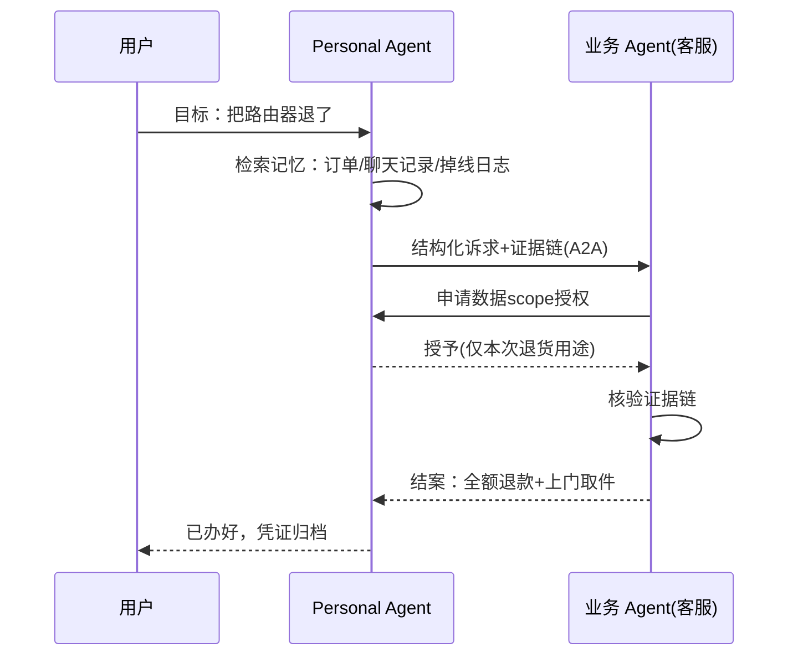

# 先有 Personal Agent，才有业务 Agent

## 引子：一个退货电话

上个月我朋友退一个出了质量问题的路由器，在电商客服那里排了四十分钟队，然后被问了五个问题：订单号是多少，什么时候买的，什么问题，有没有重启过，要不要先试恢复出厂设置。

这五个问题里，有四个的答案在电商自己的数据库里躺着——订单、购买时间、历史工单它都有。第五个问题的答案在我朋友脑子里，而他三天前刚跟家里的语音助手抱怨过这台路由器老是掉线。

电商不是不努力。它上了智能客服，接了大模型，知识库覆盖了 SKU 的每一个参数。但这次交互依然是灾难，因为它的客服 agent 不知道「对面这个人是谁、处在什么状态、已经付出过什么耐心」。

这不是那家电商的问题。今天几乎所有的客服 agent 和运营 agent，都卡在同一块天花板下面。而这篇想说的判断是：**这块天花板，业务侧自己搬不掉。它的名字叫 Personal Agent——业务 Agent 的地基在用户侧，不在企业侧。**

## 业务 Agent 的三块天花板

把市面上两类最热的业务 agent 拆开看——客服 agent 和运营 agent——它们的局限高度一致，可以归成三层。

**第一层，上下文贫困。** 企业侧关于一个用户的数据，本质是「交易切片」：订单、工单、浏览记录、会话记录。而一个真实的人是「生活切片」：他的预算约束、这个月的日程、家里有几口人、上周为什么烦、他对「等待」的容忍度。交易切片是生活切片在付款瞬间的投影，信息量差着几个数量级。所以业务 agent 的每一次对话都是从零开始的冷启动——它连「这个问题用户是不是第一次问」都要靠用户自己复述。

**第二层，信任赤字。** 企业 agent 的每一句话都被默认打折。用户心里有个背景音：「它是想卖我东西 / 想让我别退货 / 想让我给好评」。这个背景音不是用户多疑，是过去二十年营销电话、弹窗、套路短信训练出来的先验。客服话术再真诚，也消不掉这个先验，因为发话人的利益立场就写在那里。

**第三层，触达污染。** 运营 agent 干的事，说到底是「在用户没有明确同意的信道里，推送用户没有明确要求的内容」。短信、push、外呼，全是这个模式。效果逐年衰减，监管逐年收紧，用户耐受度逐年下降。运营 agent 做得越「智能」，推送越精准，用户被冒犯得越精准——因为精准的打扰比粗糙的打扰更让人脊背发凉。

这三层天花板有个共同点：**病根都不在企业侧**。上下文在用户的生活里，信任在用户的判断里，触达的合法性取决于用户的意愿。企业在自己侧无论怎么优化——更大的模型、更细的话术树、更强的标签体系——都是在天花板下面加盖楼层。

## Personal Agent 是什么

先把概念钉死。Personal Agent 是围绕「一个人」而不是「一个业务」构建的 agent：它长期持有这个人的上下文、记忆、偏好和授权，并且在利益上代表这个人行事。

最后半句是关键。它跟业务 agent 的根本区别不在技术栈——两者用的可能是同一个模型、同一套工具协议——而在**委托人不同**。业务 agent 的委托人是企业，KPI 是转化率和成本；Personal Agent 的委托人是你，KPI 是你的时间和满意度。委托人决定了立场，立场决定了它的一切行为逻辑。

Bill Gates 在 2023 年 11 月那篇《AI is about to completely change how you use computers》里就给过方向：以后你不会再为不同任务打开不同的应用，而是用日常语言告诉设备你要做什么，一个 agent 会替你跨应用把事办了。他当时管这个东西叫 personal agent，并且认为这是软件行业接下来最大的押注——谁能赢下它，谁就定义下一代软件的入口。两年过去，这个判断没有过时，反而越来越像路线图。

而扎克伯格 2025 年初在 Joe Rogan 的播客里说了硬币的另一面：每个企业都会有一个 AI agent，就像今天每家企业都有邮箱和网站。这句话经常被解读成「企业 agent 的春天」，但很少有人注意它的完整含义——**当每个企业和每个人都有 agent 的时候，真正稀缺的不是企业侧的 agent，而是能够代表人的那个 agent**。网站可以批量生产，代表你的那个东西只能有一个。

## 四个机制：地基为什么在用户侧

下面是这篇的骨架：为什么客服 agent、运营 agent 需要以 Personal Agent 为基础。我给四个机制，每个都可以独立验证。

### 机制一：上下文的成本梯度

关于一个人的知识，在哪里产生成本最低？

在个人侧。因为用户和自己的 agent 的交互是持续的、自然的、无摩擦的——他跟语音助手抱怨路由器掉线，跟手机助手确认明天的行程，这些「数据」不需要任何专门采集行为，它们是生活本身的副产品。而企业侧获取同样信息的成本结构完全不同：要么买流量做转化漏斗，要么设计表单让用户填，要么在客服对话里费劲地一个一个问。每一条上下文都要单独付费，而且买到的还是切片。

数据沿着成本梯度流动。上游在个人侧的业务（通讯录、输入法、相册）天生掌握完整画像，下游在业务侧的企业只能买到切片。**当 Personal Agent 成熟，企业 agent 面临的选择就不是「自建用户画像」还是「买画像」了，而是「从用户的 agent 那里按需获取经授权的上下文」**——这是唯一同时满足成本和完整性的选项。

### 机制二：授权与数据主权

合规的趋势线不用多解释：《个保法》、GDPR、Cookie 退场、应用商店的隐私标签、各国对跨境数据的管制。方向就一个——企业囤用户数据的成本单调递增。

在这个趋势下，「个人数据由个人持有、按目的最小化授权」不是理想主义，是唯一能规模化的数据流通方式。Personal Agent 天然就是这个模式的执行机构：它是用户数据的保管人，业务 agent 每次要用，向它申请 scope 化的、可撤销的、留痕的授权。想象一个 OAuth 的超集：不光授权「能不能访问」，还授权「为了什么目的、用几次、什么时候过期、能不能转卖」（Kantara 的 UMA 协议多年前就试过这个方向，只是当时缺一个真正需要它的用户端载体）。

对企业来说这听起来像让步，其实是解脱。今天企业合规成本高企的一大原因，就是它不得不持有大量「万一有用」的数据，然后为保管它们付出安全、法务和信任的代价。授权模式让企业按需取用而不持有，风险转移回数据的主人——这也正是数据本来该在的地方。

### 机制三：接口反转

互联网的历史，是一部「用户侧基础设施决定业务形态」的历史。

PC 普及，软件成为业务载体；浏览器普及，企业开始做网站；搜索引擎普及，企业开始做 SEO；智能手机普及，企业开始做 App。每一轮，都是用户手上先出现一个新东西，然后业务侧的整体形态围绕它重新组织。没有哪一轮是反过来的——从来没有过「业务侧先把新形态建好，然后等用户的基础设施出现」。

Personal Agent 就是下一轮用户侧的基础设施。而接口反转的含义是：**业务 agent 的设计起点，从「面向人的界面」变成「可被用户的 agent 调用的服务」**。你的客服不再是让人排队输入的对话框，而是一个能被对方 agent 调用、接收结构化诉求、返回结构化结果的 API 端点。你的营销不再是推送管道，而是一个接受「竞标」的服务商。

脚手架已经搭起来了。MCP 把业务能力暴露成标准化的工具——它自己打的比方是「AI 应用的 USB-C」；A2A 解决 agent 之间怎么对话、怎么委托任务——官网的说法很清楚：MCP 管工具接入，A2A 管 agent 协作，两者互补；更远的 ANP 们在尝试用 W3C DID 给每个 agent（包括个人的）一个跨平台身份，让认证像 email 一样便宜。这些协议里，「企业侧提供服务、个人侧持有身份和授权」的分工已经写在底层的假设里了。

### 机制四：谈判代表

把前三个机制叠起来，会得到一个质变：用户侧出现了「代表你利益的谈判者」。

今天用户面对企业，是赤手空拳的个体对建制化的组织。排队、话术、举证责任，全在个体这边。而当用户有一个 agent，博弈结构变了：企业 agent 的对面不再是「一个等着被安抚的人」，而是「一个带着完整上下文、立场坚定、不犯困不情绪化、随时可以调用规则文本的对等方」。

退货场景重演一遍：我的 agent 带着订单、聊天记录、掉线日志、三天前的抱怨语音，直接向电商的客服 agent 发起结构化诉求；对方核验证据链，一次往返完成赔付。全程不需要我出场。客服 agent 的效率指标从「排队时长」「响应速度」变成「无人工介入结案率」——因为 agent 不排队，也不需要被安抚。

把这个流程画成时序图，结构会很清楚——注意图的左端，人只出场一次：

营销场景更值得想象。运营 agent 想触达我，不再往我的短信信箱里塞垃圾，而是向我的 agent 发起一次「邀约」：内容、报价、目的、数据用途，全部结构化声明。我的 agent 按我的偏好决定：过滤掉、放着、还是替我还个价。触达从「打扰」变成「撮合」，从推送经济变成一种竞价市场。垃圾信息在协议层被消化，有效的信息因为带着真实报价和承诺反而获得准入。**信任问题没有在话术层被解决，而是在协议层被解决了。**

## 场景推演：客服和运营的形态变化

两个具体场景，把上面的机制落到地上。

**客服 agent：从接待员到结案引擎。** 我之前做过一轮客服和运营侧的调研（七个行业、头部商家），痛点清单其实惊人地稳定：重复询问、多系统数据分散、大促期间人力崩溃、售后纠纷举证难。回头看，这些痛点没有一个能靠企业侧自己解决——它们全是上下文贫困和个体-组织不对称的直接后果。Personal Agent 模式下，重复询问消失（历史在个人侧），举证不对称消失（证据由用户 agent 持有并呈递），大促人力压力下降（agent 对 agent 的工单不需要人肉排队）。客服 agent 从「降低人力成本的工具」变成「企业与用户 agent 之间的结算接口」。

**运营 agent：从推送轰炸到协商触达。** 调研里运营侧的痛点是同一批：流量贵、转化低、用户疲劳、数据孤岛。推送模式的数学是漏斗：触达一百万，转化一千。协商模式的数学是市场：向十万个 agent 发起邀约，成交一万——每次触达都是一次有报价的出价，而不是一次赌博式的骚扰。运营 agent 的 KPI 会被重写：不比发送量、打开率，比「邀约接受率」和「协商成交率」。这两个指标没法靠广撒水提升，只能靠真的懂用户——而懂用户的最短路径，是跟持有用户上下文的那个 agent 合作。

## 反方观点，和这个判断的边界

观点文写到这必须自己找茬，不然就是布道。

**第一，不是所有业务 agent 都依赖 Personal Agent。** 纯内部流程的 agent——RPA、内部报表、代码助手——服务对象是「组织内的岗位」而不是「具体的人」，它们跟 Personal Agent 没有依赖关系。判断标准很简单：这个 agent 的服务终点是不是一个具体的、外部的自然人。是，它就绕不开 Personal Agent；不是，它是另一条赛道。

**第二，鸡生蛋问题。** Personal Agent 不普及，业务 agent 适配它干嘛？这是真实的过渡期困境。我的回答是看历史同构题：2014 年「要不要做响应式网站」、2010 年「要不要做 App」、2003 年「要不要让 Google 爬」。每一轮的答案都是先给少数人做，等基础设施起量，先行者吃掉接口红利。而且过渡期的混合形态是明确的：业务 agent 同时保留 human-facing 界面和 agent-facing 接口，用流量比例决定资源倾斜。这不丢人，这是期权定价。

**第三，Personal Agent 自己的软肋。** 谁来做它——操作系统厂商、手机厂、还是开源方案？它会不会被平台绑架，变成新的守门人？用户的记忆和隐私放在哪，泄露了谁负责？用户会不会根本懒得配置这么个东西？这些全是真问题，我没有标准答案。但注意：这些是 **Personal Agent 阵营的内部问题**，是「地基由谁来打、归谁所有」的问题，而不是「要不要打地基」的问题。对业务 agent 的建设者来说，这个区分很重要——你可以赌地基的产权归属，但你很难赌「这个地基不需要存在」。

**第四，时间尺度。** 这不是一个明年就兑现的判断。个人 agent 的普及牵扯设备、协议、习惯、监管，是以五年十年计的事。但方向和时点是两回事：十年后生效的结构性趋势，恰恰是今天开始下注才有赔率的。等 A2A 通讯录长满了再去适配，跟 2015 年才开始做公众号是同一种迟到。

## 给从业者的四条建议

落到可执行的动作。

**一，给正在做客服 agent 的团队：把 agent-facing API 提上日程。** 别只优化对话框。问自己一个问题：我的客服系统能不能被另一个 agent 调用、并把整件事办完——提交结构化诉求、上传证据、查询处理状态、拿到结果？做到这一步，你的客服 agent 在协议时代就自动就位了，剩下的只是等对方的 agent 出现。

**二，给正在做运营 agent 的团队：把「邀约」做成一等公民。** 触达的元数据从「文案、人群包、发送时间」升级为「目的声明、报价、数据用途、接受/拒绝接口」。哪怕今天没有用户的 agent 来接，这些字段本身就会逼你把推送变成承诺——而带承诺的触达，打开率自己会说话。

**三，接口设计跟随开放标准。** 能力暴露走 MCP，agent 间协作评估 A2A，身份和授权关注 DID 方向。自研私有协议的窗口期在关闭，这轮的赢家标准正在形成，别在私有格式上重仓。

**四，关注 Personal Agent 侧的空白地带。** 记忆管理、授权管理、代理议价、agent 间的声誉体系——这些中间件今天基本是空的，而它们是地基里的钢筋。个人开发者和大厂在这片区域是同一起跑线。

## 结语：委托人在哪，地基在哪

回到最开始那个退货电话。它之所以是灾难，不是因为电商的模型不够大、话术不够好，而是因为整个交互结构里，用户是一个没有代表的个体，在跟一个有完整建制的组织博弈。

业务 agent 优化了那个组织的效率，但没有改变博弈结构。改变结构的，是用户侧出现一个代表。有了它，客服变成结算，营销变成撮合，数据流通变成授权经济——业务 agent 的所有天花板，都是在用户侧被掀掉的。

所以回到标题的判断：先有 Personal Agent，才有业务 Agent。这不是价值偏好，是基础设施的依赖顺序——就像先有路才有车队，先有浏览器，才有围绕它的网站生态。今天做客服 agent 和运营 agent 的团队，手里做的不是错事，但值得知道天花板在哪、地基归谁。

扎克伯格那句话的完整版，其实应该是：每个企业都会有一个 AI agent，每个企业也都将面对一个由 AI agent 代表的用户。前者是你要做的，后者是你要准备的。

## 参考资料

1. Bill Gates, [AI is about to completely change how you use computers](https://www.gatesnotes.com/AI-agents-will-change-how-you-use-computers), Gates Notes, 2023-11
2. [A2A Protocol 官方文档](https://a2a-protocol.org/latest/)：MCP 与 A2A 的互补定位（工具接入 vs agent 协作）
3. [Model Context Protocol 官网](https://modelcontextprotocol.io)
4. Mark Zuckerberg 关于「每个企业都将拥有 AI agent」的表述，见 2025 年 1 月 Joe Rogan Experience 播客及 Meta 2024 Q4 财报电话会议
5. 个人此前的一手调研：[不同行业淘宝店客服运营痛点深度调研报告](https://www.daoyuly.cn/2026/2026-04-16-taobao-customer-service-pain-points/)、[直播带货客户运营痛点深度调研报告](https://www.daoyuly.cn/2026/2026-04-16-livestream-customer-operations-pain-points/)
