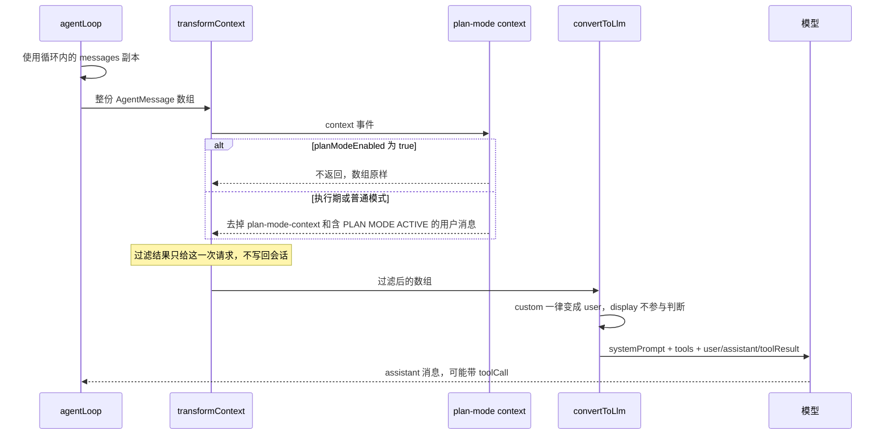
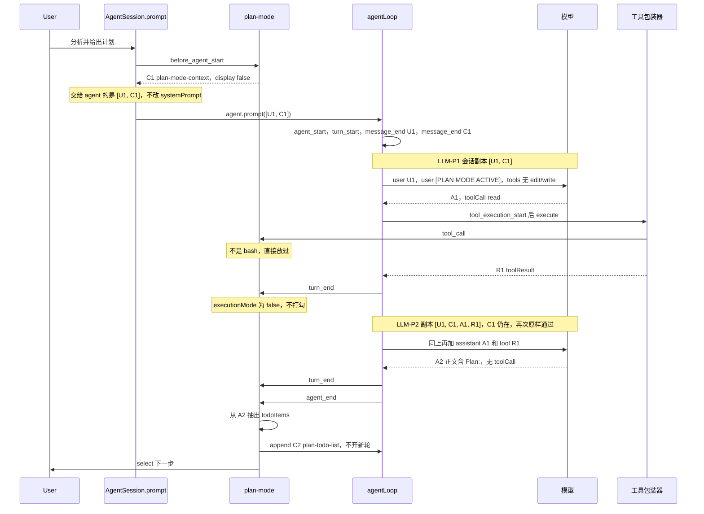
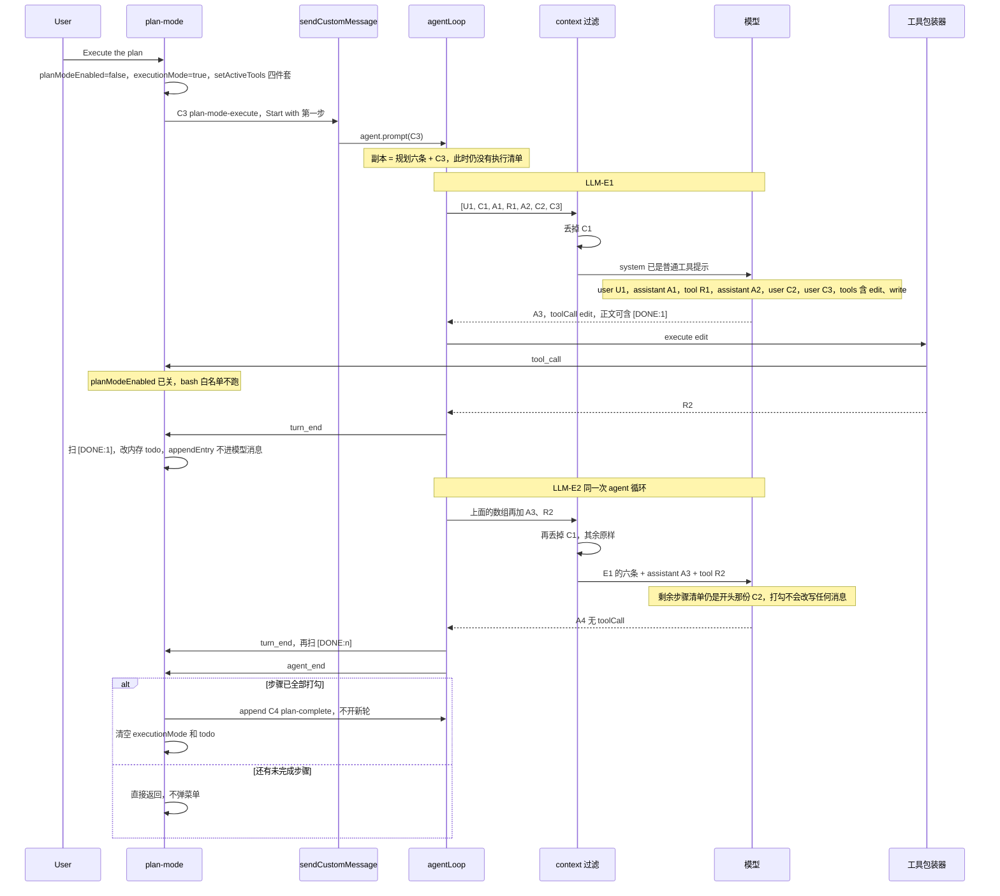
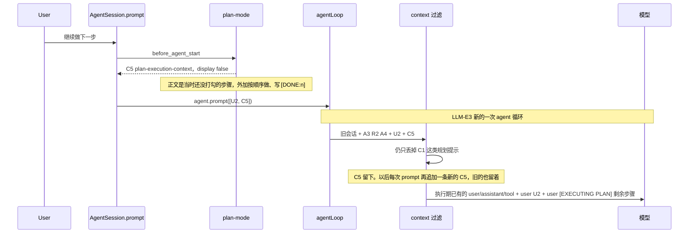
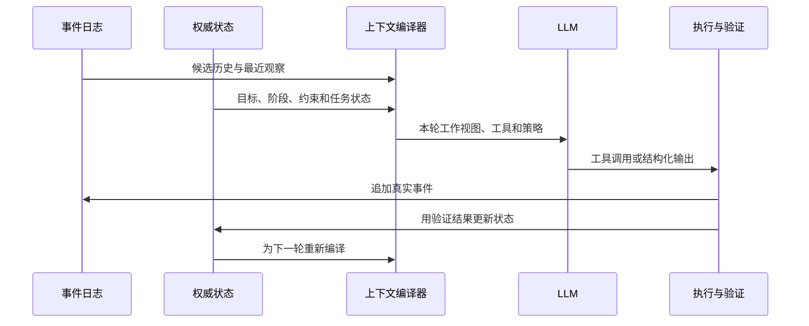

**引言**
本次深入的研究了pi中对 plan-mode 的实现和内在机理。我喜欢以示例深度下钻的方式来研究源码。
- Repo：pi-mono
- 源码位置：packages/coding-agent/examples/extensions/plan-mode/index.ts


# Plan Mode 的 LLM 调用时序

`examples/extensions/plan-mode` 不单独维护一份给模型的执行上下文。每次 LLM 请求都读同一份会话数组。请求前临时抄一份出来过滤、再转成模型消息，原数组不改。点「Execute the plan」后的第一轮不会注入 `[EXECUTING PLAN]`。

本文是[动态上下文设计指南](context-design.md)的案例分析，重点展示会话日志、扩展状态和模型实际输入之间的关系。

**Source files:**

- [`examples/extensions/plan-mode/index.ts`](../examples/extensions/plan-mode/index.ts) — 模式开关、消息注入、`context` 过滤
- [`examples/extensions/plan-mode/utils.ts`](../examples/extensions/plan-mode/utils.ts) — bash 白名单、`Plan:` 解析、`[DONE:n]`
- [`src/core/agent-session.ts`](../src/core/agent-session.ts) — `prompt`、`sendCustomMessage`、`before_agent_start`
- [`src/core/messages.ts`](../src/core/messages.ts) — `convertToLlm`
- [`src/core/sdk.ts`](../src/core/sdk.ts) — `transformContext` 接到扩展的 `context` 事件
- [`packages/agent/src/agent-loop.ts`](../../agent/src/agent-loop.ts) — 每次模型请求前的过滤与转换
- [`packages/agent/src/agent.ts`](../../agent/src/agent.ts) — `_runLoop` 在进入循环时拷贝 `systemPrompt` 和 `tools`

## 一次 LLM 请求的固定管线

规划轮和执行轮都走这里。`streamAssistantResponse` 在真正调用模型前做完过滤和转换。



`systemPrompt` 和 `tools` 在这次 `agent.prompt` 进入 `_runLoop` 时从 agent 状态拷走。执行前的 `setActiveTools` 赶得上这一轮。循环中途再改工具，这一轮的请求看不到。

`before_agent_start` 只挂在 `AgentSession.prompt` 上。`sendCustomMessage(..., { triggerTurn: true })` 直接调用 `agent.prompt`，不经过 `AgentSession.prompt`，因此不会触发 `before_agent_start`。

## 规划轮留下的会话

用户在规划模式里说「分析并给出计划」。这次走 `AgentSession.prompt`，会触发 `before_agent_start`。下面按模型先 `read`、再写出 `Plan:` 来画，所以有两次 LLM 请求。



`agent_end` 之后，会话里按顺序是：

| 标记 | 角色 | 内容 |
|---|---|---|
| U1 | user | 用户的分析请求 |
| C1 | custom `plan-mode-context` | `[PLAN MODE ACTIVE]` 和 `Plan:` 格式要求 |
| A1 | assistant | `read` 调用 |
| R1 | toolResult | 文件内容 |
| A2 | assistant | 带 `Plan:` 的编号计划 |
| C2 | custom `plan-todo-list` | `**Plan Steps:**` 列表 |

C1、C2 存在会话里。C1 只是每次请求前被滤掉，没有从会话删除。`display: false` 只影响界面，`convertToLlm` 仍会把这条 custom 消息转成 user 消息。

bash 白名单发生在工具包装器里：`tool_execution_start` 之后、真正执行之前发 `tool_call`。规划开启且工具名是 `bash` 时，`isSafeCommand` 不通过就 `block: true`，包装器用 reason 抛错，命令不会跑。`edit` / `write` 在规划期不在活动工具列表里，模型发不出对应调用。

## 点执行后的 LLM 请求

选 Execute 时扩展先关规划、打开 `executionMode`，把工具换成 `read`、`bash`、`edit`、`write` 并重建设系统提示，然后 `sendMessage(C3, { triggerTurn: true })`。这条路径是 `agent.prompt(C3)`，不经过 `AgentSession.prompt`，所以没有 `before_agent_start`，也不会出现 `[EXECUTING PLAN]`。



LLM-E1 实际送进模型的消息是：

1. `user`：U1，原始分析请求
2. `assistant`：A1，规划时的 `read`
3. `toolResult`：R1
4. `assistant`：A2，正文里的 `Plan:` 原文
5. `user`：C2，`**Plan Steps:**` 列表
6. `user`：C3，`Execute the plan. Start with: <第一步>`

计划以两种形态同时在上下文里：A2 是模型自己写过的计划，C2 是扩展抽出来再发回的列表。C3 只点名第一步。系统提示里没有执行约束，约束文本也不在这六条里。

同一次循环里的 LLM-E2 只是在这六条后面接上 A3 和 R2。`[DONE:1]` 如果写在 A3 的正文里，下一次请求能看见这句话，但步骤列表不会因此改成「剩余步骤」。`appendEntry("plan-mode")` 只给恢复会话用，`convertToLlm` 不会读它。

循环在没有 toolCall、也没有 follow-up 时结束。未完成的步骤就停在这里，直到下一条用户消息。

## 用户再发一条消息时

执行还没结束，用户又说话。这次走 `AgentSession.prompt`，`before_agent_start` 才注入剩余步骤。



C5 跟 C3 一样写入会话。再下一次用户消息会再追加一条新的 C5，内容是那一刻的剩余步骤。过滤只删规划提示（`customType === "plan-mode-context"`，以及正文含 `[PLAN MODE ACTIVE]` 的用户消息）。`plan-execution-context` 会叠在历史里。

全部步骤打勾后，`agent_end` 把 `executionMode` 清掉，再追加一条 `plan-complete`（`triggerTurn: false`）。之后的用户消息不再注入执行清单。

恢复会话时，步骤和执行开关从最后一条 `plan-mode` 自定义条目读回，`[DONE:n]` 从最后一条 `plan-mode-execute` 之后的助手文本重扫。真正把剩余步骤再送给模型，要等下一次 `AgentSession.prompt`。


# 动态上下文设计指南

LLM 应用经常从一条线性消息列表开始：

```text
user → assistant → user → assistant → ...
```

这种形式适合聊天，但不天然适合长时间运行、会调用工具、需要恢复和验证的 Agent。Agent 的下一次推理通常不应该直接读取未经处理的全部历史，而应该读取一份根据当前任务状态临时生成的工作视图。

本文把上下文设计理解为一个编排问题：

> 上下文不是聊天记录本身，而是系统在每次 LLM 调用前，根据目标、状态、证据和策略编译出的输入。

## 1. 先区分五类信息

成熟的 Agent 至少需要区分以下五层。

### 1.1 事件日志

事件日志记录实际发生过什么：

- 用户发了什么
- 模型回复了什么
- 调用了哪些工具
- 工具返回了什么
- 会话何时压缩、分支或恢复

日志适合审计、界面展示和故障复盘。它可以持续追加，但不应自动等同于下一次 LLM 的输入。

### 1.2 权威状态

权威状态描述系统现在认为什么是真的，例如：

- 当前目标
- 当前阶段
- 计划步骤
- 步骤完成情况
- 已确认的约束
- 已修改文件
- 验证结果
- 阻塞原因

这类状态应使用结构化数据保存，并由程序更新。模型写出“步骤已经完成”只是一个声明；工具成功、文件变化或测试结果才可能成为完成证据。

### 1.3 模型工作视图

工作视图是某一次 LLM 调用实际看到的内容。它可以包含：

- 当前目标
- 当前阶段的规则
- 当前步骤
- 与当前步骤有关的代码或资料
- 最近的工具结果
- 必须保留的用户约束
- 允许调用的工具

工作视图是临时产物。不同阶段、不同角色和不同调用可以从同一份状态生成不同视图。

### 1.4 执行策略

执行策略决定模型能做什么以及系统如何推进：

- 哪些工具可用
- 哪些路径可修改
- 是否允许并行
- 一轮只能完成一个步骤还是多个步骤
- 失败后重试、暂停还是回滚
- 哪个事件可以改变任务状态

策略不应只依赖提示词。能够通过工具列表、参数验证、权限检查和状态机强制执行的规则，应由程序执行。

### 1.5 评估与证据

评估层回答“结果是否真的满足目标”：

- 工具是否成功
- 文件是否产生预期变化
- 测试是否通过
- 输出是否符合 schema
- 审查器是否发现缺陷
- 用户是否确认了需要人工判断的结果

没有这一层，Agent 只能根据自己的自然语言声明更新状态，容易产生虚假的完成感。

## 2. 把上下文看成编译结果

一次 LLM 调用可以抽象为：

```text
Context = compile(
  goal,
  phase,
  authoritativeState,
  relevantEvidence,
  recentObservations,
  availableActions,
  safetyPolicy
)
```

编译过程一般包括：

1. 收集候选信息
2. 判断来源和权威级别
3. 删除过期内容
4. 选择与本轮决策有关的内容
5. 处理冲突和覆盖关系
6. 决定哪些内容保留原文、摘要或引用
7. 按模型易于理解的顺序序列化
8. 检查 token 预算和必要字段
9. 调用 LLM
10. 根据工具结果更新结构化状态



这个模型带来一个重要变化：历史记录是输入来源之一，而不是唯一来源；上下文是一个可测试的函数，而不是自然增长的副产品。

## 3. 信息的来源、权威性和生命周期

每一类上下文都应该明确三个属性。

### 3.1 来源

常见来源包括：

- 系统和开发者规则
- 用户明确要求
- 工具的客观结果
- 项目文件
- 结构化任务状态
- 模型的推断或建议
- 外部检索结果

来源必须可追踪。模型生成的总结不能悄悄变成与工具结果同等级的事实。

### 3.2 权威性

发生冲突时需要确定优先级。例如：

1. 不可绕过的安全策略
2. 用户最新且明确的要求
3. 工具和文件系统观察到的事实
4. 结构化状态
5. 已验证的摘要
6. 模型此前的推断

具体顺序取决于系统，但必须显式定义。否则模型只能根据文本位置、语气和注意力自行猜测。

### 3.3 生命周期

上下文不只需要进入机制，也需要退出机制：

- 会话级：长期目标、稳定偏好
- 阶段级：规划期只读、执行期可写
- 步骤级：当前任务、允许修改的路径
- 调用级：本轮工具结果、重试提示
- 一次性：确认请求、临时诊断信息

常见腐化来自“只会追加，不会撤销”。规划结束后，规划期的“禁止修改”应该退出；步骤完成后，旧的未完成列表也应该退出。

## 4. 意图表意：自然语言与结构化协议

自然语言适合描述目标、解释理由和处理开放问题，但不适合作为唯一控制协议。

### 4.1 容易出问题的做法

```text
完成步骤后，请在回复中写 [DONE:n]。
```

这里的完成信号来自模型自述。它不能证明：

- 工具调用成功
- 文件内容正确
- 验证已经运行
- 第 n 步确实完成

### 4.2 更可靠的做法

为控制行为提供结构化工具：

```text
complete_step({
  stepId,
  evidence,
  changedFiles,
  verification
})
```

工具负责校验：

- `stepId` 是否是当前步骤
- 路径是否在允许范围内
- 要求的验证是否已经通过
- 证据是否来自本轮真实工具结果

只有工具成功后，状态机才推进。模型的文字说明仍然可以保留，但它不再是权威状态的来源。

### 4.3 提示词与强制策略的边界

适合放在提示词中的内容：

- 当前目标
- 当前步骤
- 决策原则
- 输出格式
- 解释风格

应该由程序强制的内容：

- 工具是否可用
- 文件访问范围
- 参数是否合法
- 状态能否转换
- 操作是否需要确认
- 完成条件是否满足

提示词用于引导；工具和状态机用于保证。

## 5. 动态上下文的常用编排模式

### 5.1 过滤

保存完整会话，但在每次调用前删除：

- 已经过期的阶段指令
- 与当前任务无关的旧工具输出
- 重复的计划列表
- 已被新事实覆盖的旧结论

过滤适合从线性聊天逐步演进，因为它不要求改变持久化格式。

### 5.2 投影

不直接发送历史，而是从状态中生成一份短视图：

```text
目标
当前步骤
已确认约束
相关证据
允许动作
成功条件
```

投影更容易控制一致性和 token，但要保留足够的来源引用，避免把错误摘要变成事实。

### 5.3 阶段隔离

规划、执行和审查使用不同视图：

- 规划器：目标、代码结构、只读工具
- 执行器：当前步骤、相关代码、写入工具
- 审查器：目标、计划、diff、测试结果

阶段隔离能减少旧指令继续生效，也能让每个阶段使用更合适的模型和工具。

### 5.4 子代理隔离

为探索或规划创建独立上下文窗口，只把结构化结果返回父代理。

适合：

- 探索过程很长
- 中间资料不应污染执行上下文
- 需要并行研究
- 不同角色需要不同系统提示

代价是需要定义清晰的输入输出协议，并处理子代理结果不完整或失败的情况。

### 5.5 一步一循环

每次 Agent 循环只执行一个步骤：

1. 编译当前步骤上下文
2. 模型调用工具
3. 验证结果
4. 更新状态
5. 为下一步骤启动新循环

它牺牲一部分吞吐量，换取更强的可观察性、暂停能力和恢复能力。

### 5.6 检索式上下文

把大量文档、代码和历史放在外部存储中，只检索当前问题需要的片段。检索结果仍需处理：

- 来源可信度
- 时间有效性
- 片段是否缺少周边语义
- 多个结果是否冲突
- 是否应该保留原文引用

检索解决“找什么”，不能自动解决“什么是真的”和“何时应该失效”。

## 6. 上下文腐化

上下文腐化不等于上下文过长。短上下文也可能已经腐化。

### 6.1 常见症状

- 同一计划存在多个版本
- 已完成步骤仍显示为未完成
- 规划期规则残留到执行期
- 新旧用户要求同时出现，没有覆盖关系
- 工具已经证明某个假设错误，但旧推断仍被保留
- 摘要把不确定推断写成确定事实
- 模型开始响应旧任务而不是当前任务
- 恢复会话后任务状态与界面历史不一致

### 6.2 常见原因

- 只追加，不删除或覆盖
- 把模型散文当作数据库
- 没有权威来源和冲突策略
- 控制消息与普通对话共用同一信道
- 完成状态由模型自述更新
- 压缩器不了解任务状态
- 工具输出过多，重要信息被淹没

### 6.3 防护方式

- 为控制消息增加类型和生命周期
- 每轮只生成一份当前状态视图
- 将过期消息从 LLM 输入中过滤，但保留在审计日志
- 使用结构化工具更新状态
- 在上下文中标明来源、时间和置信度
- 对摘要进行 schema 校验
- 为恢复流程增加一致性检查

## 7. 压缩不是普通摘要

压缩的目标不是复述聊天，而是让任务能够继续。

压缩时应分类处理：

### 必须原样保留

- 用户硬约束
- 文件路径和符号名
- 精确错误文本
- 安全边界
- 未解决的阻塞

### 可以结构化保存

- 当前目标
- 计划步骤与状态
- 已修改文件
- 验证结果
- 关键决策与理由

### 可以摘要

- 调查过程
- 已排除的方案
- 重复解释
- 大段工具输出

### 可以丢弃

- 寒暄
- 已被覆盖的旧指令
- 与当前目标无关的细节
- 可从权威来源重新取得的信息

任务状态最好独立于自然语言摘要保存。恢复时先读取结构化状态，再按当前阶段重新编译模型工作视图，而不是依靠模型从摘要中猜回状态。

## 8. 一个稳健的 Agent 控制循环

推荐的基本循环如下：

1. 接收用户目标，建立任务 ID
2. 将目标和硬约束写入结构化状态
3. 规划器在隔离视图中生成结构化计划
4. 用户或策略确认计划
5. 选择当前未完成步骤
6. 编译该步骤的最小工作视图
7. 限制本轮可用工具和作用范围
8. 执行工具并记录客观结果
9. 运行步骤验证
10. 通过结构化完成工具更新状态
11. 失败时记录原因，不伪造完成
12. 压缩可压缩的日志，不压缩掉权威状态
13. 进入下一步骤或生成最终验证视图

这个循环把 LLM 放在决策位置，而不是状态数据库或安全边界的位置。

## 9. 设计方法

设计一个动态上下文系统时，可以依次回答以下问题。

### 9.1 定义状态

- 哪些事实必须跨轮次存在？
- 哪些状态需要跨进程恢复？
- 谁可以修改这些状态？
- 状态转换是否合法？

### 9.2 定义阶段

- 任务有哪些阶段？
- 每个阶段需要哪些信息？
- 每个阶段允许哪些工具？
- 阶段结束后哪些信息必须退出？

### 9.3 定义本轮视图

- 模型本轮要做什么决策？
- 为这个决策最少需要哪些事实？
- 哪些内容只是审计信息？
- 哪些内容可能造成干扰？

### 9.4 定义证据

- 什么结果才算成功？
- 证据来自模型、工具还是用户？
- 能否自动验证？
- 失败时状态如何保持一致？

### 9.5 定义压缩与恢复

- 哪些信息可以重新获取？
- 哪些必须原样保存？
- 压缩后能否确定性恢复当前阶段？
- 同一状态能否重新编译出等价上下文？

## 10. 可观察性与调试

上下文编排必须可观察。至少记录：

- 本轮调用的任务 ID、阶段和步骤 ID
- 编译前的候选信息
- 被保留、摘要和删除的内容及原因
- 最终 system prompt、消息角色和 token 分布
- 当前可用工具
- 模型产生的工具调用
- 工具结果和验证结果
- 状态转换前后的差异

调试时应同时查看三份数据：

1. 会话日志中保存了什么
2. 结构化状态中认为什么是真的
3. 某次 LLM 请求实际发送了什么

只看聊天界面通常无法解释上下文问题。

## 11. 评估指标

动态上下文不能只用“回答看起来不错”评估。可以测量：

- 任务完成率
- 步骤跳过率
- 无证据完成率
- 越权工具调用率
- 压缩前后状态一致率
- 会话恢复成功率
- 无关上下文占比
- 重复信息占比
- 每步骤 token 成本
- 旧指令误触发率
- 相同状态下输出视图的确定性

测试集应包含：

- 长工具输出
- 用户中途改变目标
- 模型漏掉完成信号
- 工具失败
- 压缩后继续执行
- 进程退出后恢复
- 多份互相冲突的旧计划
- 并行子任务返回顺序不同

## 12. 在 pi 中对应的机制

pi 的扩展接口可以直接映射这些概念：

- `context`：在每次 LLM 调用前过滤或重写消息视图
- `before_agent_start`：为新一轮注入阶段信息或替换 system prompt
- `setActiveTools`：按阶段改变工具集合
- `tool_call`：执行前做参数、路径和权限门禁
- `tool_result`：标准化或提取工具证据
- `turn_end` / `agent_end`：观察轮次结束并推进状态机
- `appendEntry`：保存不进入 LLM 上下文的结构化状态
- `session_start`：恢复状态
- `session_before_compact`：让压缩保留任务状态
- `sendMessage` / `sendUserMessage`：启动下一阶段或下一步骤
- 子代理示例：创建隔离上下文窗口并返回结构化结果

[`plan-mode.md`](plan-mode.md) 展示了现有 plan-mode 扩展在 LLM 调用层面的消息时序。它适合用来观察线性追加、动态过滤、工具切换和状态持久化如何交互，也能看到自然语言完成标记和过期控制消息可能产生的问题。

## 13. 建议的学习实验

### 实验一：记录实际输入

在每次 LLM 调用前记录最终消息的：

- 角色
- 类型
- 长度
- 来源
- 生命周期

比较聊天界面与真实模型输入的差异。

### 实验二：增加退出机制

为规划期、执行期和步骤级消息增加明确类型。在阶段切换后，从 LLM 视图中过滤旧控制消息，但保留会话日志。

### 实验三：结构化完成

用 `complete_step` 工具替代正文中的 `[DONE:n]`。只有验证通过的工具调用才能推进状态。

### 实验四：一步一循环

让每个 Agent 循环只能执行一个步骤。记录 token、成功率、偏航率以及中断恢复能力。

### 实验五：隔离规划

使用子代理在空白上下文中规划，只将结构化计划返回父会话。比较隔离前后的执行上下文大小和稳定性。

### 实验六：压缩恢复

在任务中途强制压缩并重启进程，验证：

- 当前步骤是否正确
- 已完成步骤是否不会重复执行
- 硬约束是否仍然存在
- 旧阶段指令是否没有重新生效

## 14. 设计检查清单

在实现完成前检查：

- 会话日志和模型工作视图是否分离
- 是否存在独立的权威状态
- 每类上下文是否有来源、权威级别和生命周期
- 阶段结束时旧指令是否退出
- 完成状态是否由客观证据更新
- 工具权限是否由程序而非提示词强制
- 压缩是否从结构化状态生成关键部分
- 恢复后是否能重新编译出正确视图
- 是否能解释每条上下文为什么出现在本轮调用中
- 是否有针对冲突、失败、压缩和恢复的测试

## 结论

上下文工程不是把更多文字塞进 prompt，而是在每次决策前构造正确的信息边界。

可以用三个成熟的软件概念理解它：

- **事件溯源**保存发生过什么
- **状态机**决定任务现在在哪里、可以去哪里
- **编译器**把状态和证据转换成当前模型需要的工作视图

当这三部分分离以后，LLM 不再承担记忆数据库、权限系统和任务状态机的职责，而能专注于它擅长的理解、推理和生成。
